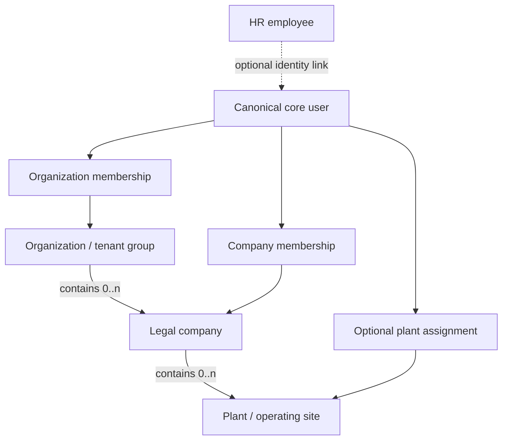

# Organizational Model

**Decision: `PROPOSED`** — product and legal-entity semantics, membership inheritance and scope constraints need owner approval. See [P03](01-decision-register.md#register).

## Proposed conceptual hierarchy

This hierarchy is a design recommendation, not a universal legal definition. `organization` is proposed as a tenant/group security boundary, `company` as a legal/financial entity, and `plant` as an operational physical site. Owners must confirm whether actual customers need these meanings, whether organization may exist without a company, whether a company can move between organizations, and how mergers, branches and shared services are represented.

## Proposed membership distinctions

| Relationship | Purpose | Proposed invariant (requires approval) |
|---|---|---|
| Organization membership | Establishes access to the tenant/group context and platform administration surface. | A user may have memberships in multiple organizations. Membership does not automatically grant access to every company. |
| Company membership | Grants explicitly assigned access at one company boundary. | Membership references a company and its owning organization consistently. Scope and role are effective only while active. |
| Plant assignment | Narrows selected company access to one or more operating sites for plant-scoped actions. | A plant belongs to the referenced company; plant assignment does not silently grant another company. |

Recommendation: deny by default and require explicit company/plant entitlements unless an owner-defined delegation rule says otherwise. Do not infer permission inheritance (organization → all companies → all plants) from hierarchy alone. Role scope, delegation, date-effective membership, status vocabulary, admin/break-glass access and self-service invitations remain undecided.

## Context selection is not authorization

A requested active organization, company or plant may come from a route, UI selection or Better Auth session hint. Treat it only as a selector. On every server action, route handler, data-access operation and background operation:

1. Resolve the authenticated principal from the server-verified session.
2. Load current, active memberships and applicable role/permission policy.
3. Confirm the selected company belongs to the selected organization and the selected plant belongs to that company.
4. Confirm the target record belongs to the authorized scope and that the requested action is permitted.
5. Apply the same scope in database filters and writes; never fetch broad data and filter after serialization.

A valid user session does not mean an active ERP membership. A foreign key does not enforce access control. Cache keys and client state must include authorized scope and be invalidated when the user, membership, role or scope changes.

## Consistency model

Propose composite keys/unique constraints on `(organization_id, company_id)` and `(company_id, plant_id)` when needed, with composite references for relationships that must prove same-parent membership. These constraints must be tested with the pinned Prisma/PostgreSQL versions. If a specific constraint cannot be expressed or safely migrated, use an owning-core transaction contract and a dedicated consistency test; document that fallback per edge in [05](05-cross-schema-relationship-policy.md).

## Unresolved semantics

No country/legal form, tax registration, statutory branch definition, fiscal-year boundary, consolidation rule, company-to-chart mapping, plant reporting rule or legal treatment is inferred. Fiscal calendar design is separate and remains deferred until the applicable business/jurisdiction is selected. See [policy classification](12-erp-policy-classification.md).
