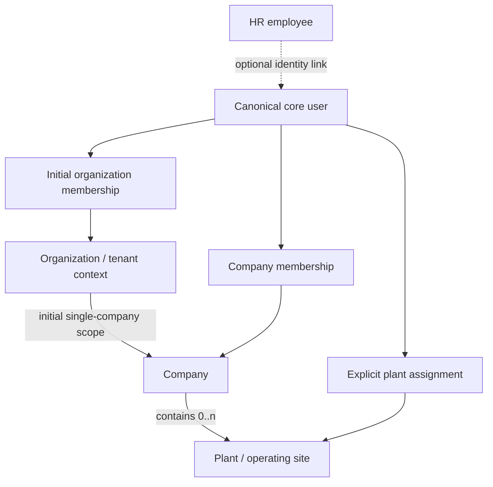

# Organizational Model

**Decision: `OWNER_APPROVED`** — the initial operating policy and membership/assignment model are selected. Technical enforcement and broader legal/jurisdiction semantics remain separate. See [P03](01-decision-register.md#register).

## Approved initial operating model

The initial product scope is single-company first. An ERP user belongs to one organization under the initial operating policy. That is not a permanent global identity constraint: keep the canonical `core.users` identity independent from organization membership and represent the association through membership records, so a later explicit product decision can evolve the organization policy without changing every user identity. `organization` is the initial tenant context, `company` is the initial operating/accounting boundary, and `plant` is an operational site; no jurisdiction-specific legal form is inferred.

## Selected membership and assignment model

| Relationship | Purpose | Selected initial invariant |
|---|---|---|
| Organization membership | Establishes the user's initial tenant context. | An ERP user is assigned to one organization under the initial policy. Do not encode a lifetime or global uniqueness constraint on `core.users`; membership history/reassignment and future policy evolution remain relationship concerns. |
| Company membership | Grants access at the company boundary within the user's organization. | The initial product starts with one company. Membership is explicit and consistent with its organization. Roles may differ by company; organization membership alone does not authorize all company resources. |
| Plant assignment | Grants access to a plant-scoped operation/resource. | Plant access requires explicit assignment; do not infer it from company membership. Roles may differ by plant. |

Resolve the active organization/company/plant from trusted server-side membership and assignment records on every protected operation. Context supplied by a route, UI or session hint is a selector only. P04 defines explicit permission inheritance and deny precedence; hierarchy alone does not grant inherited access. The current authorization posture remains deny-by-default and scoped, with delegation only through an explicit policy.

## Context selection is not authorization

A requested active organization, company or plant may come from a route, UI selection or Better Auth session hint. Treat it only as a selector. On every server action, route handler, data-access operation and background operation:

1. Resolve the authenticated principal from the server-verified session.
2. Load current, active memberships and applicable role/permission policy.
3. Confirm the selected company belongs to the selected organization and the selected plant belongs to that company.
4. Confirm the target record belongs to the authorized scope and that the requested action is permitted.
5. Apply the same scope in database filters and writes; never fetch broad data and filter after serialization.

A valid user session does not mean an active ERP membership. A foreign key does not enforce access control. Cache keys and client state must include authorized scope and be invalidated when the user, membership, role or scope changes.

## Consistency model

The selected hierarchy/membership policy does not select a physical key or enforcement mechanism. Evaluate composite keys/unique constraints on `(organization_id, company_id)` and `(company_id, plant_id)` where they prove same-parent membership. P05 owner-approves a hybrid per-relationship policy, including selective composite FKs; each in-scope edge still needs an explicit choice and pinned Prisma/PostgreSQL validation. If a constraint cannot be expressed or safely migrated, use an owning-core transaction contract and a dedicated consistency test; record the approved fallback per edge in [05](05-cross-schema-relationship-policy.md).

## Unresolved semantics

P03 owner-approves the initial one-organization-per-user, single-company-first operating policy, explicit plant assignment and scoped roles. It does not define country/legal form, tax registration, statutory branch treatment, fiscal-year boundary, consolidation rule, all future multi-company behavior or plant reporting policy. Company-to-chart ownership is separately decided by P06: each company owns its CoA, with one active primary chart for posting in the relevant period, and its plants use that chart. Fiscal calendar design remains deferred until the applicable business/jurisdiction is selected. See the [P06 closure](../phase-0.2/p06-chart-of-accounts-decision-closure.md) and [policy classification](12-erp-policy-classification.md).
