# Global Logical ERD

**Status: mixed.** P02–P06 architecture decisions are owner-approved; P06 is `DECISION_COMPLETE`. Identity mapping details, physical keys/constraints, individual P05 relationship choices, implementation grants and non-P06 entity ownership remain subject to technical validation or their own proposals. This is a logical inventory, not an implementation schema. See [decision register](01-decision-register.md), [entity ownership](07-entity-ownership-finalization.md), [relationship policy](05-cross-schema-relationship-policy.md) and [P06 closure](../phase-0.2/p06-chart-of-accounts-decision-closure.md).

```mermaid
erDiagram
  ORGANIZATION ||--o{ COMPANY : initial_single_company_first
  COMPANY ||--o{ PLANT : contains
  USER ||--o| ORGANIZATION_MEMBERSHIP : initial_one_org_assignment
  ORGANIZATION ||--o{ ORGANIZATION_MEMBERSHIP : grants_context
  USER ||--o{ COMPANY_MEMBERSHIP : has
  COMPANY ||--o{ COMPANY_MEMBERSHIP : scopes
  USER ||--o{ PLANT_ASSIGNMENT : optionally_assigned
  PLANT ||--o{ PLANT_ASSIGNMENT : scopes
  USER ||--o{ AUTH_ACCOUNT : authenticates_through
  USER ||--o{ AUTH_SESSION : opens
  USER o|--o{ EMPLOYEE : optional_login_link
  ORGANIZATION_MEMBERSHIP ||--o{ COMPANY_MEMBERSHIP : parent_scope
  COMPANY_MEMBERSHIP ||--o{ PLANT_ASSIGNMENT : parent_scope

  BUSINESS_PARTNER ||--o{ CUSTOMER_ROLE : may_have
  BUSINESS_PARTNER ||--o{ VENDOR_ROLE : may_have

  COMPANY ||--o{ CHART_OF_ACCOUNTS : owns_company_scope
  CHART_OF_ACCOUNTS ||--o{ COA_VERSION : versions
  COA_VERSION ||--o{ ACCOUNT_VERSION_ENTRY : captures
  ACCOUNT ||--o{ ACCOUNT_VERSION_ENTRY : stable_identity_revisions
  ACCOUNT ||--o{ JOURNAL_LINE : selected_by
  PLATFORM_TEMPLATE ||--o{ TEMPLATE_RELEASE : publishes
  ORGANIZATION ||--o{ ORGANIZATION_TEMPLATE : owns_scoped_template
  ORGANIZATION_TEMPLATE ||--o{ TEMPLATE_RELEASE : publishes
  TEMPLATE_RELEASE ||--o{ COA_INITIALIZATION : source_provenance
  CHART_OF_ACCOUNTS ||--o{ COA_INITIALIZATION : initialized_company_chart
  REPORTING_MAPPING_VERSION ||--o{ ACCOUNT_REPORTING_MAPPING : versions
  ACCOUNT ||--o{ ACCOUNT_REPORTING_MAPPING : presentation_mapping
  CONSOLIDATION_CHART ||--o{ CONSOLIDATION_ACCOUNT : contains
  CONSOLIDATION_MAPPING_VERSION ||--o{ CONSOLIDATION_MAPPING : versions
  ACCOUNT ||--o{ CONSOLIDATION_MAPPING : source_company_account
  CONSOLIDATION_ACCOUNT ||--o{ CONSOLIDATION_MAPPING : target_group_account
  COMPANY ||--o{ FINANCIAL_REPORT_SNAPSHOT : owns_report_scope
  COA_VERSION ||--o{ FINANCIAL_REPORT_SNAPSHOT : captures_chart_version
  REPORTING_MAPPING_VERSION ||--o{ FINANCIAL_REPORT_SNAPSHOT : captures_reporting_mapping
  CONSOLIDATION_MAPPING_VERSION ||--o{ FINANCIAL_REPORT_SNAPSHOT : captures_if_applicable
  JOURNAL_ENTRY ||--|{ JOURNAL_LINE : contains
  PURCHASE_ORDER ||--|{ PURCHASE_ORDER_LINE : contains
  GOODS_RECEIPT ||--|{ GOODS_RECEIPT_LINE : contains
  SALES_ORDER ||--|{ SALES_ORDER_LINE : contains
  PRODUCTION_ORDER ||--o{ PRODUCTION_CONFIRMATION : records
  STORAGE_LOCATION ||--o{ STOCK_MOVEMENT : location_for
  SOURCE_DOCUMENT }o..o{ AUDIT_EVENT : polymorphic_application_reference
```

## Interpretation and scope boundaries

- `USER` represents the owner-approved canonical ERP identity in `core`; Better Auth handles authentication/accounts/sessions and exact adapter mapping remains pending. `EMPLOYEE` is an HR record and its optional identity association is not the same as employment/organization membership.
- P03 owner-approves single-company-first and one organization per ERP user under the initial policy, explicit plant assignment, and distinct organization/company memberships. The one-organization rule is not a permanent global identity constraint; membership rows, history and future policy remain separate from `core.users`. P04 owner-approves explicit permission inheritance; the physical ERD does not imply inheritance from hierarchy alone.
- P06 owner-approves Finance as sole owner of `CHART_OF_ACCOUNTS`, account identity/revisions and finance mappings. Company CoAs are independent; each company has one active primary chart for posting in the relevant period, and plants use their company's chart. Template release/provenance is initialization-only; consolidation is separate from the company CoA. Period semantics and enforcement remain subject to Phase 0.3 validation; these conceptual edges do not assert physical columns or FKs.
- Procurement/sales/production/inventory/finance aggregate edges internal to a module represent logical ownership boundaries. Cross-module effects are contracts, not direct cross-module writes.
- Company/plant scope on transactional entities is expected to be decided per module. This diagram does not assert every entity is company-scoped or that every relation is an FK. Some master-data and operational concepts are listed by schema but are not linked here because their cardinality and keys remain unresolved.
- `SOURCE_DOCUMENT` to `AUDIT_EVENT` is deliberately polymorphic and application-level. Do not implement as a fictional FK.
- `integration` is intentionally absent from the relationships because Phase 0 leaves it reserved and entity-free.

## Entities by schema

| Schema | Logical entities represented or reserved |
|---|---|
| `core` | Organization, company, plant, canonical user, auth account/session/verification, memberships, optional assignments, authorization concepts. |
| `master_data` | Business partner and customer/vendor roles, material/product, units and conversion references; no CoA/account definitions. |
| `procurement` | Requisition, purchase order, goods receipt, vendor invoice and their lines. |
| `inventory` | Storage location, movement, transfer and balance projection. |
| `sales` | Quotation, sales order, delivery, billing document and lines. |
| `finance` | Owner-approved company CoAs/account identities and revisions; platform/organization template governance; reporting/consolidation mappings; journal entry/lines, AP/AR and other finance references. |
| `production` | BOM/revision/components, work center, production order and confirmations. |
| `human_resources` | Employee, department and position; future HR records deferred. |
| `integration` | None; reserved. |
| `system` | Audit event, settings, number range, document type and workflow candidates. |

Logical edges are translated to candidate physical constraints only in [05](05-cross-schema-relationship-policy.md) and [09](09-global-physical-erd.md). Where fields or policy are unknown, the physical view intentionally omits them.
