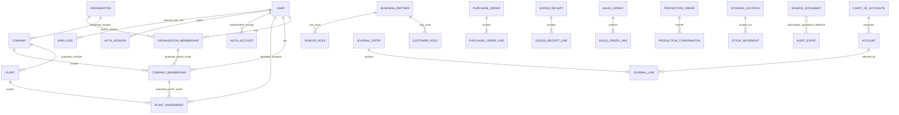

# Global Logical ERD

**Status: `PROPOSED` conceptual view.** Relationships and scope inheritance are not owner-approved. This is a complete cross-domain inventory at the current foundation level, not an implementation schema. See [entity ownership](07-entity-ownership-finalization.md), [relationship policy](05-cross-schema-relationship-policy.md) and [per-schema ERDs](10-per-schema-erd.md).

## Interpretation and scope boundaries

- `USER` represents the proposed canonical auth principal in `core`; account and session records are distinct security persistence. `EMPLOYEE` is an HR record and its optional identity association is not the same as employment/organization membership.
- `ORGANIZATION`, `COMPANY` and `PLANT` meanings/cardinalities are proposals. Membership rows are separate for each scope; no hierarchy-based permission inheritance is implied.
- `CHART_OF_ACCOUNTS` / `ACCOUNT` are shown under proposed `finance` ownership. Phase 0's `master_data` placement is preserved until an explicit owner decision supersedes it.
- Procurement/sales/production/inventory/finance aggregate edges internal to a module represent logical ownership boundaries. Cross-module effects are contracts, not direct cross-module writes.
- Company/plant scope on transactional entities is expected to be decided per module. This diagram does not assert every entity is company-scoped or that every relation is an FK. Some master-data and operational concepts are listed by schema but are not linked here because their cardinality and keys remain unresolved.
- `SOURCE_DOCUMENT` to `AUDIT_EVENT` is deliberately polymorphic and application-level. Do not implement as a fictional FK.
- `integration` is intentionally absent from the relationships because Phase 0 leaves it reserved and entity-free.

## Entities by schema

| Schema | Logical entities represented or reserved |
|---|---|
| `core` | Organization, company, plant, canonical user, auth account/session/verification, memberships, optional assignments, authorization concepts. |
| `master_data` | Business partner and customer/vendor roles, material/product, units and conversion references. |
| `procurement` | Requisition, purchase order, goods receipt, vendor invoice and their lines. |
| `inventory` | Storage location, movement, transfer and balance projection. |
| `sales` | Quotation, sales order, delivery, billing document and lines. |
| `finance` | Proposed chart/account; journal entry/lines, AP/AR and other finance references. |
| `production` | BOM/revision/components, work center, production order and confirmations. |
| `human_resources` | Employee, department and position; future HR records deferred. |
| `integration` | None; reserved. |
| `system` | Audit event, settings, number range, document type and workflow candidates. |

Logical edges are translated to candidate physical constraints only in [05](05-cross-schema-relationship-policy.md) and [09](09-global-physical-erd.md). Where fields or policy are unknown, the physical view intentionally omits them.
