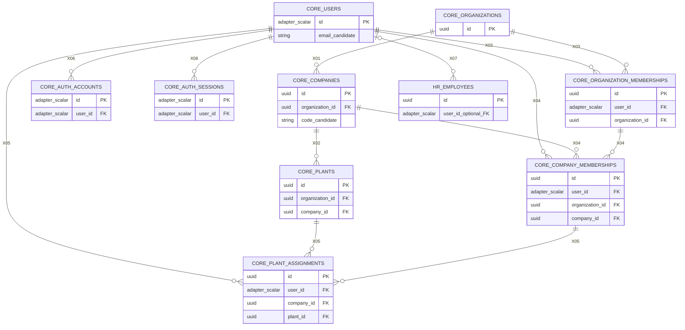

# Global Physical ERD — Draft

**Status: `PROPOSED`; not implementation-ready.** The diagram illustrates only a minimum identity/organization persistence skeleton and its candidate keys. It does not settle field names, Better Auth ID type, company scope for module records, statuses, retention, indexes, delete actions or all ten schemas' models. No Prisma schema, generated client, migration or database exists.

## Key and constraint interpretation

- UUIDs on proposed ERP-owned records follow the Phase 0 default identifier direction. The canonical Better Auth principal and dependent auth rows use `adapter_scalar`, deliberately not assumed to be UUID. The pinned adapter/generator determines the type; every reference must match it.
- `code_candidate`, email normalization/uniqueness and composite unique keys are not finalized. For X02, the target candidate is `companies.(organization_id,id)` and the source is `plants.(organization_id,company_id)`; for X09, the candidate target is `plants.(company_id,id)`. For X04, candidate targets are `companies.(organization_id,id)` and `organization_memberships.(user_id,organization_id)`; for X05, they are `company_memberships.(user_id,company_id)` and `plants.(company_id,id)`. These need matching unique constraints and exact Prisma/PostgreSQL validation.
- X01 recommends `companies.organization_id → organizations.id`. X02 requires the composite key above to prove the plant's company and organization are consistent. Exact key names and nullability remain undecided.
- X03–X05 are a proposed scope model, not approved membership inheritance. Candidate membership uniqueness is per user/scope only if owners choose one row per scope; effective-dated history may require a stable membership-row key instead. Composite constraints should prove that company membership matches its organization membership and plant assignment matches a company entitlement. A FK proves row association, not current membership status or authorization; enforce active entitlement in the owning transaction. If membership cardinality/policy differs, redesign before migration.
- X06 is same-schema auth persistence. X07 is an optional cross-schema employee-to-user FK candidate; employee may exist without a login. No uniqueness on employee `user_id` is proposed until owners decide identity/employment cardinality.
- No cascade deletion is implied by the diagram. Candidate deletion behavior is described per edge in [05](05-cross-schema-relationship-policy.md). The diagram's relationship lines do not encode compound FK column order; the edge matrix and the composite-key notes above are authoritative proposals.

## Intentionally omitted

The ten schemas remain exactly `core`, `master_data`, `procurement`, `inventory`, `sales`, `finance`, `production`, `human_resources`, `integration`, and `system`. The operational schema tables are not given made-up columns or foreign keys here because their company/plant scope, keys, lifecycle and jurisdiction policy are not sufficiently decided. The CoA's `finance` placement is shown only in the logical view as a recommendation; it is not a physical table authorization. A future minimum implementation ERD must extend this skeleton with explicit owners, approved key types, relation matrix, required constraints and tested migrations.

## Prisma validation prerequisites

The official Prisma ORM 7 multi-schema guide documents one datasource schema list and model-level `@@schema` mappings, cross-schema relations and Prisma Migrate support. That establishes capability in principle only. Validate ten exact schema names, relation/compound-key support, Better Auth model mappings, generated SQL, fresh/upgrade migrations and `RESTRICT` behavior against the selected pinned Prisma version and a disposable PostgreSQL instance before marking any item `VALIDATED`.
