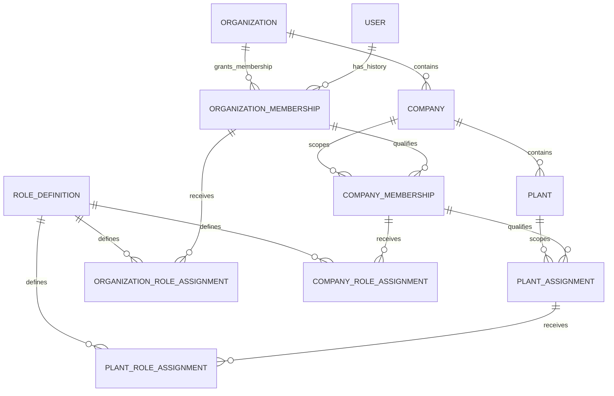

# V04.2 Tenant Scope Model & Structural Consistency Design

**Status:** Design proposal; D1 is `OWNER_APPROVED` (2026-11-06); D2–D15 remain pending owner approval.  
**Scope:** Core-owned organization/company/plant scope, memberships and assignments, scoped role-assignment relationships, candidate keys/constraints, and the application authorization boundary.  
**Gate state:** V04 remains `BLOCKED`. This design is not implementation or technical-validation evidence.

## 1. Executive summary

This proposal keeps the canonical Better Auth `User` identity independent from tenant membership and authorization. The approved initial operating policy remains one organization per ERP user and single-company-first. D1 now defines which organization-membership states occupy that user's one organization slot: ACTIVE and SUSPENDED occupy it; PENDING, REVOKED, and ENDED do not. PENDING grants no ERP access; SUSPENDED denies access. The proposed persistence model represents organization association as lifecycle-bearing `OrganizationMembership` records, not a uniqueness rule on `User`; company membership and explicit plant assignment are separate rows; scoped role assignments attach to the applicable membership/assignment instead of creating scope or access by themselves.

The proposal recommends stable surrogate IDs for membership/assignment episodes so ended records can be retained and a later grant can have a distinct history. It recommends structural parent consistency through per-edge foreign keys and selective composite keys: company→organization, plant→company-with-organization, company membership→its organization membership and company, and plant assignment→its company membership and plant. The key tuples below are candidates, not approved P05 edge choices. A valid FK establishes structural association only; current status, effective dates, permission, and resource authorization remain server-side checks.

D1 resolves organization-slot state semantics but does not implement its enforcement. Remaining owner decisions include invitation representation, reactivation/regrant and history details, effective-date/overlap policy, active duplicate rules for company memberships/plant assignments, scope-specific role assignment and custom-role ownership, service-principal representation if in scope, and individual P05 relationship/delete actions. D2–D15 remain pending owner approval; recommendations and consequences are recorded in Section 10.

This is a conceptual/physical mapping proposal for review only. It does not modify Prisma, migrations, authorization, or tests. Exact compound-key and migration behavior must be validated against the pinned Prisma/PostgreSQL/provider set before implementation.

## D1. Organization Membership Slot Semantics — OWNER_APPROVED

**Owner approval date:** 2026-11-06. No approver identity or additional approval detail is recorded.

| Membership state | Occupies organization slot | Grants ERP access |
|---|---|---|
| `PENDING` | No | No |
| `ACTIVE` | Yes | Potentially, subject to authorization |
| `SUSPENDED` | Yes | No |
| `REVOKED` / `ENDED` | No | No |

Approved invariants:

1. A canonical user may have at most one organization membership occupying the organization slot at any given time.
2. `ACTIVE` and `SUSPENDED` memberships both occupy that slot.
3. `PENDING` memberships do not occupy the slot and cannot grant ERP access.
4. `REVOKED` and `ENDED` memberships do not occupy the slot.
5. A suspended membership denies ERP access but does not permit reassignment until the previous membership has been formally ended.
6. Reassignment must end the previous slot-occupying membership before activating a new organization membership.
7. Historical membership records must be preserved.
8. Database-level concurrency protection must prevent concurrent transitions from creating multiple slot-occupying memberships.
9. Membership state alone is not sufficient authorization. Current session, membership, scope, role, and resource authorization must still be checked server-side.

**Implementation status:** Not implemented or validated. A PostgreSQL partial unique index on the canonical user ID with predicate `status IN ('ACTIVE','SUSPENDED')` is a candidate database guard, not a selected or tested migration. It requires Prisma/PostgreSQL compatibility validation, a reviewed forward migration, concurrent transition tests, tests for every state transition, and fresh migration replay. None of that evidence is claimed here.

## 2. Approved constraints and boundary

| Source decision | Constraint carried into this proposal | Not inferred or reopened |
|---|---|---|
| P02 / canonical identity | Better Auth authenticates and persists the canonical ERP user identity; ERP membership and authorization are separate from auth accounts/sessions. The current Prisma model maps that persistence to `core.user`; retain the adapter-selected ID type for every FK. | No second ERP login identity, Better Auth organization role, session hint, or email value is a tenant grant. The actual adapter/model mapping remains subject to P02 validation. |
| P03 / organization | Initial operating policy: one organization per ERP user; single-company-first; preserve membership/assignment relationships rather than a permanent global uniqueness rule on the canonical user. D1 separately approves organization-slot state and reassignment ordering. | No permanent `UNIQUE(User.id)`-based one-organization rule; D1's enforcement and the remaining D3/D4 history/effectivity details are not technically validated or fully specified. |
| P03 / company and plant | Organization membership and company membership are distinct; company membership is explicit; plant access requires explicit assignment. Roles may differ by company or plant. | Organization membership does not grant every company; company membership does not grant every plant. |
| P04 / roles | Hybrid system/custom roles; explicit permission inheritance; deny overrides allow within the applicable scope; Platform Admin and Tenant Admin remain distinct; controlled break-glass; dedicated service identities; SoD and audit. | Detailed grants, role catalog ownership, role-to-scope compatibility, and enforcement are not finalized by this proposal. |
| P05 / relationships | Select FK, selective composite FK, or application reference per edge, with an explicit owner, invariant, lifecycle, nullability, action, migration, and test. FKs do not grant access. | X01–X05 are candidates, not individually approved physical edges. No blanket composite FK or cascade rule is assumed. X06's approved Restrict behavior is unrelated to these new relationships. |
| P07 / ownership | Core owns the conceptual organization/company/plant, canonical user, membership, assignment, and authorization-assignment concepts. Each persistent business entity has one logical write owner and lifecycle. | This conceptual assignment does not finalize every aggregate, field, custom-role owner, or physical model. |
| P08 / persistence | One governed Prisma model/client and migration history; explicitly map models to their owning schema; PostgreSQL FKs are the baseline, with per-edge validation; Prisma Migrate is the governed migration path. | No claim is made that a particular compound relation or SQL constraint is supported by the selected exact toolchain until generated schema/SQL and migrations are tested. |
| P10 / freshness | Protected operations use current account/session and current membership/scope; changes affect protected operations on the next request under a bounded, tested propagation policy. | No specific propagation bound, cache TTL, or membership-status API is selected here. |

The approved P03 model and trusted-scope sequence are in `docs/phase-0.1/03-organizational-model.md`; P04 separation and enforcement are in `04-authorization-scope-model.md`; per-edge integrity rules are in `05-cross-schema-relationship-policy.md`; conceptual ownership is in `07-entity-ownership-finalization.md`; P07/P08/P10 closures are in `docs/phase-0.2/`. The V04.1 audit records the current implementation gaps in `docs/phase-0.3/v04-tenant-isolation-audit.md`.

## 3. Entity relationship model

### 3.1 Conceptual ER diagram

The diagram shows logical relationships and history-capable multiplicities, not a final physical schema, approved FK list, or permission inheritance rule. The initial one-organization/single-company policy is a constraint on operation and onboarding, not a reason to collapse the relationship entities.

The proposed role-assignment design treats `ScopedRoleAssignment` as one conceptual relationship with scope-specific physical assignment rows. That avoids a polymorphic membership FK and lets each assignment point to the precise organization membership, company membership, or plant assignment that establishes its scope. Whether this subtype design is preferred over a single nullable-scope table is an owner decision listed below.

### 3.2 Responsibility, ownership, parent, and lifecycle

| Entity | Responsibility and owner | Parent / relation | Proposed lifecycle boundary |
|---|---|---|---|
| **Core User** | Canonical ERP principal, owned by Core; Better Auth account/session persistence remains authentication infrastructure. | No organization/company parent. It may have many historical organization memberships and many company/plant membership relationships through their own records. | Auth account/session lifecycle is P02/P10. Do not delete/recreate a user to transfer tenant scope; current hard deletion is disabled and auth FKs are Restrict. Membership lifecycle is independent. |
| **Organization** | Initial tenant context, owned by Core. Does not automatically represent a jurisdiction/legal entity. | Parent of companies and organization memberships. | Provision, activate, suspend/retire under a future core lifecycle policy. Retire/restrict children rather than cascade-delete access/history. Exact lifecycle and decommissioning are not selected here. |
| **Organization Membership** | Records a user's organization association and its lifecycle; owned by Core. It is the initial tenant-context entitlement input, not a Better Auth role. | One Core User and one Organization. Parent scope for company memberships and organization-scoped role assignments. | One row per membership episode is proposed: pending, activation, suspension, end/revoke, and audit metadata. D1 approves that ACTIVE and SUSPENDED occupy the one-user slot; PENDING, REVOKED, and ENDED do not. PENDING and SUSPENDED deny access. Preserve ended rows. Reactivation/regrant, effective intervals, and retention remain pending under D3/D4. |
| **Company** | Operating/accounting boundary owned by Core. Initial product is single-company-first; the conceptual data model need not hard-code permanent singleton cardinality. | Exactly one Organization parent; may have plants and explicit company memberships. | Activate/retire under Core lifecycle; cannot be removed while memberships, plants, or dependent owned records require it. Parent deletion behavior is per-edge. |
| **Company Membership** | Explicit user's company entitlement, owned by Core. It is separate from organization membership and is required for company-scoped authorization inputs. | One user, the corresponding organization membership, and one company under the same organization. | Separate lifecycle from org membership; access is usable only when all required parent memberships are current. Revoke/expire rather than delete. Exact duplicate and reassignment semantics need approval. |
| **Plant** | Operational site, owned by Core. It does not itself grant access. | Exactly one Company and, for structural consistency, the same Organization as that Company. | Activate/retire under Core lifecycle; keep historical references valid as needed; do not cascade-delete durable operational facts. |
| **Plant Assignment** | Explicit user access-scope relationship to a plant, owned by Core. Company membership does not imply this relationship. | One user, one company membership, and one plant under that membership's company and organization. | Grant/revoke/expire independently. It is effective only while its company membership and relevant organization membership are effective. Historical assignments should remain attributable. |
| **Scoped Role Assignment** | Assigns a role definition to an already-established membership scope; assignment concept owned by Core. It is an authorization input, not membership itself. | Organization assignment attaches to Organization Membership; company assignment to Company Membership; plant assignment to Plant Assignment. | Grant/revoke/effectivity and audit are separate from membership status. A role assignment cannot extend or revive its parent membership. Role catalog ownership and grant lifecycle need owner decision. |
| **Role Definition** *(supporting entity)* | Describes a system or custom role name/version and its governed permission references. A separate definition is warranted by P04's hybrid roles and multiple assignments; it must not be duplicated as arbitrary role strings on memberships. Candidate owner is Core for the authorization catalog, with organization ownership for tenant-defined records only if approved. | Referenced by the three scoped assignment types; custom role records may require an owning organization if the owner selects tenant-defined roles. | Retire/version rather than mutate historical grant meaning silently. Exact catalog owner, tenant-customization, and permission representation remain unresolved. |
| **Invitation** *(conditional supporting entity)* | If invitations can precede a Core User, a distinct invitation record owns invite-token digest, expiry, intended scope, inviter, and redemption lifecycle. It is not an active membership. | May target an existing user or an email before identity creation; redemption creates or activates a membership under a transaction. | Expire/revoke/consume; never store a reusable raw secret. Whether invitation is a distinct entity or a pending membership state is an owner choice. |

### 3.3 Why the relationships are separate

- **Organization Membership** cannot be a `user.organizationId` field: P03 explicitly preserves membership history and future policy change without a permanent user-identity constraint. The row also has its own grant/revocation/audit lifecycle.
- **Company Membership** cannot be inferred from Organization Membership: company-level access is explicit under P03, and it may carry distinct company-scoped roles.
- **Plant Assignment** cannot be inferred from Company Membership: plant access is explicitly assigned and may have its own roles/effectivity.
- **Scoped Role Assignment** cannot be stored as a role column on a user or membership: one principal may have different roles at organization, company, and plant scopes; assignments need independent grant/revocation/audit history and explicit permission rules.
- **Role Definition** is a supporting catalog object because P04 approves hybrid system/custom roles. Role codes on assignment rows alone would not provide a governed owner, definition lifecycle, or stable permission meaning.
- **Invitation** is only necessary if onboarding can precede canonical user creation or requires an independently expiring/redeemable token. A pending membership is an alternative for invitations to an already-existing user; do not put a raw invitation secret on a membership row.

## 4. Cardinality matrix

“Initial policy” is the approved product operating rule; it is deliberately distinguished from a permanent database shape. Database constraints below are candidates subject to P05 approval and validation. Application checks remain necessary even where a constraint exists.

| Relationship | Initial product operating policy | Conceptual/history cardinality | Candidate database enforcement | Application enforcement / future history |
|---|---|---|---|---|
| User → Organization Membership → Organization | An ERP user belongs to one organization under the initial policy; D1 specifies which membership states occupy the slot. | A user may have zero memberships before onboarding and many historical membership episodes; each episode refers to exactly one user and one organization. An organization has zero or many members. | FKs to User and Organization. Candidate partial unique index on `OrganizationMembership.userId` with predicate `status IN ('ACTIVE','SUSPENDED')`; PENDING, REVOKED, and ENDED rows are outside the index. Do not put uniqueness on User itself. | Resolve exactly one applicable membership for a human principal; fail closed on zero or multiple slot-occupying memberships. Serialize transitions and retain ended rows. Any future multi-organization policy requires an explicit product decision and revised constraint/tests. |
| Organization → Company | Initial product is single-company-first and starts with one company. | An organization has zero or many companies across its lifecycle; each company has exactly one organization. | Non-null FK `Company.organizationId → Organization.id`; candidate alternate unique `(organizationId,id)` for composite child FKs. No permanent unique constraint on `Company.organizationId` is proposed. | Provision the initial company per product setup; do not expose multi-company workflow until approved. Model and migrations can still represent future companies without redesign. |
| Organization Membership → Company Membership ← Company | Organization membership alone does not grant every company. Company membership is explicit; initial scope is single-company-first. | An organization membership may have zero or many company-membership episodes; each company membership references exactly one matching organization membership and company. A company has zero or many member episodes. | FKs to User, the parent Organization Membership (including user and organization), and Company (including organization). Candidate partial unique on `(userId, companyId)` for the owner-selected set of current states; no uniqueness that erases historical rejoin episodes. | Validate parent membership and company scope/status on every protected operation. Multiple current companies remain disabled by initial product policy, not by globally unique canonical identity. Decide whether duplicate active company-membership rows are invalid. |
| Company → Plant | A company may contain plants; initial product can use one or more according to selected setup, but no access follows automatically. | A company has zero or many plants; each plant belongs to exactly one company. | Non-null composite FK candidate `(Plant.organizationId, Plant.companyId) → Company.(organizationId,id)`; candidate unique `(organizationId,companyId,id)` for dependent scope FKs. | Confirm the company and plant are active and the requested resource is plant-scoped. A valid parent FK does not grant a user access. |
| Company Membership → Plant Assignment ← Plant | Company membership does not grant plant access; assignment must be explicit. | A company-membership episode may have zero or many plant-assignment episodes; each assignment references exactly one member, that member's company membership, and a plant in the same company/organization. A plant has zero or many assigned users. | FKs to User; composite FK to Company Membership over stable membership ID/user/org/company; composite FK to Plant over org/company/plant. Candidate partial unique `(userId,plantId)` for currently effective assignment if the owner chooses one row per user/plant. | Check assignment and all ancestor memberships are current, and that the target operation requires the selected plant. Record reassignment/revocation without deleting history. |
| Membership/assignment → scoped Role Assignment → Role Definition | Roles may differ by company/plant; only explicitly defined inheritance applies. | A membership/assignment may have zero or many role grant episodes; each assignment has exactly one role definition and one scope parent. Multiple roles can exist at one scope unless owner-selected policy narrows them. | Prefer scope-specific assignment FKs to the exact membership/assignment and Role Definition. Candidate active uniqueness by parent + role + assignment scope; time-overlap constraints depend on temporal model. | Verify parent membership/assignment is current, role is enabled and applicable to scope, and the requested action is allowed. Never infer child-scope grants from a parent role unless an explicit P04 policy says so. |

### Database-enforced versus application-enforced cardinality

- **Good database candidates:** parent existence; non-null required parent columns; same-organization/company composite relationships; stable row identity; duplicate current rows when a clear status-based partial-unique predicate is approved; uniqueness of an explicitly scoped role code if that catalog policy is approved.
- **Not an FK guarantee:** active membership, current time window, enabled company/plant, requested action, role inheritance, field-level restrictions, or whether the target business record is in the allowed scope. These require authorization-time server checks, and where appropriate same-transaction owner checks.
- **Initial one-organization rule:** D1 approves one slot-occupying membership per canonical user: rows with `status IN ('ACTIVE','SUSPENDED')` occupy the slot; `PENDING`, `REVOKED`, and `ENDED` do not. The candidate partial unique index is on membership rows, not `User`, and is not yet implemented or validated. How any future `EXPIRED` label maps to these states, and how scheduled intervals interact with the current-state guard, remains open under D3/D4.
- **Single-company-first:** do not create `UNIQUE(Company.organizationId)` solely to encode an initial product rollout. Enforce the initial supported workflow in provisioning/application policy unless the owner explicitly approves a permanent physical one-company invariant.

## 5. Membership lifecycle

D1's organization-slot state semantics are owner-approved. This does not finalize every transition rule or imply that the state is an authorization grant. `PENDING`, `ACTIVE`, `SUSPENDED`, `REVOKED`, and `ENDED` are the states named by D1; any additional label such as `EXPIRED` must be mapped to an approved state before it affects slot enforcement. D2–D4 remain pending owner approval.

### Invitation and activation

1. A person must resolve to the canonical Core User before a membership can authorize anything. An invitation or `PENDING` membership grants no ERP access and occupies no organization slot.
2. A `PENDING` row may exist while the user has an `ACTIVE` or `SUSPENDED` membership elsewhere because it occupies no slot. It cannot be used as an access path or as a company/plant authorization parent.
3. If the invitee already has a canonical User, a pending Organization Membership can be considered; activation follows an approved verified acceptance/administrative grant flow and produces attributable audit context. D2's invitation mechanics remain unresolved.
4. If invitations may precede user registration, a separate Invitation record is the proposed option; store only a token digest and expiry. Redemption verifies the invitation and creates/activates membership in one transaction. Email is not canonical identity and must not itself grant access.
5. Company Membership and Plant Assignment are separately granted after parent entitlement and hierarchy checks. Acceptance of an organization invite must not silently create company or plant access unless a separately approved explicit onboarding command does so.

### Suspension, revocation, and reactivation

- **Suspension (D1 approved):** preserve the membership row, make it ineffective for ERP access, and continue to occupy the user's one-organization slot. A suspended membership therefore denies access but does not permit reassignment until formally ended.
- **Revocation/end (D1 approved slot effect):** `REVOKED` and `ENDED` rows do not occupy the slot or grant access. Preserve their historical records; do not cascade-delete company memberships, plant assignments, or role-grant history. Descendants are unusable because each protected operation rechecks the full current parent chain; a governed transition may mark descendants ended for lifecycle reporting.
- **Reassignment (D1 approved ordering):** end the previous slot-occupying membership before activating a new organization membership. The operation must not change `User.id`, delete history, or silently move company/plant relationships. New company membership and plant assignment are explicit and do not carry over by inference. A new `PENDING` row may precede the transfer, but it cannot authorize access or activate until the old slot is formally ended.
- **Reactivation/regrant:** D3 remains pending. The design recommendation is audited restoration from `SUSPENDED` (which continues to occupy the same slot) and a new membership episode after a `REVOKED`/`ENDED` record, but this recommendation is not owner-approved. P10's rule that revoked sessions never reactivate is not itself a membership rule.
- Role assignments must not remain independently effective when their parent membership/assignment is suspended, ended, or expired. Parent-state validation is mandatory even if descendants are also explicitly revoked for audit clarity.

### History and effective dates

- Preserve a distinct row for each membership episode. Record creation/update, grant/activation actor, effective start/end, and suspension/revocation reason/actor where approved. Security audit events remain separate governed records; do not store tokens or unnecessary payloads in membership rows.
- D4 remains pending on whether to use current-state status only, effective timestamps, or scheduled/backdated windows. If effective dating is selected, a half-open UTC interval `[validFrom, validUntil)` is a candidate convention; approve backdating/future scheduling and how status combines with time before implementation. `ACTIVE` outside its approved effective interval cannot authorize.
- Rejoining the same organization should preserve the old episode. Whether a suspended row can be restored or a revoked episode can be reopened remains D3, pending owner approval.

### Duplicate and concurrent membership changes

D1 requires at most one slot-occupying membership per canonical user at a time. All grant/activation/suspend/revoke/reassign paths must enforce that invariant, including concurrent invite acceptance, administration, restoration, and bulk provisioning.

Required implementation safeguards (not yet implemented or tested):

1. Run transitions in a transaction and lock the canonical user row (or use an equally explicit per-user serialization mechanism) before reading/changing slot rows.
2. Re-read current membership state and any selected effective interval inside that transaction; validate expected versions and idempotency for retryable commands.
3. Use the candidate PostgreSQL partial unique index on canonical user ID with predicate `status IN ('ACTIVE','SUSPENDED')` as a database backstop. It is not a unique constraint on `User` and leaves `PENDING`, `REVOKED`, and `ENDED` history outside the slot index.
4. For reassignment, end the prior ACTIVE or SUSPENDED row before activating the new membership, within the governed transition transaction. A concurrent attempt must fail/serialize rather than commit a second slot-occupying row.
5. If D4 later approves scheduled/future intervals, validate a separate overlap guard (for example a PostgreSQL exclusion constraint, with extension/provider/Prisma implications) or another proved serialized temporal contract. A status-based partial unique index alone does not prevent overlapping valid-time windows represented by other states.
6. Apply analogous company/plant duplicate guards only after D6 is approved. Role grants may be multiple; their uniqueness and overlap semantics are separate.
7. Emit attributable audit events for grants, transitions, and failed high-risk administrative attempts under the approved audit policy. Conflicts fail closed and do not create another active membership.

The D1 policy is decided; its database enforcement is not. The partial-index proposal requires Prisma/PostgreSQL compatibility validation, a reviewed forward migration, concurrent transition tests, tests for every state transition, and fresh migration replay. None of this evidence is claimed to have passed.

## 6. Structural integrity proposal

All rows below are Core-owned conceptual candidates. Names and key types are proposals: P07's UUID direction applies to ERP-owned identifiers, while the canonical Better Auth user ID remains adapter-selected and is currently modeled as `String`. Each edge and referential action below remains subject to P05 owner review and exact Prisma/PostgreSQL validation.

| Entity / edge | Candidate key and columns | Candidate constraint, index, and reason | Candidate referential action / lifecycle |
|---|---|---|---|
| Organization | `Organization.id` candidate UUID primary key. Optional business code is not defined here. | PK; any code uniqueness/normalization needs a business decision. | Referenced organization is retired, not physically deleted while child relationships exist. |
| Company → Organization (P05 X01) | `Company.id` candidate UUID PK; required `organizationId`. | FK `organizationId → Organization.id`; alternate unique `(organizationId,id)` so composite descendants can prove same parent. Index `organizationId`; PostgreSQL does not automatically index referencing FK columns. | Candidate `RESTRICT`/non-destructive retirement while companies/records exist, consistent with X01's candidate; X01 still needs individual approval. |
| Plant → Company (P05 X02) | `Plant.id` candidate UUID PK; required `organizationId`, `companyId`. | Composite FK `(organizationId,companyId) → Company(organizationId,id)` prevents a plant from pairing a real company with a different organization. Candidate unique `(organizationId,companyId,id)` for child assignments. Index the child FK tuple. | Candidate `RESTRICT`; deactivation/retirement instead of cascading operational history. X02 is not individually approved. |
| Organization Membership → User / Organization (P05 X03) | `OrganizationMembership.id` candidate UUID PK; `userId` uses the Better Auth scalar type; required `organizationId`; status/effective/audit fields. | FKs `userId → User.id` and `organizationId → Organization.id`. Candidate unique `(id,userId,organizationId)` permits a child FK to validate the exact historical parent, including subject and scope. Candidate partial unique index on canonical `userId` with `status IN ('ACTIVE','SUSPENDED')` enforces D1's one-slot invariant while leaving `PENDING`, `REVOKED`, and `ENDED` history outside the index. Index `(userId,status)` and `(organizationId,status)` for resolution/admin queries. | Candidate `RESTRICT`; end/revoke rather than delete. D1 defines the index predicate semantically, but the database guard is not implemented or validated. X03 still requires per-edge P05 selection. |
| Company Membership → User / Organization Membership / Company (P05 X04) | `CompanyMembership.id` candidate UUID PK; `userId`, `organizationMembershipId`, `organizationId`, `companyId`; state/effectivity fields. | Simple User FK; composite FK `(organizationMembershipId,userId,organizationId) → OrganizationMembership(id,userId,organizationId)`; composite FK `(organizationId,companyId) → Company(organizationId,id)`. Candidate unique `(id,userId,organizationId,companyId)` for child plant/role references. Index `(userId,organizationId,companyId,status)`, parent FK tuples, and `(organizationId,companyId,status)`. Candidate partial unique `(userId,companyId)` for approved current states; do not unique over all history. | Candidate `RESTRICT`; preserve history and end/revoke. Parent FK proves the referenced organization-membership row and hierarchy, not that it is currently active. X04 remains a per-edge choice. |
| Plant Assignment → User / Company Membership / Plant (P05 X05) | `PlantAssignment.id` candidate UUID PK; `userId`, `companyMembershipId`, `organizationId`, `companyId`, `plantId`; state/effectivity fields. | Simple User FK; composite FK `(companyMembershipId,userId,organizationId,companyId) → CompanyMembership(id,userId,organizationId,companyId)`; composite FK `(organizationId,companyId,plantId) → Plant(organizationId,companyId,id)`. Candidate unique target `(id,userId,organizationId,companyId,plantId)` if scoped role assignment needs it. Index user/status, membership tuple, and plant tuple. Candidate partial unique `(userId,plantId)` for owner-approved current assignments. | Candidate `RESTRICT`; explicit revoke/end; no cascade from company membership or plant. X05's precise keys/actions are unapproved and need validation. |
| Role Definition / scoped assignment | Candidate role-definition PK plus stable assignment IDs. Assignment rows refer to one scope-specific parent and one role definition. | Unique role code must be scoped according to approved global-vs-tenant catalog semantics. Index each assignment parent, role, status, and effective dates. Candidate active uniqueness by parent + role; multiple simultaneous roles may be allowed. | Retire role definitions; revoke assignments. Restrict deletion where grants/history refer to them. Exact role edge/actions are P05 decisions and role lifecycle is a P04 owner choice. |
| Invitation (if selected) | Candidate invitation UUID; organization and optionally company scope; normalized target identifier; token digest, expiry, inviter, redeemed/revoked times. | FK to organization and any explicitly selected intended scope; unique pending-invite tuple only after email normalization and duplicate policy are approved. Never unique a canonical user by invite email. | Expire/revoke/consume; no cascade into active memberships. Redeem transaction creates/activates membership only after authentication and policy validation. |

### Composite-key rationale and limitations

- The composite company/plant keys are proposed only where a child must prove same-parent scope. They are not a blanket pattern for all company/plant business tables. Module-specific business rows remain per-entity P05 decisions (including X08/X09).
- The row-ID-plus-subject/scope alternate unique keys let a child reference a specific historical membership episode and simultaneously prove its user and organization/company. A plain FK to `membership.id` alone proves which row exists but does not prove duplicated child scope fields agree with it.
- Historical rejoin needs multiple rows for the same user/organization or user/company/plant over time. Therefore an unconditional unique `(userId,organizationId)` or `(userId,companyId)` on membership history is not proposed. D1 approves a partial unique guard on organization-membership rows for `status IN ('ACTIVE','SUSPENDED')`; this candidate is not yet implemented or technically validated. Other current-state guards depend on D3/D4/D6. No `User` uniqueness is added.
- PostgreSQL does not infer same-parent consistency from separate simple FKs. If the proposed compound key cannot be expressed safely in the pinned Prisma/provider version, record that per-edge and use the P05-approved same-transaction Core contract plus a dedicated consistency test; do not silently describe an application check as a database FK.
- No `ON DELETE CASCADE` is proposed for identity/membership/assignment/role history. `RESTRICT` is a candidate, not blanket owner approval. Ordinary lifecycle transitions are status/effectivity changes; any retention or privacy erasure must follow applicable policy and owner/legal review.
- Primary keys are stable and immutable per P07. Exact `ON UPDATE` actions remain per-edge; do not repurpose keys or assume updates cascade through identity/scope relationships.
- PostgreSQL FK constraints do not automatically create indexes on referencing columns. Indexes listed above are candidates for FK checks and common scope-resolution paths; final workload and index choices require validation rather than indexing every possible column by default.

## 7. Company and plant consistency rules

### Structural (database) consistency candidates

1. **Company belongs to one organization:** `Company.organizationId` is non-null and references an Organization. Its `(organizationId,id)` candidate key allows dependent rows to reference that exact organization/company pair.
2. **Plant belongs to one company and its organization:** Plant carries both required `organizationId` and `companyId`; one composite FK points to the Company pair. Do not rely on two unrelated FKs (`companyId` and `organizationId`) because each may independently exist while describing different parents.
3. **Company Membership matches the organization membership:** Company Membership carries the parent organization-membership row ID plus the user's ID and organization ID; its composite FK targets that exact membership episode. A second composite FK requires `(organizationId,companyId)` to exist as one Company. This prevents a user belonging to organization A from structurally receiving a company-membership row for organization B.
4. **Plant Assignment matches both parents:** Plant Assignment references its exact Company Membership using membership ID + user + organization + company, and references Plant using organization + company + plant. The same user, organization, and company must therefore agree on both parent paths.
5. **Scoped Role Assignment matches the entitlement row:** The assignment references the membership/assignment at exactly its intended scope. Scope-specific models avoid an assignment whose nullable `companyId`/`plantId` disagrees with an unrelated membership row.

These are candidate FK designs. X01–X05 and any new role/invitation edges require individual P05 approval and pinned DDL/Prisma validation.

### Runtime authorization checks (not guaranteed by structural keys)

- On every protected server operation, resolve the authenticated canonical user, current account/session state, active organization membership, selected company membership, and explicit plant assignment as applicable.
- Confirm the company and plant are active and the requested business resource belongs to the permitted scope. A valid Company Membership FK or Plant Assignment FK can point to a revoked/suspended historical record; status and effective dates must be checked in the owning transaction.
- Require Company Membership for company access; do not treat organization membership or an organization-scoped role as company access automatically. Require Plant Assignment for plant-scoped access; do not treat company membership or a company-scoped role as plant access automatically.
- Evaluate the role/permission policy after membership/scope resolution. P04 inheritance is explicit; no parent-to-child role/access inheritance comes merely from the ERD hierarchy.
- Apply the verified scope as part of database read/write predicates. Composite FKs prevent inconsistent writes, but do not prevent reading a structurally valid row outside the principal's allowed scope.

## 8. Proposed Prisma mapping (not schema code)

All proposed models map to `@@schema("core")`, consistent with P07's Core ownership of organization, company, plant, membership, plant assignment, and authorization-assignment concepts. Names below are descriptive candidates; the actual existing `User` model/table and Better Auth adapter mapping must remain compatible with P02 and be tested. Do not modify `prisma/schema.prisma` as part of this design task.

| Proposed Prisma model | Key field concepts and relations | Mapping note |
|---|---|---|
| `User` *(existing)* | Existing adapter-selected `id`; reverse relations to organization/company memberships and plant assignments. | Remains canonical authentication/ERP identity. Do not add a tenant FK or organization-specific unique field to User. Preserve Better Auth's actual table mapping. |
| `Organization` | `id` candidate UUID; lifecycle/status and timestamps; `companies`, `memberships`. | `@@schema("core")`; no invented legal, tax, or jurisdiction fields. |
| `Company` | `id`, required `organizationId`; organization relation; `plants`, `memberships`; candidate compound unique for `(organizationId,id)`. | `@@schema("core")`; company code/natural-key shape is unresolved. |
| `Plant` | `id`, required `organizationId`, `companyId`; Company relation over both parent fields; `assignments`. | `@@schema("core")`; compound unique candidate for `(organizationId,companyId,id)`. |
| `OrganizationMembership` | `id`, `userId`, `organizationId`, proposed lifecycle/effectivity/audit concepts; User and Organization relations; company memberships and organization role assignments. | `@@schema("core")`; relation tuple `(id,userId,organizationId)` may be needed for composite child relations. Partial unique and exclusion constraints may require reviewed migration SQL beyond ordinary model declarations. |
| `CompanyMembership` | `id`, `userId`, `organizationMembershipId`, `organizationId`, `companyId`, lifecycle/effectivity; User, OrganizationMembership, and Company relations; plant assignments and company role assignments. | `@@schema("core")`; composite relations must prove both same user/org and same org/company. Candidate tuple `(id,userId,organizationId,companyId)` for child references. |
| `PlantAssignment` | `id`, `userId`, `companyMembershipId`, `organizationId`, `companyId`, `plantId`, lifecycle/effectivity; User, CompanyMembership, and Plant relations; plant role assignments. | `@@schema("core")`; composite relations tie the assignment to one user-company membership and one plant in that company. |
| `RoleDefinition` | `id`, stable code/version, role kind, allowed scope category, lifecycle; optional owning `organizationId` only for organization-owned custom definitions if approved; reverse relations to assignments. | `@@schema("core")` is the proposal for shared authorization concepts. Custom-role ownership/permission storage is unresolved; avoid embedding an ungoverned permissions JSON blob. |
| `OrganizationRoleAssignment` | `id`, `organizationMembershipId`, `roleDefinitionId`, lifecycle/effectivity, grant/revoke actor references as approved. | Physical subtype of conceptual `ScopedRoleAssignment`; binds only an organization membership. |
| `CompanyRoleAssignment` | `id`, `companyMembershipId`, `roleDefinitionId`, lifecycle/effectivity and audit references. | Binds only a company membership; does not grant plant scope. |
| `PlantRoleAssignment` | `id`, `plantAssignmentId`, `roleDefinitionId`, lifecycle/effectivity and audit references. | Binds only an explicit plant assignment. |
| `OrganizationInvitation` *(conditional)* | `id`, `organizationId`, normalized invite target, secret digest, expiry, inviter, redeemed/revoked metadata; optional intended company only if explicitly selected. | Separate model if invitations may precede User creation or require independent lifecycle. An invite is never a User or active Membership. |

### Prisma-specific validation notes

- The proposed user FK scalar must match the exact Better Auth-generated/model ID type; `String` reflects the current schema only, not a final P02 adapter validation.
- ERP-owned UUID IDs follow P07's UUID direction, but UUID version/default/generation remain technical choices, not selected here.
- Composite relations need matching compound unique targets and compatible scalar types/order. Validate whether the pinned Prisma version can represent every intended relation and generate the expected PostgreSQL constraints; do not assume that a diagram or `@@unique` proposal proves it.
- PostgreSQL partial unique indexes, exclusion constraints, checks tying scope subtype to role scope, and some lifecycle guards may need explicit reviewed migration SQL. P08 requires Prisma Migrate as the governed migration path; any migration-only construct must be represented/reviewed within that history and tested on fresh and upgrade paths.
- Keep domain data-access contracts owner-controlled. A central generated Prisma Client does not authorize arbitrary modules to write Core membership/role tables.

## 9. Authorization implications

This model supplies structured inputs to future server-side authorization; it does not make an authorization decision by itself.

1. **Authenticate:** use the server-verified Better Auth session to identify the canonical Core User. A valid session does not prove current ERP membership.
2. **Resolve scope:** treat route/UI/session scope as a selector. Load the current Organization Membership; validate the selected Company Membership and, for plant operations, the explicit Plant Assignment. Confirm organization→company→plant parent consistency.
3. **Resolve current lifecycle:** require active account, membership/assignment status, and effective date on each protected operation under P10's tested freshness bound. Suspended, expired, revoked, mismatched, or ambiguous relationships deny access.
4. **Evaluate scoped role and action:** load role grants attached at the applicable scope and apply P04's hybrid role model, explicit inheritance, deny-overrides-allow, separation of duties, and resource lifecycle conditions. Do not infer a company/plant grant merely from a parent entity or parent role.
5. **Authorize the target and query:** check that the target record belongs to the resolved organization/company/plant and that the requested action is permitted. Put the same authorized scope into database filters and writes; never fetch broad data and filter after serialization.
6. **Audit and return minimum data:** record required grant/revocation and sensitive-action audit context, use a bounded non-human identity for jobs, and return only the minimum approved DTO. Cache keys partition by principal and authorized scope and are invalidated when memberships, role assignments, sessions, or scope change.

A composite FK may prove a Company Membership points through an Organization Membership to a Company in the same organization; it cannot prove either membership is active or that a role permits `read`, `update`, `export`, or a specific field. RLS, if selected later, remains defense-in-depth and depends on the V07 transaction-local pooled-context evidence documented in V04.1.

## 10. D1 owner decision and unresolved D2–D15

D1 is `OWNER_APPROVED` as of 2026-11-06, with the exact state-to-slot/access policy recorded in the D1 section above. It is no longer an open policy question; the candidate database enforcement remains unimplemented and technically unvalidated. D2–D15 remain `PENDING_OWNER_APPROVAL`. Their options and recommendations below are proposals, not approvals. P03/P04/P05/P07/P08/P10 decisions already approved are not reopened; the pending questions fill details they leave open. No approver identity or additional approval detail is inferred.

| ID | Owner question and options | Recommendation | Technical consequences | Does implementation depend on answer? |
|---|---|---|---|---|
| **D1 — Organization-slot states (`OWNER_APPROVED`, 2026-11-06)** | Approved policy: `PENDING`—does not occupy/no access; `ACTIVE`—occupies/potential access subject to authorization; `SUSPENDED`—occupies/no access; `REVOKED`/`ENDED`—does not occupy/no access. A canonical user may have at most one slot-occupying membership. Suspension blocks access and reassignment until formally ended; reassignment ends the former occupant before activating another; preserve history; prevent concurrent duplicate occupants at database level; always check session, membership, scope, role, and resource authorization server-side. | Implement the approved state semantics with a candidate partial unique index on canonical user ID for `ACTIVE` and `SUSPENDED` membership rows, plus serialized transition transactions. This remains a technical proposal, not an implementation decision. | Requires Prisma/PostgreSQL compatibility validation, reviewed forward migration, concurrent transition tests, tests for every state transition, and fresh migration replay. No such tests have passed or are claimed. | **Policy answer: resolved.** Technical implementation and validation remain required before the guard or V04 can be considered complete. |
| **D2 — Invitation before canonical user** | Are invites limited to existing users with a pending membership, or may an invite be sent before account registration and bind by verified email/token? | Support a separate expiring Invitation record for pre-registration invitations; keep it non-authorizing and redeem into membership only after canonical identity verification. If initial onboarding is admin-provisioned only, defer the invite model. | Determines whether an invitation table, token lifecycle, email normalization/uniqueness, acceptance audit, and membership slot handling are needed. Never treat email as canonical identity. | **Yes** for invite-enabled onboarding; otherwise can be deferred without blocking the base scope relationships. |
| **D3 — Suspension, revocation, and regrant history** | Can suspended membership be restored in place? Is revocation terminal? Does a later grant create a new membership episode or reopen an old row? | Permit audited restoration from suspension; make revoked/ended episodes terminal and create a new row for a later grant. Preserve all episodes; do not reactivate revoked sessions or conflate membership with session state. | Determines lifecycle transitions, audit fields, history semantics, descendant handling, and whether unique constraints can use a single current row. | **Yes.** Required before final state model and transition API; implementation can use a provisional status only after approval. |
| **D4 — Effective-date semantics** | Use current-state status only; add effective start/end timestamps for immediate changes/history; or support scheduled/backdated intervals with overlap enforcement? | Store auditable UTC grant/effective/end timestamps. Do not support scheduled/backdated membership windows initially unless the product needs them; if enabled, use half-open intervals and an explicit overlap-control design. | Current-state-only has simpler partial uniqueness. Temporal scheduling can require an exclusion constraint (extension/provider validation) or serialized transition contract; `now()` cannot be used as a partial-index predicate. Backdating changes audit and authorization history. | **Yes** for final columns and overlap integrity; not required to decide the approved one-org principle. |
| **D5 — Physical one-company invariant** | Should the initial “single-company-first” policy mean a database-enforced maximum of one company per organization, or only that provisioning/UI initially exposes one company while the model supports many? | Keep the model 0..many companies per organization and enforce the initial rollout in provisioning/product policy; do not create a permanent one-company unique constraint without an explicit product decision. | A singleton DB constraint affects onboarding, future multi-company evolution, migrations, and tests; application-only rollout allows future companies but requires product gates. | **Only if a database singleton is desired.** The base hierarchy model does not depend on that answer; the recommended design avoids a singleton constraint. |
| **D6 — Duplicate current company memberships and plant assignments** | May a user have multiple simultaneous current rows for the same user/company or user/plant (for example separate role-bearing rows), or is each relationship unique and roles separate? | One current Company Membership per user/company and one current Plant Assignment per user/plant; represent multiple roles as separate role assignments. Permit historical episodes. | Determines scoped partial-unique indexes and whether a grant may have multiple membership records per scope. | **Yes** before active unique constraints and grant workflows; basic FK hierarchy can be modeled first. |
| **D7 — Role assignment scope/inheritance and special grants** | Are roles assigned only to the matching membership scope, or may organization-scoped roles explicitly inherit into selected company/plant actions? What exact scopes/actions can Platform Admin, Tenant Admin, break-glass, and service identities receive? | Store scope-specific role assignments; default to no inheritance. Add only explicit, owner-approved inheritance/grants. Keep Platform Admin and Tenant Admin separate, and keep human membership separate from service identity. | Determines grant representation, ability evaluation, caches, audit, and whether scope-specific subtype models are sufficient. Exact grant matrix must precede CASL/authorization implementation. | **Yes** for role assignment and protected operations; not required to establish base entity FKs. |
| **D8 — Custom role catalog ownership** | Are custom roles global platform definitions, organization-owned definitions, or both? Can tenants edit system roles or only create bounded custom roles? | Core owns the catalog and system-role definitions; permit separately organization-owned custom definitions only if approved, immutable/versioned, and unable to widen the tenant boundary. | Determines `RoleDefinition` owner/scope columns, uniqueness, FK shape, versioning, cross-tenant isolation, and CRUD authority. | **Yes** before role catalog and role assignment implementation; not before modeling membership entities. |
| **D9 — P05 X01: Company→Organization edge** | Choose same-schema FK vs owning-Core transaction/application reference; confirm nullability and delete/update action. | Non-null same-schema FK `Company.organizationId → Organization.id`, candidate `RESTRICT`/retire. | Requires exact migration, indexes, and deletion tests; FK enforces parent existence only. | **Yes** before Company schema/migration. |
| **D10 — P05 X02: Plant→Company hierarchy edge** | Choose simple company FK plus application consistency, or composite FK `(organizationId,companyId)`; confirm actions. | Composite FK to `(Company.organizationId,Company.id)` to prove same organization, subject to Prisma/provider proof; candidate `RESTRICT`. | Requires matching target unique key and tested compound relation. If unsupported, record application contract fallback and add same-transaction mismatch tests. | **Yes** before Plant schema/migration. |
| **D11 — P05 X03: Organization Membership edges** | Approve User and Organization FKs, stable membership ID, and per-edge delete/update behavior. | Same-schema FKs to User and Organization; retain history and candidate `RESTRICT` rather than cascade delete. | FKs do not enforce one current membership or status; active-slot guard is separate. | **Yes** before membership migration. |
| **D12 — P05 X04: Company Membership edges** | Approve User, Organization Membership, and Company references; choose simple versus composite tuples and actions. | User FK; composite membership reference containing membership ID/user/org; composite Company reference containing org/company; candidate `RESTRICT`. | Matching alternate unique keys and generated compound FKs are required; parent status remains runtime-checked. | **Yes** before Company Membership migration. |
| **D13 — P05 X05: Plant Assignment edges** | Approve User, Company Membership, and Plant references; choose simple/composite key tuples and actions. | User FK; composite Company Membership tuple containing assignment ID/user/org/company; composite Plant tuple containing org/company/plant; candidate `RESTRICT`. | Proves consistent scope structurally but not active entitlement. Requires compound-target validation and direct wrong-parent insert tests. | **Yes** before Plant Assignment migration. |
| **D14 — Role relationship and deletion edges** | Approve the selected scope-specific role-assignment→membership/assignment and role-definition FKs, including lifecycle and whether retired role definitions remain referentially valid. | Same-schema typed FKs; revoke/retire instead of cascade deletion; preserve grant history. | Determines assignment tables and schema migration; exact P05 edge records and P04 role catalog must align. | **Yes** before role model/migration; can be deferred if role assignments are not in the V04.2 implementation slice. |
| **D15 — Service principal representation** | If background/integration jobs are in initial implementation scope, how are dedicated service identities issued, scoped, rotated, revoked, and related to authorization without pretending they are human Users? | Model a distinct service principal/credential lifecycle and scoped assignments; do not overload `User` or allow implicit human impersonation. Defer the entity if no such jobs are in scope. | Adds identity type, key/credential handling, audit actor semantics, and role-assignment relation variants; P04's dedicated service-identity architecture remains binding. | **Only when service jobs are brought into scope;** do not block human membership hierarchy design. |

P05 edge recommendations above are deliberately presented as decision requests, not approved FK declarations. Product owners must also approve any business-key uniqueness or legal retention policy before those fields/retention rules are introduced; no legal/jurisdictional policy is invented here. Exact UUID type/version, Prisma compound-relation support, index/constraint SQL, and adapter scalar compatibility are technical validation items under P02/P08/P09, not fabricated owner approvals.

## 11. Risks and implementation dependencies

| Risk / dependency | Consequence if ignored | Required handling |
|---|---|---|
| D1 state policy is approved but enforcement is unvalidated; D2–D4 lifecycle/temporal details remain pending | Without the approved ACTIVE/SUSPENDED database guard and serialized transitions, concurrent changes could still create multiple slot occupants; unresolved invite/effectivity rules can also create ambiguous transitions. | Implement the candidate partial unique index for ACTIVE/SUSPENDED; resolve D2–D4 where in scope; validate migration compatibility and test every state transition, concurrency, and fresh replay. |
| Composite FK support is assumed from a diagram | Prisma generation or migration may fail, or the database may omit the intended same-parent invariant. | Validate each X01–X05 edge in the pinned Prisma/PostgreSQL/provider setup; use the documented P05 fallback if a specific edge cannot be safely expressed. |
| FK is mistaken for current authorization | A structurally valid but revoked membership can authorize stale requests or assignments. | Recheck parent state and grants transactionally on every protected operation; test stale session/role/scope changes under P10. |
| Membership transition paths bypass serialization | Two admins/invite acceptances can race and violate one-organization policy or create duplicate scope memberships. | One owning-Core transaction contract for every writer, per-user serialization, database uniqueness backstop, idempotency, and concurrency tests. |
| Company/plant scope fields drift | A relation may point to a valid but wrong parent if only independent simple FKs are used. | Use approved compound keys where feasible; otherwise same-transaction owner validation with direct wrong-parent tests. |
| Historical rows are cascade-deleted | Reassignment erases audit/history and changes the meaning of prior transactions. | Prefer lifecycle revoke/retire; per-edge action approval; governed retention/decommissioning before any physical deletion. |
| Role scope is encoded as strings or inherited implicitly | Tenant/company/plant grants bleed across boundaries; custom roles can widen access. | Typed role assignments, explicit inheritance/grant matrix, separate admin trust boundaries, and negative authorization tests. |
| Prisma and PostgreSQL constraint expressiveness differs | A hand-waved partial unique/check/exclusion constraint may not be represented in generated schema or migration history. | Treat manual SQL constructs as candidates only; maintain them through reviewed Prisma Migrate migrations and test fresh plus upgrade migration paths. |
| P07 ownership/access contracts are bypassed by a shared client | Other modules mutate Core membership or scope rows without the Core owner lifecycle. | Publish Core-owned commands/read contracts; restrict direct write access by module convention/architecture checks and later privilege governance. |
| Session/cache freshness is unspecified | A valid session or cached scope can preserve revoked membership or role access. | Select and test P10 propagation bounds and cache invalidation; fail closed when current entitlement cannot be established. |
| Custom roles or service identities are underspecified | Assignment rows lack stable ownership, actor attribution, or scope-safe subject identity. | Resolve D7/D8 and, if jobs are in scope, D15 before implementing those authorization subjects. |

Implementation dependencies include P02 Better Auth ID mapping; D1's approved organization-slot semantics plus pending D2–D4 membership lifecycle/effectivity choices as applicable; P04 detailed scoped grants; P05 per-edge FK/composite-FK/application-reference/action approvals; P07 entity/aggregate registry and Core write contracts; P08 exact Prisma/PostgreSQL generation and migrations; P09 pinned versions; P10 current-state propagation; and V07 pooling/session-context tests before any RLS use based on pooled tenant state. D1's partial unique index, transition transaction, and test evidence remain unimplemented. This design does not clear V04 or any other gate.

## 12. Recommended next validation steps

1. Treat D1 as `OWNER_APPROVED` (2026-11-06); do not re-open its state-to-slot policy. Obtain owner selections for pending D2–D8 and any in-scope D15 items. Confirm none changes P03's approved one-organization initial policy or creates a permanent global canonical-user uniqueness constraint.
2. Review and approve each P05 edge separately: X01 Company→Organization, X02 Plant→Company, X03 Organization Membership→User/Organization, X04 Company Membership→User/Organization Membership/Company, X05 Plant Assignment→User/Company Membership/Plant, and the new role/invitation edges if included. For each, record invariant, nullable fields, exact key tuple, delete/update action, source/target owners, migration approach, and tests.
3. Reconcile the approved choices into the P07 entity/aggregate ownership registry and conceptual/physical ERDs. Decide whether scoped roles use three typed assignment tables as proposed or an owner-approved alternative; do not treat this document as an ERD approval.
4. Validate Better Auth's generated User identifier type and P02 mapping; validate candidate UUID choices and every compound target/reference using the pinned P09 Prisma/PostgreSQL/provider version. Inspect generated client and SQL rather than relying on prose or diagrams.
5. Validate that the pinned Prisma/PostgreSQL combination can represent and migrate the candidate partial unique index on canonical user ID for `status IN ('ACTIVE','SUSPENDED')`; prepare a reviewed forward migration, then on a disposable database perform fresh migration replay and upgrade from the current V03 history. Inspect the index predicate, FK metadata, nullability, other unique/exclusion/check constraints, delete/update actions, and same-parent behavior. Test all approved membership-state outcomes and valid/invalid organization/company/plant combinations; none of these tests has yet passed.
6. Test each owner-approved state transition and slot effect, plus concurrent invite acceptance, grant, suspension, ending/revocation, and reassignment using the chosen lock/unique protocol. In reassignment, assert the prior slot occupant is ended before the new membership becomes ACTIVE; ensure races fail/serialize, ended history remains, and unapproved D3/D4 transitions are not treated as approved behavior.
7. Implement only after design approvals. Exercise the actual owner commands and protected server/query boundaries for current membership, company membership, plant assignment, scoped roles, revocation, and stale-session/cache propagation. Add multi-tenant negative tests to CI; unit-only or FK-only tests do not prove tenant isolation.
8. If selective RLS is later selected, first complete V07 for transaction-local context and pooled connection reuse, then validate selected policies under least-privilege runtime roles. RLS does not replace the membership/authorization checks described here.
9. Record evidence and residual risk in Phase 0.3. V04 may change status only after all relevant structural, authorization, pooling, and adversarial criteria pass. Keep V05–V10 and Phase 1 statuses independent and unchanged by this design document.

## Status boundary

- This file is a design proposal only; no schema, migration, code, role catalog, authorization, or test is implemented by it.
- **D1 is `OWNER_APPROVED` (2026-11-06); its candidate database enforcement remains unimplemented and unvalidated. V04 remains `BLOCKED`. Owner approval of D1 does not establish technical validation or clear V04.
- **V05–V10 remain unchanged.** In particular, V07 remains a separate prerequisite for any future RLS design relying on pooled transaction-local context.
- **Phase 1 remains `BLOCKED`.** Applicable owner decisions and reproducible technical evidence remain required.
