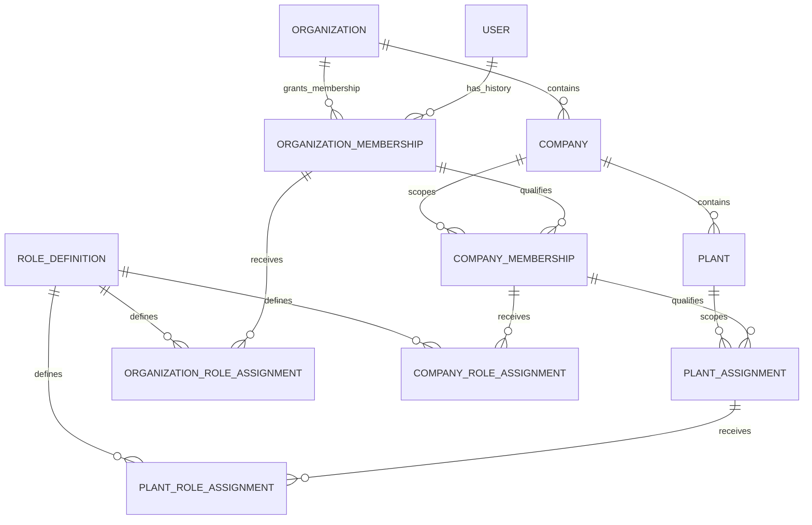

# V04.2 Tenant Scope Model & Structural Consistency Design

**Status:** Design proposal; D1–D10 and D14 are `OWNER_APPROVED` (2026-11-06); D11–D13 and D15 remain `PENDING_OWNER_APPROVAL`.  
**Scope:** Core-owned organization/company/plant scope, memberships and assignments, invitations, scoped role-assignment relationships, candidate keys/constraints, and the application authorization boundary.  
**Gate state:** V04 remains `BLOCKED`. This design is not implementation or technical-validation evidence.

## 1. Executive summary

This proposal keeps the canonical Better Auth `User` identity independent from tenant membership and authorization. The approved initial operating policy remains one organization per ERP user and single-company-first. D1 defines which organization-membership states occupy that user's one organization slot: ACTIVE and SUSPENDED occupy it; PENDING, REVOKED, and ENDED do not. PENDING grants no ERP access; SUSPENDED denies access. Under D2, pre-registration invitations are separate, non-authorizing `Invitation` records; only verified redemption resolved to the canonical user and validated against D1 may create an ACTIVE membership. D3 approves restoration from SUSPENDED on the same membership record, makes REVOKED and ENDED terminal, and requires a new membership record for any later grant after either terminal state. D4 approves current-state membership semantics: current status determines effectiveness, lifecycle timestamps are audit/history metadata only, and scheduled or backdated membership state changes are not supported in the initial design. D5 approves Organization→Company database cardinality of zero-to-many, with exactly one Organization per Company; single-company-first is an initial provisioning/UI policy, not a permanent database singleton constraint. Organization Membership does not grant access to every Company; explicit Company Membership remains required for company-scoped authorization. D6 approves at most one active/current Company Membership per canonical User–Company pair and at most one active/current Plant Assignment per canonical User–Plant pair; additional roles use separate RoleAssignment records, while ended episodes remain historical and a grant after a terminal state creates a new episode. Current status and scope must still be checked by server-side authorization; a record or FK alone grants no access. D7 additionally approves typed role-to-scope matching, no automatic inheritance, explicit documented cross-scope inheritance only, distinct Platform Admin and Tenant Admin boundaries, controlled attributable reasoned and audited break-glass, and dedicated non-impersonating service identities. D8 assigns global/system role ownership to Core and permits organization-owned custom roles only within the owner's authority and Core's ceiling, with versioning and audit. D14 approves role-edge Restrict actions and preservation of role records/history. These are owner policy approvals, not implementation or technical-validation evidence. Membership and descendant history remain preserved; none of these policies makes a membership or role an authorization decision by itself. The proposed persistence model represents organization association as lifecycle-bearing `OrganizationMembership` records, not a uniqueness rule on `User`; company membership and explicit plant assignment are separate rows; scoped role assignments attach to the applicable membership/assignment instead of creating scope or access by themselves.

The proposal recommends stable surrogate IDs for membership/assignment episodes so ended records can be retained and a later grant can have a distinct history. It recommends structural parent consistency through per-edge foreign keys and selective composite keys: company→organization, plant→company-with-organization, company membership→its organization membership and company, and plant assignment→its company membership and plant. D5 settles only the Organization→Company cardinality and initial single-company-first rollout boundary; D9 separately approves X01's required direct Company→Organization FK and `RESTRICT` actions, while D10 approves X02's same-organization Plant→Company composite relation and `RESTRICT` actions. These are policy approvals; physical mappings remain unimplemented and technically unvalidated, and other P05 edges remain subject to individual decisions. D6 approves current duplicate semantics for Company Membership and Plant Assignment only; candidate partial unique indexes do not constitute an implementation decision and require PostgreSQL/Prisma 7.10.1 validation, including status predicates, migration SQL, concurrency behavior, and fresh migration replay. A valid FK establishes structural association only; current status, applicable lifecycle/time-window policy where separately approved, permission, and resource authorization remain server-side checks. Under D4, membership timestamps are audit/history metadata, not temporal authorization windows.

D1–D10 and D14 are approved policy decisions; their enforcement is not implemented. D1–D6 resolve organization-slot, invitation, membership lifecycle/history and current-state/timestamp, Organization→Company cardinality/initial rollout, and Company Membership/Plant Assignment duplicate/history policies. D7 resolves typed role-scope compatibility, explicit-only cross-scope inheritance, separate admin trust boundaries, accountable break-glass, and dedicated non-impersonating service identities; D8 establishes Core ownership of global/system roles and bounded organization-owned custom roles with versioning and audit; D14 approves restricted role edges and preservation of role history. D9 approves only P05 X01 Company→Organization, with a required direct FK and `RESTRICT` actions, while preserving D5's zero-to-many cardinality and no permanent Company organization uniqueness. D10 approves only P05 X02 Plant→Company, using a same-organization composite reference and `RESTRICT` actions, with a same-transaction Core validation fallback and required wrong-parent negative test if the ORM cannot express the FK safely. D11–D13 and D15 remain pending owner approval; recommendations and consequences are recorded in Section 10. No P05 X03–X05 or Invitation edge is approved here. These decisions establish policy only, not implementation or technical validation; they do not define a complete permission catalog or grant matrix.

This is a conceptual/physical mapping proposal for review only. It does not modify Prisma, migrations, authorization, or tests. Exact compound-key and migration behavior must be validated against the pinned Prisma/PostgreSQL/provider set before implementation.

## D1. Organization Membership Slot Semantics — OWNER_APPROVED

**Owner approval date:** 2026-11-06. No approver identity or additional approval detail is recorded.

| Membership state | Occupies organization slot | Grants ERP access |
|---|---|---|
| `PENDING` | No | No |
| `ACTIVE` | Yes | Potentially, subject to authorization |
| `SUSPENDED` | Yes | No |
| `REVOKED` / `ENDED` | No | No |

Approved invariants:

1. A canonical user may have at most one organization membership occupying the organization slot at any given time.
2. `ACTIVE` and `SUSPENDED` memberships both occupy that slot.
3. `PENDING` memberships do not occupy the slot and cannot grant ERP access.
4. `REVOKED` and `ENDED` memberships do not occupy the slot.
5. A suspended membership denies ERP access but does not permit reassignment until the previous membership has been formally ended.
6. Reassignment must end the previous slot-occupying membership before activating a new organization membership.
7. Historical membership records must be preserved.
8. Database-level concurrency protection must prevent concurrent transitions from creating multiple slot-occupying memberships.
9. Membership state alone is not sufficient authorization. Current session, membership, scope, role, and resource authorization must still be checked server-side.

**Implementation status:** Not implemented or validated. A PostgreSQL partial unique index on the canonical user ID with predicate `status IN ('ACTIVE','SUSPENDED')` is a candidate database guard, not a selected or tested migration. It requires Prisma/PostgreSQL compatibility validation, a reviewed forward migration, concurrent transition tests, tests for every state transition, and fresh migration replay. None of that evidence is claimed here.

## D2. Invitation Handling — OWNER_APPROVED

**Owner approval date:** 2026-11-06. No approver identity or additional approval detail is recorded.

Approved policy:

1. SAP Core supports invitations to people who do not yet have a canonical Better Auth account.
2. An invitation is a separate `Invitation` record, not an `OrganizationMembership`.
3. An invitation may be sent to an email address and must have a cryptographically secure, single-use token with an expiration time.
4. An invitation does not create an account, grant ERP access, occupy an organization membership slot, or independently authorize any operation.
5. The recipient must register or authenticate and verify ownership of the invited email address before redemption.
6. Redemption must resolve to the canonical Better Auth `User` identity. Email is an invitation delivery and verification attribute, never the canonical identity or authorization principal.
7. Only after successful identity verification and validation of the invitation may the system create an `ACTIVE` `OrganizationMembership`.
8. Before activation, enforce D1's approved organization-slot invariant; do not create a second slot-occupying membership for any canonical user. If the user already has an `ACTIVE` or `SUSPENDED` membership in another organization, redemption must fail closed until that membership is formally ended.
9. Expired, revoked, already redeemed, or otherwise invalid invitations cannot be redeemed.
10. Invitation redemption must be atomic and concurrency-safe: duplicate or concurrent redemption must not create duplicate memberships or bypass D1's slot constraint.
11. Preserve invitation and membership lifecycle/audit history according to the future approved retention policy.

**Implementation status:** Invitation schema, token generation/storage, email-verification integration, redemption transaction, concurrency protection, migrations, and tests remain unimplemented and unvalidated. Token storage representation and exact P05 relationship edges remain technical/design validation items; D2 does not approve any additional P05 edge, role policy, or other lifecycle decision.

## D3. Suspension, Revocation, and Regrant History — OWNER_APPROVED

**Owner approval date:** 2026-11-06. No approver identity or additional approval detail is recorded.

Approved policy:

1. A `SUSPENDED` `OrganizationMembership` may be restored to `ACTIVE` on the same membership record, subject to required authorization. Record suspension and restoration in auditable history.
2. `REVOKED` and `ENDED` are terminal states. A membership in either state is never reactivated or reopened.
3. A grant after a membership reaches `REVOKED` or `ENDED` creates a new `OrganizationMembership` record; do not overwrite or reopen the historical episode.
4. Preserve membership history, including grant, suspension, restoration, revocation, and ending history. Preserve `CompanyMembership` and `PlantAssignment` history as well.
5. Descendant entitlements are ineffective whenever their parent `OrganizationMembership` is not currently effective. Do not cascade-delete descendant history. Any descendant invalidation or lifecycle updates must retain the original records.
6. Restoring a membership does not restore sessions that were already revoked. Protected operations must check the current membership and scope; a valid session alone does not establish current entitlement.
7. Preserve D1's organization-slot rules. A suspended membership continues to occupy the slot; before another organization membership can occupy it, the suspended membership must be formally transitioned to terminal `ENDED` or `REVOKED`. Reassignment must still end the prior slot occupant before activating another membership.

D3 approves only these membership lifecycle and history semantics. It does not approve any P05 relationship edge, role policy, or other lifecycle rule; D4 is recorded separately below.

**Implementation status:** Transition implementation, auditable-history storage, descendant invalidation, transaction/concurrency handling, migrations, and tests remain unimplemented and unvalidated. D3 approval is policy approval only and is not evidence of technical validation.

## D4. Effective-Date Semantics — OWNER_APPROVED

**Owner approval date:** 2026-11-06. No approver identity or additional approval detail is recorded.

Approved policy:

1. Membership uses current-state semantics. Its current status is the source of truth for determining whether the membership is effective.
2. Record lifecycle timestamps as audit/history metadata, including grant/creation, activation, suspension, restoration, revocation, and ending times as applicable to the transition.
3. Scheduled membership activation and backdated membership state changes are not supported in the initial design.
4. No temporal interval-overlap constraint is required for membership in the initial design.
5. D1's organization-slot invariant remains unchanged.
6. Audit timestamps do not imply or support scheduled or backdated authorization; they must not be interpreted as temporal validity intervals.

**Implementation status:** D4 policy approval is not implementation or technical-validation evidence. Timestamp schema, audit-history storage, lifecycle transition implementation, migrations, concurrency handling, and tests remain unimplemented and unvalidated.

## D5. Physical One-Company Invariant — OWNER_APPROVED

**Owner approval date:** 2026-11-06. No approver identity or additional approval detail is recorded.

Approved policy:

1. The approved Organization→Company database cardinality is zero-to-many: an Organization may have zero or many Companies, and each Company belongs to exactly one Organization.
2. Do not impose a permanent one-Company-per-Organization database constraint, including a unique constraint on `Company.organizationId`.
3. The initial single-company-first rollout is enforced in provisioning and UI/product policy, not by changing the base database cardinality. Future multi-company rollout can use the approved zero-to-many cardinality without changing that base cardinality.
4. Organization Membership does not grant access to all Companies. Explicit Company Membership remains required for company-scoped authorization.
5. D5 approves only this cardinality and the initial rollout boundary. It does not approve the P05 Company→Organization FK or delete/update actions, Company Membership duplicate semantics, or role policies; D7, D8, and D14 are recorded separately.

**Implementation status:** D5 policy approval is not implementation or technical-validation evidence. Company schema, FK migration, the single-company-first provisioning/UI restriction, multi-company authorization, and related tests remain unimplemented and unvalidated. The current schema/design has no Company model/table or Company Membership implementation; no technical behavior is claimed.

## D6. Current Company Membership and Plant Assignment Uniqueness — OWNER_APPROVED

**Owner approval date:** 2026-11-06. No approver identity or additional approval detail is recorded.

Approved policy:

1. For the same canonical User and Company pair, at most one `CompanyMembership` may be active/current at a time.
2. For the same canonical User and Plant pair, at most one `PlantAssignment` may be active/current at a time.
3. Multiple roles in the same scope are represented by separate `RoleAssignment` records. Do not create duplicate `CompanyMembership` or `PlantAssignment` records solely to hold additional roles.
4. Ended Company Membership and Plant Assignment episodes remain preserved as historical records.
5. After a Company Membership or Plant Assignment reaches a terminal status, a later grant creates a new episode record; it does not reopen, overwrite, or reuse the historical episode.
6. Server-side authorization must check current status and scope. A record's existence or a valid FK does not itself grant access.
7. D6 approves only these duplicate/history semantics. It does not itself approve P05 X01–X05 FK/composite-FK/referential actions or D15 service-principal representation; D7, D8, and D14 are separately recorded role-policy approvals. D6 adds no other status/lifecycle details.

**Implementation status:** D6 is policy approval only, not implementation or technical-validation evidence. Candidate partial unique indexes or other constraints remain unimplemented and must be validated against PostgreSQL and Prisma 7.10.1, including the status predicate, migration SQL, concurrency behavior, and fresh migration replay. No schema, migration, authorization implementation, or tests are claimed.

## D7. Role Assignment Scope, Inheritance, and Special Grants — OWNER_APPROVED

**Owner approval date:** 2026-11-06. No approver identity or additional approval detail is recorded.

Approved policy:

1. A Role Assignment is attached only to its matching typed scope parent: Organization Role Assignment to an Organization Membership, Company Role Assignment to a Company Membership, or Plant Role Assignment to a Plant Assignment. A role assignment must not be attached to a different scope type or mismatched scope.
2. Permissions do not inherit automatically from organization to company or plant scopes, or from company to plant scopes. Cross-scope inheritance is permitted only when an explicit policy is approved and documented; absent that policy, no inheritance applies.
3. Platform Admin and Tenant Admin are separate trust boundaries. A grant or authority in one boundary does not imply authority in the other.
4. Break-glass access must be controlled, attributable to the actor, reasoned, and audited. It does not silently bypass the applicable scope or accountability requirements.
5. Service identities are dedicated identities, not implicit human impersonation. D7 does not approve a service-principal model or lifecycle; D15 remains pending.
6. Preserve P04's hybrid system/custom-role model, explicit permission inheritance, deny-overrides-allow within the applicable scope, separation of duties, and audit requirements. This approval does not define a complete permission catalog, grant matrix, or technical enforcement.

**P04 consistency check:** No conflict was found with the approved P04 principles: typed scope and no automatic inheritance preserve explicit scoped authorization; the separate Platform Admin/Tenant Admin boundaries, controlled attributable break-glass, dedicated non-impersonating service identities, deny-overrides-allow, separation of duties, and audit remain intact. Detailed grants and technical enforcement remain unresolved.

**Implementation status:** D7 is policy approval only. Typed assignment representation, grant evaluation, break-glass controls, audit implementation, and authorization tests remain unimplemented and unvalidated.

## D8. Custom Role Catalog Ownership — OWNER_APPROVED

**Owner approval date:** 2026-11-06. No approver identity or additional approval detail is recorded.

Approved policy:

1. Core owns the global authorization catalog and all system-role definitions. Tenants may not edit or redefine system roles.
2. Custom roles, when organization-owned, are owned by their organization and are limited to permissions within that organization's authority and the ceiling established by Core. A custom role cannot widen the tenant boundary or grant authority the owning organization does not possess.
3. Role definitions must be versioned, and changes must be auditable. These requirements do not specify a versioning schema, permission catalog, grant lifecycle, or detailed grant matrix.

**Implementation status:** D8 is policy approval only. Catalog ownership enforcement, custom-role boundaries, versioning, audit storage, and tests remain unimplemented and unvalidated; no schema or grant lifecycle is selected here.

## D9. P05 X01 — Company to Organization — OWNER_APPROVED

**Owner approval date:** 2026-11-06. No approver identity or additional approval detail is recorded.

Approved X01 policy:

1. Every Company belongs to exactly one Organization; `Company.organizationId` is required (`NOT NULL`).
2. Use a direct FK `Company.organizationId → Organization.id` with `ON DELETE RESTRICT` and `ON UPDATE RESTRICT`.
3. An Organization cannot be deleted while it has a Company. Use the governed lifecycle/decommissioning process rather than cascade deletion.
4. Preserve D5: an Organization may have zero or many Companies. Do not add a permanent unique constraint on `Company.organizationId`.
5. D9 approves only P05 edge X01 and its referential actions. It does not approve X02–X05, Invitation, or any other edge.

**Implementation status:** D9 is relationship-policy approval only. The FK, migration, lifecycle/decommissioning behavior, and tests remain unimplemented and technically unvalidated; approval is not evidence of database or ORM compatibility.

## D10. P05 X02 — Plant to Company — OWNER_APPROVED

**Owner approval date:** 2026-11-06. No approver identity or additional approval detail is recorded.

Approved X02 policy:

1. Every Plant belongs to exactly one Company and carries the required `(organizationId, companyId)` reference pair.
2. Use a composite FK `(Plant.organizationId, Plant.companyId) → Company(organizationId, id)` so the Plant's Organization and Company must match.
3. Add a unique target key on `(Company.organizationId, Company.id)` if PostgreSQL requires it for the composite FK.
4. Apply `ON DELETE RESTRICT` and `ON UPDATE RESTRICT`. Do not cascade-delete the Company/Plant hierarchy.
5. If Prisma 7.10.1 or the selected provider cannot safely represent this composite relation, use Core-owned same-transaction validation as the fallback. The fallback must preserve the same-parent invariant and include a negative test rejecting a wrong-parent/mismatched Organization–Company pair. Do not omit the invariant because of an ORM limitation.
6. D10 approves only P05 edge X02 and its referential actions. It does not approve X01, X03–X05, Invitation, or any other edge.

**Implementation status:** D10 is relationship-policy approval only. Composite FK/target key or the approved fallback, migrations, and wrong-parent negative tests remain unimplemented and technically unvalidated. No Prisma/PostgreSQL compatibility is claimed.

## D14. Role Relationship and Deletion Edges — OWNER_APPROVED

**Owner approval date:** 2026-11-06. No approver identity or additional approval detail is recorded.

Approved role-edge policy:

1. Each Role Assignment references exactly one Role Definition and exactly one matching typed scope parent, as specified by D7.
2. Role Assignment→scope-parent and Role Assignment→Role Definition edges use `ON DELETE RESTRICT` and `ON UPDATE RESTRICT`.
3. Primary keys on these role records are immutable. A Role Definition used by assignments is retired or disabled rather than hard-deleted; revoked Role Assignments remain preserved as history.
4. Do not cascade-delete role-grant history.
5. D14 applies only to role edges. It does not approve or change P05 X01–X05, other relationship edges, or their referential actions.

**Implementation status:** D14 is role-edge policy approval only, not schema, migration, or technical-validation evidence. Exact physical mappings, migrations, and tests remain unimplemented and unvalidated.

## 2. Approved constraints and boundary

| Source decision | Constraint carried into this proposal | Not inferred or reopened |
|---|---|---|
| P02 / canonical identity | Better Auth authenticates and persists the canonical ERP user identity; ERP membership and authorization are separate from auth accounts/sessions. The current Prisma model maps that persistence to `core.user`; retain the adapter-selected ID type for every FK. | No second ERP login identity, Better Auth organization role, session hint, or email value is a tenant grant. The actual adapter/model mapping remains subject to P02 validation. |
| P03 / organization | Initial operating policy: one organization per ERP user; single-company-first; preserve membership/assignment relationships rather than a permanent global uniqueness rule on the canonical user. D1 separately approves organization-slot state and reassignment ordering; D3 approves suspension restoration and terminal revocation/ending with a new record for any later grant; D4 approves current-state membership effectiveness and audit-only lifecycle timestamps. | No permanent `UNIQUE(User.id)`-based one-organization rule; D1–D4 enforcement/history implementation remains unimplemented and unvalidated. D4 excludes scheduled or backdated membership state changes and requires no initial membership overlap constraint. |
| P03 / company cardinality (D5) | Approved Organization→Company database cardinality is zero-to-many, with exactly one Organization parent per Company. The initial single-company-first rollout is constrained by provisioning/UI policy, not a permanent database singleton. | D5 does not approve the P05 X01 FK/delete/update actions or Company Membership duplicate semantics; D9 separately approves X01's FK and actions. Role policies D7, D8, and D14 are recorded separately. Company schema and rollout enforcement remain unimplemented and unvalidated. |
| P03 / company and plant uniqueness (D6) | At most one active/current Company Membership per canonical User–Company pair and one active/current Plant Assignment per canonical User–Plant pair. Multiple roles use separate RoleAssignment records; ended episodes are retained, and a grant after a terminal status creates a new episode. | D6 approves duplicate/history policy only. It does not itself approve P05 relationship edges/actions or D15 service-principal representation, and does not add status/lifecycle details beyond its stated policy. D7, D8, and D14 role policies and D9/X01 and D10/X02 edge policies are recorded separately. Current-state guards and authorization remain unimplemented and unvalidated. |
| P03 / company and plant | Organization membership and company membership are distinct; company membership is explicit; plant access requires explicit assignment. Roles may differ by company or plant. | Organization membership does not grant every company; explicit Company Membership is required for company-scoped authorization. Company membership does not grant every plant. |
| P04 / roles | Hybrid system/custom roles; explicit permission inheritance; deny overrides allow within the applicable scope; Platform Admin and Tenant Admin remain distinct; controlled, attributable, reasoned, audited break-glass; dedicated non-impersonating service identities; SoD and audit. D7 approves typed matching role scopes and no automatic cross-scope inheritance; D8 approves Core ownership of global/system roles and bounded organization-owned custom roles with versioning and audit. | Detailed permission catalog, grant matrix, and technical enforcement remain unresolved. D7/D8 policy approval does not define grant lifecycle or implementation. |
| P05 / relationships | Select FK, selective composite FK, or application reference per edge, with an explicit owner, invariant, lifecycle, nullability, action, migration, and test. FKs do not grant access. | D9 approves X01 and its `ON DELETE RESTRICT`/`ON UPDATE RESTRICT` actions; D10 approves X02 and its `ON DELETE RESTRICT`/`ON UPDATE RESTRICT` actions, including the same-organization composite relation and specified Core validation fallback. X03–X05 and Invitation edges remain pending owner decisions. D14 separately approves typed role-assignment edges with `RESTRICT` actions. Exact physical mapping and technical validation for X01, X02, and role edges remain required. No blanket composite FK or cascade rule is assumed. X06's approved Restrict behavior is unrelated to these relationships. |
| P07 / ownership | Core owns the conceptual organization/company/plant, canonical user, membership, assignment, and authorization-assignment concepts. Each persistent business entity has one logical write owner and lifecycle. | This conceptual assignment does not finalize every aggregate, field, or physical model. D8 separately resolves ownership of global/system and organization-owned custom role definitions. |
| P08 / persistence | One governed Prisma model/client and migration history; explicitly map models to their owning schema; PostgreSQL FKs are the baseline, with per-edge validation; Prisma Migrate is the governed migration path. | No claim is made that a particular compound relation or SQL constraint is supported by the selected exact toolchain until generated schema/SQL and migrations are tested. |
| P10 / freshness | Protected operations use current account/session and current membership/scope; changes affect protected operations on the next request under a bounded, tested propagation policy. | No specific propagation bound, cache TTL, or membership-status API is selected here. |

The approved P03 model and trusted-scope sequence are in `docs/phase-0.1/03-organizational-model.md`; P04 separation and enforcement are in `04-authorization-scope-model.md`; per-edge integrity rules are in `05-cross-schema-relationship-policy.md`; conceptual ownership is in `07-entity-ownership-finalization.md`; P07/P08/P10 closures are in `docs/phase-0.2/`. The V04.1 audit records the current implementation gaps in `docs/phase-0.3/v04-tenant-isolation-audit.md`.

## 3. Entity relationship model

### 3.1 Conceptual ER diagram

The diagram shows logical relationships and history-capable multiplicities, not a final physical schema or validated DDL. D5 approves zero-to-many Organization→Company cardinality and no permanent singleton constraint; D9 separately approves X01's required Company→Organization FK and `RESTRICT` actions. D10 approves X02's Plant→Company same-organization composite relationship and `RESTRICT` actions, with the specified same-transaction Core-validation fallback if the ORM cannot express it safely. These policies do not establish implementation or technical compatibility. D6 separately limits active/current Company Membership and Plant Assignment to one per canonical User–Company and User–Plant pair; ended episodes remain historical, and D6 does not determine physical index design or other FKs. D7 requires each role assignment to match its typed scope and prohibits automatic cross-scope inheritance; D14 approves restricted delete/update actions on role edges only. X03–X05 and Invitation edges remain pending.

The proposed role-assignment design treats `ScopedRoleAssignment` as one conceptual relationship with scope-specific physical assignment rows. That avoids a polymorphic membership FK and lets each assignment point to exactly one matching typed parent: Organization Membership, Company Membership, or Plant Assignment. D7 approves this scope match and no automatic cross-scope permission inheritance. Whether this subtype design is preferred over a single nullable-scope table remains a modeling choice; any alternative must preserve D7's approved typed-scope invariant and D14's role-edge actions.

### 3.2 Responsibility, ownership, parent, and lifecycle

| Entity | Responsibility and owner | Parent / relation | Proposed lifecycle boundary |
|---|---|---|---|
| **Core User** | Canonical ERP principal, owned by Core; Better Auth account/session persistence remains authentication infrastructure. | No organization/company parent. It may have many historical organization memberships and many company/plant membership relationships through their own records. | Auth account/session lifecycle is P02/P10. Do not delete/recreate a user to transfer tenant scope; current hard deletion is disabled and auth FKs are Restrict. Membership lifecycle is independent. |
| **Organization** | Initial tenant context, owned by Core. Does not automatically represent a jurisdiction/legal entity. | Parent of companies and organization memberships. | Provision, activate, suspend/retire under a future core lifecycle policy. Retire/restrict children rather than cascade-delete access/history. Exact lifecycle and decommissioning are not selected here. |
| **Organization Membership** | Records a user's organization association and its lifecycle; owned by Core. It is the initial tenant-context entitlement input, not a Better Auth role. | One Core User and one Organization. Parent scope for company memberships and organization-scoped role assignments. | Preserve a distinct row per membership episode and auditable grant, suspension, restoration, revocation, and ending history. D1 defines slot occupancy; D3 permits restoring SUSPENDED to ACTIVE on the same row, makes REVOKED and ENDED terminal, and requires a new row for a later grant. Under D4, current status determines membership effectiveness; lifecycle timestamps are audit/history metadata only, with no scheduled or backdated membership state changes or initial overlap constraint. |
| **Company** | Operating/accounting boundary owned by Core. D5 approves zero-to-many Companies per Organization; initial product is single-company-first through provisioning/UI policy, not a permanent database singleton. D9 separately approves X01. | Exactly one Organization parent through required `organizationId`; may have plants and explicit company memberships. | Activate/retire under Core lifecycle; X01 uses the D9-approved direct FK with `ON DELETE RESTRICT` and `ON UPDATE RESTRICT`. An Organization with Companies cannot be deleted; use lifecycle/decommissioning, not cascade deletion. D9 does not decide other edges/actions. |
| **Company Membership** | Explicit user's company entitlement, owned by Core. It is separate from organization membership and, under D5, remains required for company-scoped authorization. | One user, the corresponding organization membership, and one company under the same organization. | D6 permits at most one active/current Company Membership per canonical User–Company pair. Preserve ended episodes; a grant after a terminal status creates a new episode, not a reopened or overwritten row. Do not duplicate Company Memberships for additional roles; represent those through separate RoleAssignment records. Parent effectiveness and all applicable status/scope checks remain server-side authorization requirements. D6 does not add other status/lifecycle details. |
| **Plant** | Operational site, owned by Core. It does not itself grant access. D10 separately approves X02. | Exactly one Company, using required `(organizationId, companyId)` values; its Organization and Company must match. | Enforce same-parent consistency with D10's composite FK to `(Company.organizationId, Company.id)` and its `RESTRICT` actions. If Prisma/provider cannot safely express the relation, use Core same-transaction validation with a wrong-parent negative test; the invariant must not be dropped. Keep historical references valid; no implementation or compatibility is claimed. |
| **Plant Assignment** | Explicit user access-scope relationship to a plant, owned by Core. Company membership does not imply this relationship. | One user, one company membership, and one plant under that membership's company and organization. | D6 permits at most one active/current Plant Assignment per canonical User–Plant pair. Preserve ended episodes; a grant after a terminal status creates a new episode, not a reopened or overwritten row. Do not duplicate Plant Assignments for additional roles; represent those through separate RoleAssignment records. Parent effectiveness and all applicable status/scope checks remain server-side authorization requirements. D6 does not add other status/lifecycle details. |
| **Scoped Role Assignment** | Assigns a role definition to an already-established membership scope; assignment concept owned by Core. It is an authorization input, not membership itself. | Exactly one matching typed parent: Organization Role Assignment→Organization Membership, Company Role Assignment→Company Membership, or Plant Role Assignment→Plant Assignment; exactly one Role Definition. | D7 requires this typed scope match, no automatic cross-scope inheritance, and explicit documented policy for any permitted inheritance. D6 requires multiple roles in one scope to use separate records rather than duplicate Company Membership or Plant Assignment records. D14 requires `ON DELETE RESTRICT` and `ON UPDATE RESTRICT` on role edges, immutable primary keys, and preservation of revoked assignments/history; a role assignment cannot extend or revive its parent membership. Implementations remain unvalidated. |
| **Role Definition** *(supporting entity)* | Describes a system or custom role name/version and its governed permission references. A separate definition is warranted by P04's hybrid roles and multiple assignments; it must not be duplicated as arbitrary role strings on memberships. D8 approves Core ownership of global/system definitions and organization ownership of bounded custom definitions. | Referenced by each typed assignment; organization-owned custom definitions are scoped to their owning Organization. | D8 prohibits tenant edits to system roles and requires role definitions to be versioned and changes audited. Custom roles cannot exceed their organization's permission authority or Core's ceiling. D14 requires `ON DELETE RESTRICT` and `ON UPDATE RESTRICT` on role edges and retirement/disable rather than hard deletion for used definitions. Permission catalog, schema, and grant lifecycle remain unspecified; implementation is unvalidated. |
| **Invitation** *(supporting entity; D2 approved)* | A separate invitation record for an intended Organization and invited email; it is not an Organization Membership, User, entitlement, or authorization principal. | Targets an email before canonical Better Auth identity exists; after authenticated registration or sign-in and verified email ownership, valid redemption resolves the canonical User and may create an ACTIVE Organization Membership subject to D1. The exact physical relation remains subject to P05 approval. | Cryptographically secure single-use token and expiration; invalid, revoked, expired, or redeemed invitations cannot be redeemed. Preserve invitation and membership lifecycle/audit history under the future approved retention policy. Token storage, redemption, schema, and migration remain unimplemented and unvalidated. |

### 3.3 Why the relationships are separate

- **Organization Membership** cannot be a `user.organizationId` field: P03 explicitly preserves membership history and future policy change without a permanent user-identity constraint. The row also has its own grant/revocation/audit lifecycle.
- **Company Membership** cannot be inferred from Organization Membership: D5 confirms company-level access remains explicit, and Company Membership may carry distinct company-scoped roles. D5's zero-to-many Organization→Company database cardinality neither grants access to all companies nor approves role inheritance. Under D6, do not create duplicate Company Membership records for additional roles; use separate RoleAssignment records instead.
- **Plant Assignment** cannot be inferred from Company Membership: plant access is explicitly assigned and may have its own roles/effectivity. D6 permits only one active/current assignment per canonical User–Plant pair; additional roles use separate RoleAssignment records rather than duplicate assignments.
- **Scoped Role Assignment** cannot be stored as a role column on a user or membership: one principal may have different roles at organization, company, and plant scopes; each assignment must reference exactly one matching typed scope parent and one Role Definition. D7 prohibits automatic cross-scope inheritance, while D14 requires restricted role edges and preserved grant history.
- **Role Definition** is a supporting catalog object because P04 approves hybrid system/custom roles. Under D8, Core owns global/system definitions and organization-owned custom definitions stay within the owner's authority and Core's ceiling; system roles are not tenant-editable. Definitions are versioned and changes audited, but no complete permission catalog or grant lifecycle is specified.
- **Invitation** is a separate, non-authorizing record under approved D2 for pre-registration onboarding. It must not be represented as an Organization Membership; redemption follows verified email ownership, resolves the canonical Better Auth User, checks D1's slot invariant, and atomically creates an ACTIVE Organization Membership only when the invite is valid. D2 does not approve physical FK edges or token-storage implementation.

## 4. Cardinality matrix

“Initial policy” is the approved product operating rule; it is deliberately distinguished from a permanent database shape. D9 approves P05 X01 and D10 approves X02, including their stated referential actions; D14 separately approves role-edge `RESTRICT` actions. Their physical mappings and migrations remain subject to technical validation. X03–X05 and Invitation edges remain subject to individual P05 decisions; proposed indexes and other physical constraints also require technical validation. D6 approves duplicate/history semantics, not index implementation. Application checks remain necessary even where a constraint exists.

| Relationship | Initial product operating policy | Conceptual/history cardinality | Candidate database enforcement | Application enforcement / future history |
|---|---|---|---|---|
| User → Organization Membership → Organization | An ERP user belongs to one organization under the initial policy; D1 specifies which membership states occupy the slot, D3 specifies restoration and terminal regrant history, and D4 specifies current-state effectiveness. | A user may have zero memberships before onboarding and many historical membership episodes; each episode refers to exactly one user and one organization. Restore from SUSPENDED on the same row; after REVOKED or ENDED, any later grant is a new row. Current status determines effectiveness; lifecycle timestamps are audit/history metadata, not authorization intervals. No scheduled activation or backdated state changes. An organization has zero or many members. | FKs to User and Organization. Candidate partial unique index on `OrganizationMembership.userId` with predicate `status IN ('ACTIVE','SUSPENDED')`; PENDING, REVOKED, and ENDED rows are outside the index. Do not put uniqueness on User itself; D4 requires no temporal overlap constraint for membership in the initial design. | Resolve exactly one applicable membership for a human principal; fail closed on zero or multiple slot-occupying memberships. Serialize transitions and retain every episode and transition history. A suspended membership must become terminal before another membership occupies the slot. Do not interpret audit timestamps as scheduled/backdated authorization. Any future multi-organization policy requires an explicit product decision and revised constraint/tests. |
| Invitation → canonical User → Organization Membership | D2 approves a separate invitation record for a person without a canonical account; invitation itself never grants access or occupies a membership slot. | Each invitation targets an intended organization and invited email; redemption resolves a verified canonical User and may produce at most one ACTIVE Organization Membership. Invitation creation does not create User or Membership. | Candidate Invitation model and constraints only. Any Organization/User/Membership FK, token-storage shape, or uniqueness strategy requires separate technical/P05 review; D2 approves no physical edge. | Verify invited-email ownership, resolve canonical User, validate one-time/unexpired/unrevoked invitation and D1 slot, then consume atomically and create the membership. Fail closed on invalid or duplicate redemption; preserve history under future approved retention policy. |
| Organization → Company | D5 approves initial single-company-first operation through provisioning/UI policy, without a permanent database singleton constraint. D9 approves P05 X01's required direct FK and referential actions. | **D5 approved database cardinality:** an organization has zero or many companies; each company has exactly one organization. | D9 approves required `Company.organizationId NOT NULL` and direct FK `Company.organizationId → Organization.id`, with `ON DELETE RESTRICT` and `ON UPDATE RESTRICT`. Do not add a permanent unique constraint on `Company.organizationId`. | Provision the initial company and constrain the initial provisioning/UI workflow to one company. Organization cannot be deleted while Companies remain; use lifecycle/decommissioning rather than cascade deletion. Physical implementation and validation remain required. |
| Organization Membership → Company Membership ← Company | D5 confirms Organization Membership alone does not grant every company; explicit Company Membership is required for company-scoped authorization. Initial scope is single-company-first through provisioning/UI policy. D6 permits at most one active/current Company Membership per canonical User–Company pair. | An organization membership may have zero or many Company Membership episodes; each episode references exactly one matching organization membership and company. A company has zero or many membership episodes. Ended/terminal episodes remain historical; a later grant creates a new episode. | FKs to User, the parent Organization Membership (including user and organization), and Company (including organization) remain candidate P05 edges. A candidate partial unique guard may enforce D6's active/current uniqueness for `(userId, companyId)`; the exact status predicate and migration SQL require PostgreSQL/Prisma 7.10.1 validation. Do not add uniqueness that erases historical episodes. | Server-side authorization must check current status and scope on every protected operation; record/FK presence alone grants no access. D6 does not decide role inheritance, additional lifecycle details, or P05 relationship actions; D7's role-inheritance policy is recorded separately. |
| Company → Plant | D10 approves P05 X02: each Plant belongs to exactly one Company, with same-Organization consistency; no access follows automatically. | A company has zero or many plants; each plant carries required `(organizationId, companyId)` and belongs to exactly one matching Company. | D10 approves composite FK `(Plant.organizationId, Plant.companyId) → Company(organizationId,id)` with `ON DELETE RESTRICT` and `ON UPDATE RESTRICT`. Add unique target `(Company.organizationId, Company.id)` if PostgreSQL requires it. If Prisma 7.10.1/provider cannot represent the composite relation safely, use Core same-transaction validation and a negative wrong-parent test; do not drop the invariant. Technical compatibility is not established. | Confirm the company and plant are active and the requested resource is plant-scoped. A valid parent FK does not grant a user access. |
| Company Membership → Plant Assignment ← Plant | Company membership does not grant plant access; assignment must be explicit. D6 permits at most one active/current Plant Assignment per canonical User–Plant pair. | A Company Membership episode may have zero or many Plant Assignment episodes; each assignment references exactly one member, that member's Company Membership, and a Plant in the same company/organization. A plant has zero or many assignment episodes. Ended/terminal episodes remain historical; a later grant creates a new episode. | FKs to User; composite FK to Company Membership over stable membership ID/user/org/company; composite FK to Plant over org/company/plant remain candidate P05 edges. A candidate partial unique guard may enforce D6's active/current uniqueness for `(userId,plantId)`; exact status predicate and migration SQL require PostgreSQL/Prisma 7.10.1 validation. | Server-side authorization must check current assignment, parent membership, and scope; record/FK presence alone grants no access. D6 does not approve P05 relationship actions or additional lifecycle details. |
| Membership/assignment → scoped Role Assignment → Role Definition | D7 requires typed matching scope and no automatic cross-scope inheritance; any permitted inheritance needs an explicit approved and documented policy. | A membership/assignment may have zero or many role grant records; each Role Assignment references exactly one matching typed scope parent and one Role Definition. Under D6, multiple roles in one scope use separate RoleAssignment records. | D14 approves `ON DELETE RESTRICT` and `ON UPDATE RESTRICT` for role-assignment edges to the scope parent and Role Definition; role primary keys are immutable. Do not cascade-delete role-grant history. Exact physical mapping and migrations remain unvalidated; no active uniqueness or grant lifecycle is selected. | Verify current parent membership/assignment, matching scope, role applicability, and requested action. No parent-to-child permission inheritance applies unless an explicit policy is approved and documented. Apply P04's deny-overrides-allow within scope, separate admin boundaries, SoD, and audit requirements. |

### Database-enforced versus application-enforced cardinality

- **Good database candidates:** parent existence; non-null required parent columns; same-organization/company composite relationships; stable row identity; unique guards implementing D1's and D6's approved current-state duplicate semantics, once exact status predicates and physical forms are validated; uniqueness of an explicitly scoped role code if that catalog policy is approved.
- **Not an FK guarantee:** active membership, current time window, enabled company/plant, requested action, role inheritance, field-level restrictions, or whether the target business record is in the allowed scope. These require authorization-time server checks, and where appropriate same-transaction owner checks.
- **Initial one-organization rule:** D1 approves one slot-occupying membership per canonical user: rows with `status IN ('ACTIVE','SUSPENDED')` occupy the slot; `PENDING`, `REVOKED`, and `ENDED` do not. D3 approves same-row restoration from `SUSPENDED` and a new row after terminal `REVOKED`/`ENDED`. D4 confirms current-state membership effectiveness and that lifecycle timestamps are audit/history metadata only; scheduled/backdated membership state changes and a temporal overlap constraint are not part of the initial design. The candidate partial unique index is on membership rows, not `User`, and is not yet implemented or validated. Any future `EXPIRED` label must be mapped to an approved state before it affects slot enforcement.
- **D5-approved company cardinality:** do not create `UNIQUE(Company.organizationId)`; the approved database cardinality is zero-to-many Companies per Organization, with exactly one Organization per Company. Enforce the initial single-company-first workflow in provisioning/UI policy. This does not approve the P05 X01 FK/delete/update actions or Company Membership duplicate, role-inheritance, or other lifecycle semantics.

## 5. Membership lifecycle

D1's organization-slot state semantics, D2's invitation policy, D3's suspension/revocation/regrant history policy, and D4's current-state membership timestamp policy are owner-approved. These approvals do not imply that a state or invitation is an authorization grant or finalize every membership lifecycle detail. `PENDING`, `ACTIVE`, `SUSPENDED`, `REVOKED`, and `ENDED` are the states named by D1; D3 makes `REVOKED` and `ENDED` terminal. Under D4, current membership status is the effectiveness source of truth; lifecycle timestamps are audit/history metadata only, and scheduled activation/backdated membership state changes are unsupported in the initial design. Any additional label such as `EXPIRED` must be mapped to an approved state before it affects slot enforcement.

### Invitation and activation

1. An invitation is its own lifecycle-bearing `Invitation` record, never an `OrganizationMembership`. It may address a person by email before canonical account creation, but it creates no account, grants no ERP access, occupies no membership slot, and authorizes no operation.
2. The invitation carries a cryptographically secure, single-use redemption token and expiration. Expired, revoked, redeemed, or otherwise invalid invitations must fail closed. Token storage format and email delivery implementation are not selected or validated here.
3. The recipient must register or authenticate and verify ownership of the invited email before redemption. Redemption resolves that authenticated person to the canonical Better Auth `User`; email is a delivery/verification attribute only, never identity or authorization principal.
4. After validating the invitation and verified canonical identity, enforce D1's slot invariant. If the user already has an `ACTIVE` or `SUSPENDED` membership occupying another organization's slot, redemption fails closed until that membership is formally ended. Only then may redemption create an `ACTIVE` Organization Membership.
5. Invitation validation, slot check, single-use consumption, and membership creation must be one atomic, concurrency-safe transition. Retries, duplicate requests, or racing redemptions cannot produce duplicate memberships or bypass D1's slot guard. Preserve invitation and membership lifecycle/audit history under the future approved retention policy.
6. An invitation itself never authorizes a company or plant. Company Membership and Plant Assignment remain separately granted after parent entitlement and hierarchy checks; no additional scope or role policy is approved by D2.
7. Invitation schema, token generation/storage, email-verification integration, redemption transaction, concurrency protection, migrations, and tests remain unimplemented and unvalidated. D2 does not approve any physical P05 invitation edge.

### Suspension, revocation, and regrant

- **Suspension (D1 approved):** preserve the membership row, make it ineffective for ERP access, and continue to occupy the user's one-organization slot. A suspended membership therefore denies access but does not permit reassignment until formally ended.
- **Revocation/end (D1 and D3 approved):** `REVOKED` and `ENDED` rows do not occupy the slot or grant access, and are terminal. Preserve their historical records; do not cascade-delete Company Membership, Plant Assignment, or role-grant history. Descendant entitlements are ineffective whenever their parent Organization Membership is not currently effective. Recheck the full current parent chain on every protected operation; any descendant invalidation or lifecycle updates must retain descendant history.
- **Reassignment (D1 and D3 approved ordering):** a SUSPENDED membership continues to occupy the slot and must be formally transitioned to terminal `ENDED` or `REVOKED` before another organization membership can occupy it. End the previous slot-occupying membership before activating a new organization membership. The operation must not change `User.id`, delete history, or silently move company/plant relationships. New Company Membership and Plant Assignment records are explicit and do not carry over by inference. A new `PENDING` row may precede the transfer, but it cannot authorize access or activate until the old slot is terminal.
- **Restoration and regrant (D3 approved):** restore `SUSPENDED` to `ACTIVE` on the same `OrganizationMembership` record, subject to required authorization, and record the transition in auditable history. Never reactivate or reopen `REVOKED` or `ENDED`; a later grant creates a new membership record. Restoring the membership does not restore already-revoked sessions. D3 does not approve a role policy or any additional lifecycle rule.
- Role assignments and descendant entitlements must not remain effective when their parent Organization Membership is not currently effective. Parent-state validation is mandatory; do not cascade-delete descendant history.

### History and lifecycle timestamps

- Preserve a distinct row for each membership episode and preserve grant, suspension, restoration, revocation, and ending history. Record creation/grant and activation, suspension, restoration, revocation, and ending timestamps as applicable, with transition actor and other approved audit metadata. D3 requires auditable transition history and D4 defines these timestamps as audit/history metadata; neither decision selects the storage implementation. Security audit events remain separate governed records; do not store tokens or unnecessary payloads in membership rows. Preserve Company Membership and Plant Assignment history as well.
- D4 approves current-state membership semantics: the current membership status is the source of truth for effectiveness. Scheduled membership activation and backdated membership state changes are unsupported in the initial design, lifecycle timestamps do not imply temporal validity windows, and no temporal interval-overlap constraint is required for membership initially. These audit timestamps must not be interpreted as support for scheduled or backdated authorization.
- D3 resolves the membership episode rules: restore SUSPENDED on the same row; REVOKED and ENDED remain terminal; a later grant after either terminal state creates a new row. Descendant entitlements remain ineffective while the parent Organization Membership is not currently effective, without deleting descendant history. D4 does not alter D1's organization-slot invariant.

### Duplicate and concurrent membership changes

D1 requires at most one slot-occupying membership per canonical user at a time. All grant/activation/suspend/revoke/reassign paths must enforce that invariant, including concurrent invite acceptance, administration, same-record restoration, new-episode regrant, and bulk provisioning. D3 approves these lifecycle outcomes but does not select their transaction or concurrency implementation.

Required implementation safeguards (not yet implemented or tested):

1. Run transitions in a transaction and lock the canonical user row (or use an equally explicit per-user serialization mechanism) before reading/changing slot rows.
2. Re-read the current membership status inside that transaction; D4 makes it the source of truth for membership effectiveness. Validate expected versions and idempotency for retryable commands; do not use audit timestamps as temporal authorization intervals.
3. Use the candidate PostgreSQL partial unique index on canonical user ID with predicate `status IN ('ACTIVE','SUSPENDED')` as a database backstop. It is not a unique constraint on `User` and leaves `PENDING`, `REVOKED`, and `ENDED` history outside the slot index.
4. For reassignment, end the prior ACTIVE or SUSPENDED row before activating the new membership, within the governed transition transaction. A concurrent attempt must fail/serialize rather than commit a second slot-occupying row.
5. D4 does not support scheduled membership activation or backdated membership state changes in the initial design, so no temporal interval-overlap constraint is required for membership. This decision does not determine temporal semantics for Company Membership, Plant Assignment, or role assignments; those remain subject to their applicable owner decisions.
6. D6 approves at most one active/current Company Membership per canonical User–Company pair and one active/current Plant Assignment per canonical User–Plant pair. Candidate database guards must implement these semantics without erasing ended history; validate exact status predicates, SQL, Prisma/PostgreSQL support, concurrency behavior, and migration replay before implementation. Multiple roles use separate RoleAssignment records; D6 does not decide their inheritance or other authorization semantics.
7. Emit attributable audit events for grants, transitions, and failed high-risk administrative attempts under the approved audit policy. Conflicts fail closed and do not create another active membership.

D1, D3, D4, and D6 policies are decided; their transition/timestamp/duplicate-guard implementations and database enforcement are not. Candidate partial unique indexes for D1 and D6, plus D3/D4 transition, timestamp-schema, and history behavior, require validation against PostgreSQL and Prisma 7.10.1, including exact status predicates, reviewed migration SQL, transaction/concurrency handling, tests for approved behavior, and fresh migration replay. D6 does not decide additional status/lifecycle details or any P05 relationship edge. D4 requires no temporal membership overlap guard in the initial design. No implementation or validation evidence is claimed to exist or to have passed.

## 6. Structural integrity proposal

All rows below are Core-owned conceptual candidates. Names and key types are proposals: P07's UUID direction applies to ERP-owned identifiers, while the canonical Better Auth user ID remains adapter-selected and is currently modeled as `String`. D9 approves X01 and D10 approves X02, including their specified actions; D14 separately approves role-edge actions. X03–X05 and Invitation edges remain subject to owner decisions. The D9/D10/D14 physical mappings and all migrations remain technically unvalidated.

| Entity / edge | Candidate key and columns | Candidate constraint, index, and reason | Candidate referential action / lifecycle |
|---|---|---|---|
| Organization | `Organization.id` candidate UUID primary key. Optional business code is not defined here. | PK; any code uniqueness/normalization needs a business decision. | Referenced organization is retired, not physically deleted while child relationships exist. |
| Company → Organization (P05 X01; D9 approved) | `Company.id` candidate UUID PK; required non-null `organizationId`. | Direct FK `Company.organizationId → Organization.id`, with `ON DELETE RESTRICT` and `ON UPDATE RESTRICT`; index `organizationId` because PostgreSQL does not automatically index referencing FK columns. D9/D5 do not authorize a permanent unique constraint on `organizationId`. | Approved X01 policy: an Organization with Companies cannot be deleted; use lifecycle/decommissioning, not cascade deletion. Physical FK and migration remain unimplemented and technically unvalidated. Any alternate unique target for another edge is governed by D10 only if PostgreSQL requires it. |
| Plant → Company (P05 X02; D10 approved) | `Plant.id` candidate UUID PK; required `organizationId` and `companyId`, referencing exactly one Company. | Composite FK `(Plant.organizationId,Plant.companyId) → Company(organizationId,id)` proves same-Organization consistency. Add target unique `(Company.organizationId,Company.id)` if PostgreSQL requires it. Index the child FK tuple. | `ON DELETE RESTRICT` and `ON UPDATE RESTRICT`. If Prisma 7.10.1/provider cannot represent the composite relation safely, Core validates the same-parent invariant in the same transaction; require a negative wrong-parent/mismatched Organization–Company test and never omit the invariant. Mapping, migration, fallback and tests remain unimplemented/unvalidated. |
| Organization Membership → User / Organization (P05 X03) | `OrganizationMembership.id` candidate UUID PK; `userId` uses the Better Auth scalar type; required `organizationId`; status/effective/audit fields. | FKs `userId → User.id` and `organizationId → Organization.id`. Candidate unique `(id,userId,organizationId)` permits a child FK to validate the exact historical parent, including subject and scope. Candidate partial unique index on canonical `userId` with `status IN ('ACTIVE','SUSPENDED')` enforces D1's one-slot invariant while leaving `PENDING`, `REVOKED`, and `ENDED` history outside the index. Index `(userId,status)` and `(organizationId,status)` for resolution/admin queries. | Candidate `RESTRICT`; end/revoke rather than delete. D1 defines the index predicate semantically, but the database guard is not implemented or validated. X03 still requires per-edge P05 selection. |
| Company Membership → User / Organization Membership / Company (P05 X04) | `CompanyMembership.id` candidate UUID PK; `userId`, `organizationMembershipId`, `organizationId`, `companyId`; state/effectivity fields. | Simple User FK; composite FK `(organizationMembershipId,userId,organizationId) → OrganizationMembership(id,userId,organizationId)`; composite FK `(organizationId,companyId) → Company(organizationId,id)`. Candidate unique `(id,userId,organizationId,companyId)` for child plant/role references. Index `(userId,organizationId,companyId,status)`, parent FK tuples, and `(organizationId,companyId,status)`. Candidate partial unique index corresponding to D6's one-active/current-row semantics on `(userId,companyId)`; exact status predicate and migration SQL require PostgreSQL/Prisma 7.10.1 validation. Do not unique over all history. | Any FK and referential action remains a P05 X04 choice; D6 does not approve it. Preserve ended episodes. A parent FK proves the referenced organization-membership row and hierarchy, not current effectiveness or authorization. |
| Plant Assignment → User / Company Membership / Plant (P05 X05) | `PlantAssignment.id` candidate UUID PK; `userId`, `companyMembershipId`, `organizationId`, `companyId`, `plantId`; state/effectivity fields. | Simple User FK; composite FK `(companyMembershipId,userId,organizationId,companyId) → CompanyMembership(id,userId,organizationId,companyId)`; composite FK `(organizationId,companyId,plantId) → Plant(organizationId,companyId,id)`. Candidate unique target `(id,userId,organizationId,companyId,plantId)` if scoped role assignment needs it. Index user/status, membership tuple, and plant tuple. Candidate partial unique index corresponding to D6's one-active/current-row semantics on `(userId,plantId)`; exact status predicate and migration SQL require PostgreSQL/Prisma 7.10.1 validation. | Any FK and referential action remains a P05 X05 choice; D6 does not approve it. Preserve ended episodes. D6 does not define other status/lifecycle details or imply access from row/FK presence. |
| Role Definition / scoped assignment | Candidate Role Definition PK plus stable Role Assignment IDs. Each assignment references exactly one matching typed scope parent and one Role Definition. | D7 approves typed scope matching and no automatic cross-scope inheritance. D8 approves Core ownership of global/system roles, bounded organization-owned custom roles, versioning, and audit. Catalog key shape, permission representation, and assignment uniqueness remain unspecified. | D14 approves `ON DELETE RESTRICT` and `ON UPDATE RESTRICT` on role-assignment edges, immutable primary keys, retirement/disable rather than hard deletion for used definitions, and preservation of revoked assignments/history; no cascade deletion of role-grant history. Physical mapping and validation remain outstanding. |
| Invitation (D2-approved concept) | Candidate invitation UUID; intended organization; invited email; token material/storage representation, expiry, inviter, redeemed/revoked lifecycle and verified canonical User on redemption. | A distinct record, never an Organization Membership or authorization principal. Candidate Organization association and any other physical edge require separate P05 approval; email is not a canonical identity key. | Single-use, cryptographically secure token; expire/revoke/consume without cascade into membership history. Atomic redemption may create an ACTIVE membership only after verified identity and D1 slot validation. Schema, token storage, transaction, migration, and tests remain unimplemented/unvalidated. |

### Composite-key rationale and limitations

- The composite company/plant keys are proposed only where a child must prove same-parent scope. They are not a blanket pattern for all company/plant business tables. Module-specific business rows remain per-entity P05 decisions (including X08/X09).
- The row-ID-plus-subject/scope alternate unique keys let a child reference a specific historical membership episode and simultaneously prove its user and organization/company. A plain FK to `membership.id` alone proves which row exists but does not prove duplicated child scope fields agree with it.
- Historical rejoin needs multiple rows for the same user/organization or user/company/plant over time. D3 specifically requires a new Organization Membership row after a terminal `REVOKED` or `ENDED` episode, while restoration from `SUSPENDED` reuses the same row. Therefore an unconditional unique `(userId,organizationId)` or `(userId,companyId)` across membership history is not proposed. D1 approves the organization-membership slot semantics and a candidate partial unique guard; D6 approves one active/current Company Membership per canonical User–Company pair and one active/current Plant Assignment per canonical User–Plant pair, with new episodes after terminal status. The D1/D6 index proposals are not implemented or technically validated; exact D6 status predicates, SQL, concurrency behavior, and migration replay require validation against PostgreSQL and Prisma 7.10.1. No `User` uniqueness is added.
- PostgreSQL does not infer same-parent consistency from separate simple FKs. D10 specifically approves a Core same-transaction validation fallback for X02 if Prisma 7.10.1/provider cannot safely express the composite FK. The fallback must preserve the Organization–Company same-parent invariant and include a negative test rejecting a mismatched Organization–Company pair; do not silently describe the fallback as a database FK or drop the invariant.
- No `ON DELETE CASCADE` is proposed for identity/membership/assignment/role history. D9 approves `RESTRICT` actions for X01, D10 approves `RESTRICT` actions for X02, and D14 approves them for role edges; actions on X03–X05 and Invitation edges remain pending, not blanket approvals. Ordinary lifecycle transitions are status/effectivity changes; any retention or privacy erasure must follow applicable policy and owner/legal review.
- Primary keys are stable and immutable per P07; D14 explicitly applies immutability to role primary keys. D9 approves `ON UPDATE RESTRICT` for X01, D10 approves it for X02, and D14 for role edges; X03–X05 and Invitation update actions remain pending. Do not repurpose keys or assume updates cascade through identity/scope relationships.
- PostgreSQL FK constraints do not automatically create indexes on referencing columns. Indexes listed above are candidates for FK checks and common scope-resolution paths; final workload and index choices require validation rather than indexing every possible column by default.

## 7. Company and plant consistency rules

### Structural (database) consistency candidates

1. **Company belongs to one organization:** Under D9, `Company.organizationId` is required (`NOT NULL`) and references exactly one Organization through the direct FK `Company.organizationId → Organization.id`, with `ON DELETE RESTRICT` and `ON UPDATE RESTRICT`. Do not create a permanent unique constraint on `Company.organizationId`; D5 still permits zero-to-many Companies per Organization. An Organization with Companies is decommissioned through lifecycle, not deleted by cascade. The FK/migration remain unvalidated.
2. **Plant belongs to one company and its organization:** Under D10, Plant carries required `(organizationId, companyId)` and references exactly one Company through composite FK `(Plant.organizationId,Plant.companyId) → Company(organizationId,id)`, with `ON DELETE RESTRICT` and `ON UPDATE RESTRICT`. Add the target unique key if PostgreSQL requires it. If Prisma 7.10.1/provider cannot safely express this relation, Core validates both parents in the same transaction and a negative test must reject mismatched Organization–Company pairs; do not rely on unrelated simple FKs or omit the invariant. No compatibility is claimed.
3. **Company Membership matches the organization membership:** Company Membership carries the parent organization-membership row ID plus the user's ID and organization ID; its composite FK targets that exact membership episode. A second composite FK requires `(organizationId,companyId)` to exist as one Company. This prevents a user belonging to organization A from structurally receiving a company-membership row for organization B.
4. **Plant Assignment matches both parents:** Plant Assignment references its exact Company Membership using membership ID + user + organization + company, and references Plant using organization + company + plant. The same user, organization, and company must therefore agree on both parent paths.
5. **Scoped Role Assignment matches the entitlement row:** The assignment references the membership/assignment at exactly its intended scope. Scope-specific models avoid an assignment whose nullable `companyId`/`plantId` disagrees with an unrelated membership row.

D9 approves X01 and D10 approves X02 as relationship policies, including their actions; their DDL/Prisma mappings still require technical validation. X03–X05 and Invitation edges remain pending individual P05 approval. D14 separately approves role-edge policies, not X03–X05 or Invitation edges.

### Runtime authorization checks (not guaranteed by structural keys)

- On every protected server operation, resolve the authenticated canonical user, current account/session state, active organization membership, selected company membership, and explicit plant assignment as applicable.
- Confirm the company and plant are active and the requested business resource belongs to the permitted scope. A valid Company Membership FK or Plant Assignment FK can point to a revoked/suspended historical record; current membership and assignment status, plus any other separately approved lifecycle conditions, must be checked in the owning transaction. Under D4, membership audit timestamps are not authorization intervals.
- Require Company Membership for company access; do not treat organization membership or an organization-scoped role as company access automatically. Require Plant Assignment for plant-scoped access; do not treat company membership or a company-scoped role as plant access automatically.
- Evaluate the role/permission policy after membership/scope resolution. P04 inheritance is explicit; no parent-to-child role/access inheritance comes merely from the ERD hierarchy.
- Apply the verified scope as part of database read/write predicates. Composite FKs prevent inconsistent writes, but do not prevent reading a structurally valid row outside the principal's allowed scope.

## 8. Proposed Prisma mapping (not schema code)

All proposed models map to `@@schema("core")`, consistent with P07's Core ownership of organization, company, plant, membership, plant assignment, and authorization-assignment concepts. Names below are descriptive candidates; the actual existing `User` model/table and Better Auth adapter mapping must remain compatible with P02 and be tested. Do not modify `prisma/schema.prisma` as part of this design task.

| Proposed Prisma model | Key field concepts and relations | Mapping note |
|---|---|---|
| `User` *(existing)* | Existing adapter-selected `id`; reverse relations to organization/company memberships and plant assignments. | Remains canonical authentication/ERP identity. Do not add a tenant FK or organization-specific unique field to User. Preserve Better Auth's actual table mapping. |
| `Organization` | `id` candidate UUID; lifecycle/status and timestamps; `companies`, `memberships`. | `@@schema("core")`; no invented legal, tax, or jurisdiction fields. |
| `Company` | `id`, required non-null `organizationId`; Organization relation; `plants`, `memberships`; target unique `(organizationId,id)` only if PostgreSQL requires it for D10's X02 composite FK. | `@@schema("core")`; D9 approves the direct X01 FK and `RESTRICT` actions. Do not add permanent uniqueness on `organizationId`; the X01 migration and any D10-required alternate key remain unimplemented and technically unvalidated. Company code/natural-key shape is unresolved. |
| `Plant` | `id`, required `organizationId` and `companyId`; Company relation over `(organizationId,companyId)`; `assignments`. | `@@schema("core")`; D10 approves the X02 composite relation and `RESTRICT` actions. If Prisma 7.10.1/provider cannot safely represent it, use Core same-transaction validation with a required mismatched-parent negative test; never drop the invariant. Any additional compound unique for descendant assignment targets remains a candidate. No technical compatibility is claimed. |
| `OrganizationMembership` | `id`, `userId`, `organizationId`, proposed lifecycle status and audit timestamp concepts; User and Organization relations; company memberships and organization role assignments. | `@@schema("core")`; relation tuple `(id,userId,organizationId)` may be needed for composite child relations. D4 makes current status authoritative and lifecycle timestamps audit/history metadata only; no temporal membership overlap constraint is required initially. Timestamp schema and the D1 partial unique guard remain unimplemented and require review/validation. |
| `CompanyMembership` | `id`, `userId`, `organizationMembershipId`, `organizationId`, `companyId`, lifecycle/effectivity; User, OrganizationMembership, and Company relations; plant assignments and company role assignments. | `@@schema("core")`; composite relations must prove both same user/org and same org/company. Candidate tuple `(id,userId,organizationId,companyId)` for child references. D6 approves at most one active/current row per canonical User–Company pair; any database guard is only a candidate pending status-predicate and Prisma/PostgreSQL validation. |
| `PlantAssignment` | `id`, `userId`, `companyMembershipId`, `organizationId`, `companyId`, `plantId`, lifecycle/effectivity; User, CompanyMembership, and Plant relations; plant role assignments. | `@@schema("core")`; composite relations tie the assignment to one user-company membership and one plant in that company. D6 approves at most one active/current row per canonical User–Plant pair; any database guard is only a candidate pending status-predicate and Prisma/PostgreSQL validation. |
| `RoleDefinition` | `id`, stable code/version, role kind, allowed scope category, lifecycle; owning `organizationId` for organization-owned custom definitions; reverse relations to typed assignments. | `@@schema("core")` is the proposal for shared authorization concepts. D8 assigns Core ownership of global/system definitions and organization ownership of bounded custom definitions; definitions are versioned and changes audited. Exact permission catalog and storage remain unspecified; do not invent a permissions JSON schema. D14 requires used definitions to be retired/disabled, not hard-deleted. |
| `OrganizationRoleAssignment` | `id`, `organizationMembershipId`, `roleDefinitionId`, lifecycle/effectivity, grant/revoke actor references as approved. | Physical subtype of conceptual `ScopedRoleAssignment`; binds only an organization membership. |
| `CompanyRoleAssignment` | `id`, `companyMembershipId`, `roleDefinitionId`, lifecycle/effectivity and audit references. | Binds only a company membership; does not grant plant scope. |
| `PlantRoleAssignment` | `id`, `plantAssignmentId`, `roleDefinitionId`, lifecycle/effectivity and audit references. | Binds only an explicit plant assignment. |
| `Invitation` *(proposed mapping for D2-approved concept)* | Candidate `id`, intended `organizationId`, invited email, candidate token digest/storage fields, expiry, inviter, redeemed/revoked metadata, and canonical `userId` recorded on successful redemption as appropriate. | Distinct non-authorizing record; it is never a User or Organization Membership. Exact Prisma model/table, token storage, canonical-user relation, and every P05 edge remain to be designed and validated; no company or role grant is implied. |

### Prisma-specific validation notes

- The proposed user FK scalar must match the exact Better Auth-generated/model ID type; `String` reflects the current schema only, not a final P02 adapter validation.
- ERP-owned UUID IDs follow P07's UUID direction, but UUID version/default/generation remain technical choices, not selected here.
- Composite relations need matching compound unique targets and compatible scalar types/order. Validate whether the pinned Prisma version can represent every intended relation and generate the expected PostgreSQL constraints; do not assume that a diagram or `@@unique` proposal proves it.
- PostgreSQL partial unique indexes, exclusion constraints for other separately approved use cases, checks tying scope subtype to role scope, and some lifecycle guards may need explicit reviewed migration SQL. D4 requires no temporal interval-overlap constraint for membership in the initial design. P08 requires Prisma Migrate as the governed migration path; any migration-only construct must be represented/reviewed within that history and tested on fresh and upgrade paths.
- Keep domain data-access contracts owner-controlled. A central generated Prisma Client does not authorize arbitrary modules to write Core membership/role tables.

## 9. Authorization implications

This model supplies structured inputs to future server-side authorization; it does not make an authorization decision by itself.

1. **Authenticate:** use the server-verified Better Auth session to identify the canonical Core User. A valid session does not prove current ERP membership.
2. **Resolve scope:** treat route/UI/session scope as a selector. Load the current Organization Membership; validate the selected Company Membership and, for plant operations, the explicit Plant Assignment. Confirm organization→company→plant parent consistency.
3. **Resolve current lifecycle:** require active account and the current Organization Membership status on each protected operation under P10's tested freshness bound; under D4, that status is the source of truth for membership effectiveness, not lifecycle timestamps. Check Company Membership and Plant Assignment status under their applicable lifecycle policies. Suspended, expired, revoked, mismatched, or ambiguous relationships deny access. Restoring a membership does not restore a session that was already revoked; authorization must resolve the current membership and scope.
4. **Evaluate scoped role and action:** load role grants attached to exactly matching typed scope parents and apply P04's hybrid role model, explicit inheritance, deny-overrides-allow within scope, separation of duties, and resource lifecycle conditions. Under D7, no cross-scope permission inheritance applies automatically; any such inheritance must be explicit, approved, and documented. Keep Platform Admin and Tenant Admin separate. Break-glass must be controlled, attributable, reasoned, and audited. Under D8, system roles are Core-owned and not tenant-editable; organization-owned custom roles remain within the owner's permission authority and Core's ceiling. D7/D8 do not define a complete permission catalog or grant matrix.
5. **Authorize the target and query:** check that the target record belongs to the resolved organization/company/plant and that the requested action is permitted. Put the same authorized scope into database filters and writes; never fetch broad data and filter after serialization.
6. **Audit and return minimum data:** record required grant/revocation and sensitive-action audit context, use a bounded non-human identity for jobs, and return only the minimum approved DTO. Cache keys partition by principal and authorized scope and are invalidated when memberships, role assignments, sessions, or scope change.

A composite FK may prove a Company Membership points through an Organization Membership to a Company in the same organization; it cannot prove either membership is active or that a role permits `read`, `update`, `export`, or a specific field. RLS, if selected later, remains defense-in-depth and depends on the V07 transaction-local pooled-context evidence documented in V04.1.

## 10. D1–D10 and D14 approved policies; unresolved D11–D13 and D15

D1–D10 and D14 are `OWNER_APPROVED` as of 2026-11-06, with their membership, cardinality, duplicate/history, role-scope/ownership, and relationship-edge policies recorded in the dedicated sections above. D1–D5 implementation and technical validation remain outstanding; D6's active/current duplicate guards, candidate partial-index predicates, migration SQL, concurrency behavior, and fresh migration replay remain unimplemented and unvalidated. D7/D8/D14 role-policy enforcement and mapping, and D9/D10 X01/X02 DDL, migrations, and tests, also remain unimplemented and technically unvalidated. D11–D13 and D15 remain `PENDING_OWNER_APPROVAL`; their options and recommendations below are proposals, not approvals. P03/P04/P05/P07/P08/P10 decisions already approved are not reopened; pending questions fill details they leave open. D1–D8, D9, D10, and D14 approve only their expressly stated scopes: X03–X05 and Invitation edges are not approved here. No approver identity or additional approval detail is inferred.

| ID | Owner question and options | Recommendation | Technical consequences | Does implementation depend on answer? |
|---|---|---|---|---|
| **D1 — Organization-slot states (`OWNER_APPROVED`, 2026-11-06)** | Approved policy: `PENDING`—does not occupy/no access; `ACTIVE`—occupies/potential access subject to authorization; `SUSPENDED`—occupies/no access; `REVOKED`/`ENDED`—does not occupy/no access. A canonical user may have at most one slot-occupying membership. Suspension blocks access and reassignment until formally ended; reassignment ends the former occupant before activating another; preserve history; prevent concurrent duplicate occupants at database level; always check session, membership, scope, role, and resource authorization server-side. | Implement the approved state semantics with a candidate partial unique index on canonical user ID for `ACTIVE` and `SUSPENDED` membership rows, plus serialized transition transactions. This remains a technical proposal, not an implementation decision. | Requires Prisma/PostgreSQL compatibility validation, reviewed forward migration, concurrent transition tests, tests for every state transition, and fresh migration replay. No such tests have passed or are claimed. | **Policy answer: resolved.** Technical implementation and validation remain required before the guard or V04 can be considered complete. |
| **D2 — Invitation handling (`OWNER_APPROVED`, 2026-11-06)** | Approved: support pre-registration invitations as separate `Invitation` records addressed by email, with cryptographically secure single-use expiring tokens. They create no account/access/membership or authorization. Recipient registers or authenticates, verifies invited-email ownership, resolves to canonical Better Auth User, and may receive an ACTIVE Organization Membership only after invitation validation and D1 slot validation; fail closed for invalid/redeemed/expired/revoked invitations or an already-occupied different organization slot. Redemption is atomic/concurrency-safe, with invitation and membership history preserved under future approved retention policy. | Implement only this approved policy: verify identity/email and invitation, serialize/atomically consume redemption, check D1's ACTIVE/SUSPENDED slot guard, then create ACTIVE Organization Membership. | Invitation schema, token generation/storage, email-verification integration, redemption transaction, concurrency protection, migrations, and tests remain unimplemented and unvalidated. D2 approves no additional P05 relationship edge, role policy, or other lifecycle rule. | **Policy answer: resolved.** Technical implementation and validation remain required before invitation handling or V04 can be considered complete. |
| **D3 — Suspension, revocation, and regrant history (`OWNER_APPROVED`, 2026-11-06)** | Approved policy: restore `SUSPENDED` to `ACTIVE` on the same `OrganizationMembership` record subject to required authorization; `REVOKED` and `ENDED` are terminal and never reactivated; a later grant after either terminal state creates a new record. Preserve auditable membership grant/suspension/restoration/revocation/ending history and preserve Company Membership and Plant Assignment history. Descendant entitlements are ineffective while the parent Organization Membership is not currently effective; never cascade-delete descendant history. Restoration does not restore already-revoked sessions. Preserve D1's slot rules, including that a suspended membership must be terminally ended or revoked before another membership occupies the slot. | Implement only these approved lifecycle/history semantics. D3 does not itself approve P05 edges, roles, or other lifecycle rules; D4 is a separate approval. | Transition implementation, audit-history storage, descendant invalidation, transaction/concurrency handling, migrations, and tests remain unimplemented and unvalidated. D3 is policy approval only. | **Policy answer: resolved.** Technical implementation and validation remain required before the lifecycle behavior or V04 can be considered complete. |
| **D4 — Effective-date semantics (`OWNER_APPROVED`, 2026-11-06)** | Approved policy: membership uses current-state semantics; current status is the source of truth for effectiveness. Record grant/creation, activation, suspension, restoration, revocation, and ending timestamps as applicable, for audit/history only. Scheduled membership activation and backdated membership state changes are unsupported in the initial design; no temporal interval-overlap constraint is required. D1's organization-slot invariant remains unchanged, and timestamps do not imply scheduled or backdated authorization. | Implement only the approved current-state and audit-metadata semantics; do not introduce timestamp-based membership authorization, scheduled activation, backdated changes, or an initial membership interval-overlap constraint. | Timestamp schema, audit-history storage, lifecycle transition implementation, migrations, concurrency handling, and tests remain unimplemented and unvalidated. D4 policy approval is not technical-validation evidence. | **Policy answer: resolved.** Technical implementation and validation remain required before the membership lifecycle behavior or V04 can be considered complete. |
| **D5 — Physical one-company invariant (`OWNER_APPROVED`, 2026-11-06)** | Approved: Organization→Company database cardinality is zero-to-many, with exactly one Organization per Company. The initial single-company-first rollout is enforced through provisioning/UI policy, not a permanent database singleton. | Do not add a permanent unique constraint on `Company.organizationId`; permit future multi-company rollout without changing the approved base cardinality. Keep explicit Company Membership required for company-scoped authorization; Organization Membership does not grant all Companies. | Company schema, X01 FK migration, provisioning/UI restriction, multi-company authorization, and tests remain unimplemented and unvalidated. D5 does not itself approve P05 X01 actions or role policies; D9 separately approves X01, and D7/D8/D14 are recorded separately. | **Policy answer: resolved.** D9's X01 policy is separately approved; implementation and technical validation remain required. |
| **D6 — Current Company Membership and Plant Assignment uniqueness (`OWNER_APPROVED`, 2026-11-06)** | Approved: at most one active/current `CompanyMembership` for each canonical User–Company pair and at most one active/current `PlantAssignment` for each canonical User–Plant pair. Multiple roles in one scope use separate `RoleAssignment` records, not duplicate memberships/assignments. Preserve ended episodes; after an episode reaches a terminal status, a later grant creates a new record, not a reopened or overwritten historical record. Server-side authorization checks current status and scope; row/FK existence alone grants no access. D6 approves only these duplicate/history semantics; it does not approve P05 X01–X05 edges/actions, D15 service-principal representation, or other status/lifecycle detail. D7, D8, and D14 are separate role-policy approvals and are not implied by D6. | Implement candidate uniqueness guards only for D6's active/current User–Company and User–Plant pair semantics; do not invent status sets or erase history. Use separate role-assignment records for additional roles. | Candidate partial unique indexes/constraints remain unimplemented and unvalidated. Validate exact status predicates and migration SQL against PostgreSQL and Prisma 7.10.1, concurrency behavior, and fresh migration replay. No P05 edge or role-inheritance decision is implied. | **Policy answer: resolved.** Technical implementation and validation remain required before uniqueness guards or V04 can be considered complete. |
| **D7 — Role assignment scope/inheritance and special grants (`OWNER_APPROVED`, 2026-11-06)** | Approved: each Role Assignment attaches to exactly one matching typed scope parent (Organization Membership, Company Membership, or Plant Assignment). No automatic cross-scope permission inheritance; any permitted inheritance requires an explicit approved and documented policy. Platform Admin and Tenant Admin remain distinct trust boundaries. Break-glass is controlled, attributable, reasoned, and audited. Service identities are dedicated, not implicit human impersonation; D15's model/lifecycle remains pending. Preserve P04's hybrid roles, explicit permission inheritance, deny-overrides-allow within scope, SoD, and audit. | Implement only these approved scope and authorization boundaries. Do not infer a complete permission catalog, grant matrix, or grant lifecycle. | Typed assignment modeling, authorization evaluation, break-glass controls, audit, and negative scope/inheritance tests remain unimplemented and unvalidated; no technical behavior or complete grant set is approved. | **Policy answer: resolved.** Implementation and technical validation remain required before role assignment or protected-operation enforcement. |
| **D8 — Custom role catalog ownership (`OWNER_APPROVED`, 2026-11-06)** | Approved: Core owns the global authorization catalog and all system-role definitions; tenants cannot edit or redefine system roles. Organization-owned custom roles are limited to their owner's permission authority and the Core-defined ceiling. Role definitions must be versioned and changes audited. | Implement these ownership, boundary, versioning, and audit requirements only. Do not infer a permission catalog, role-grant matrix, schema, or grant lifecycle. | Catalog ownership enforcement, custom-role boundaries, versioning/audit representation, and tests remain unimplemented and unvalidated; no technical representation is selected. | **Policy answer: resolved.** Implementation and technical validation remain required before custom-role catalog or assignment enforcement. |
| **D9 — P05 X01: Company→Organization (`OWNER_APPROVED`, 2026-11-06)** | Approved: every Company has exactly one Organization; `Company.organizationId` is `NOT NULL`; direct FK `Company.organizationId → Organization.id`; `ON DELETE RESTRICT`; `ON UPDATE RESTRICT`. An Organization with Companies cannot be deleted; use lifecycle/decommissioning, not cascade deletion. Preserve D5's zero-to-many Companies per Organization and do not add permanent uniqueness on `Company.organizationId`. D9 approves only X01 and its actions; no X02–X05 or Invitation edge is implied. | Implement only the approved X01 edge/actions and lifecycle boundary; do not alter D5 cardinality or add organizationId uniqueness. | FK, migration, decommissioning behavior, and tests remain unimplemented and technically unvalidated. D9 approval does not establish PostgreSQL/Prisma compatibility. | **Policy answer: resolved.** Implementation and technical validation remain required before Company schema/migration. |
| **D10 — P05 X02: Plant→Company (`OWNER_APPROVED`, 2026-11-06)** | Approved: each Plant has exactly one Company and carries required `(organizationId,companyId)`. Use composite FK `(Plant.organizationId,Plant.companyId) → Company(organizationId,id)` to enforce same Organization; add a unique target key on `(Company.organizationId,Company.id)` if PostgreSQL requires it. `ON DELETE RESTRICT` and `ON UPDATE RESTRICT`. If Prisma 7.10.1/provider cannot safely represent the composite relation, use Core validation in the same transaction plus a negative test rejecting a wrong-parent/mismatched Organization–Company pair. Do not omit the invariant because of ORM limits. D10 approves only X02; no X03–X05 or Invitation edge is implied. | Implement only this approved X02 policy and its approved fallback; do not claim ORM compatibility before validation. | Composite relation/target key or fallback, migration, and wrong-parent negative test remain unimplemented and technically unvalidated. No Prisma/PostgreSQL compatibility is claimed. | **Policy answer: resolved.** Implementation and technical validation remain required before Plant schema/migration. |
| **D11 — P05 X03: Organization Membership edges** | Approve User and Organization FKs, stable membership ID, and per-edge delete/update behavior. | Same-schema FKs to User and Organization; retain history and candidate `RESTRICT` rather than cascade delete. | FKs do not enforce one current membership or status; active-slot guard is separate. | **Yes** before membership migration. |
| **D12 — P05 X04: Company Membership edges** | Approve User, Organization Membership, and Company references; choose simple versus composite tuples and actions. | User FK; composite membership reference containing membership ID/user/org; composite Company reference containing org/company; candidate `RESTRICT`. | Matching alternate unique keys and generated compound FKs are required; parent status remains runtime-checked. | **Yes** before Company Membership migration. |
| **D13 — P05 X05: Plant Assignment edges** | Approve User, Company Membership, and Plant references; choose simple/composite key tuples and actions. | User FK; composite Company Membership tuple containing assignment ID/user/org/company; composite Plant tuple containing org/company/plant; candidate `RESTRICT`. | Proves consistent scope structurally but not active entitlement. Requires compound-target validation and direct wrong-parent insert tests. | **Yes** before Plant Assignment migration. |
| **D14 — Role relationship and deletion edges (`OWNER_APPROVED`, 2026-11-06)** | Approved for role edges only: every Role Assignment references exactly one matching typed scope parent and one Role Definition. Role Assignment→scope-parent and Role Assignment→Role Definition edges use `ON DELETE RESTRICT` and `ON UPDATE RESTRICT`; primary keys are immutable. Used Role Definitions are retired/disabled rather than hard-deleted; revoked Role Assignments and role-grant history are preserved, with no cascade deletion. D14 does not change P05 X01–X05 or other edges/actions. | Implement only these role-edge and history policies. Keep the physical mapping aligned with D7 scope matching and D8 catalog ownership. | Role models, mappings, migrations, and tests remain unimplemented and unvalidated. Approval is not evidence of technical feasibility or validation. | **Policy answer: resolved.** Technical implementation and validation remain required before role models or migrations can be considered complete. |
| **D15 — Service principal representation** | If background/integration jobs are in initial implementation scope, how are dedicated service identities issued, scoped, rotated, revoked, and related to authorization without pretending they are human Users? | Model a distinct service principal/credential lifecycle and scoped assignments; do not overload `User` or allow implicit human impersonation. Defer the entity if no such jobs are in scope. | Adds identity type, key/credential handling, audit actor semantics, and role-assignment relation variants; P04's dedicated service-identity architecture remains binding. | **Only when service jobs are brought into scope;** do not block human membership hierarchy design. |

P05 X03–X05 and Invitation edge recommendations above remain decision requests, not approved FK declarations. D9 approves X01 and D10 approves X02 and their stated actions; D14 separately approves role-edge policies. The physical mappings, migrations, and technical validation for X01/X02 and role edges remain outstanding. None of these approvals extends to any other edge. Product owners must also approve any business-key uniqueness or legal retention policy before those fields/retention rules are introduced; no legal/jurisdictional policy is invented here. Exact UUID type/version, Prisma compound-relation support, index/constraint SQL, and adapter scalar compatibility are technical validation items under P02/P08/P09, not fabricated owner approvals.

## 11. Risks and implementation dependencies

| Risk / dependency | Consequence if ignored | Required handling |
|---|---|---|
| D1–D4 policies are approved, but enforcement is unvalidated | Without D1's ACTIVE/SUSPENDED slot guard, D2's atomic verified-email invitation redemption, D3's restoration/terminal-regrant/history handling, and D4's current-status source of truth with audit-only timestamps, concurrent transitions could create multiple slot occupants, redeem invalid/duplicate invitations, reopen terminal episodes, lose descendant history, or misinterpret timestamps as authorization windows. | Validate the candidate partial unique index and invitation token, email-verification, redemption, migration, and concurrency design. Implement and test D3 transitions/history/descendant effectiveness and D4 timestamp/audit semantics without deleting history; test every approved D1–D4 behavior and fresh replay. Do not add scheduled/backdated membership state changes or temporal overlap constraints to the initial design. |
| D5/D9 Company→Organization policies are approved, but implementation is unvalidated | Without the Company model, D5's zero-to-many cardinality and D9's required direct X01 FK/restrict actions may not be enforced; a permanent `Company.organizationId` unique constraint would contradict D5. | Implement D5 without a permanent `Company.organizationId` uniqueness constraint; implement and validate D9's `NOT NULL` direct FK, delete/update `RESTRICT`, and lifecycle/decommissioning behavior. Retain provisioning/UI single-company-first and explicit Company Membership for company-scoped access. D10 separately governs X02. No schema, rollout restriction, authorization, or tests are claimed here. |
| D6 duplicate/history policy is approved, but physical guards are unvalidated | Without correct pair-scoped uniqueness, concurrent operations could create multiple active/current Company Memberships for one User–Company pair or Plant Assignments for one User–Plant pair; an incorrect constraint could also erase valid historical episodes or block later grants. | Validate the candidate partial unique indexes/constraints and exact status predicates against PostgreSQL and Prisma 7.10.1; review migration SQL, test concurrency and historical regrant behavior, and perform fresh migration replay before implementation. Keep role assignments separate; D7, D8, and D14 are separately approved but remain unimplemented and unvalidated. No implementation or validation evidence is claimed. |
| D10 composite FK support or fallback is assumed without evidence | Prisma 7.10.1/provider may not represent the X02 composite relation safely; an incomplete fallback could allow a Plant to reference a Company from a mismatched Organization. | Validate the approved composite FK and any PostgreSQL-required target unique key against the pinned Prisma/PostgreSQL/provider. If unsafe, implement D10's Core same-transaction check and required negative wrong-parent test; never drop the same-parent invariant. X03–X05 remain separate pending P05 decisions. No technical validation is claimed. |
| FK is mistaken for current authorization | A structurally valid but revoked membership can authorize stale requests or assignments. | Recheck parent state and grants transactionally on every protected operation; test stale session/role/scope changes under P10. |
| Membership transitions or invitation redemption bypass atomic concurrency controls | Concurrent grants, restorations, terminal regrants, or duplicate invitation redemptions can violate D1's one-organization slot, reopen terminal episodes, lose audit history, or create duplicate memberships. | One owning-Core transaction contract for all writers, per-user serialization, atomic single-use invitation consumption, D1's database uniqueness backstop, D3 transition/history handling, D4 current-status checks and audit-only timestamp recording, idempotency, and concurrency tests; all remain unimplemented and unvalidated. No temporal membership overlap guard is required by D4 for the initial design. |
| Company/plant scope fields drift | Independent simple FKs may allow a Plant's Company and Organization fields to refer to different parents. | Enforce D10's composite X02 relation, or if safely unsupported, its Core same-transaction validation fallback with a negative mismatched-parent test. Do not weaken the invariant. X03–X05 remain pending and need their own decisions. |
| Historical rows are cascade-deleted | Reassignment erases audit/history and changes the meaning of prior transactions. | Prefer lifecycle revoke/retire; per-edge action approval; governed retention/decommissioning before any physical deletion. |
| Role scope is encoded as strings or inherited implicitly | Tenant/company/plant grants bleed across boundaries; custom roles can widen access if D8's authority ceiling is not enforced. | Implement D7's typed matching scopes, no automatic cross-scope inheritance, distinct admin boundaries, and controlled/audited break-glass; enforce D8's Core ceiling and organization permission authority. A complete grant matrix remains unspecified. Add negative authorization tests. |
| Prisma and PostgreSQL constraint expressiveness differs | A hand-waved partial unique/check/exclusion constraint may not be represented in generated schema or migration history. | Treat manual SQL constructs as candidates only; maintain them through reviewed Prisma Migrate migrations and test fresh plus upgrade migration paths. |
| P07 ownership/access contracts are bypassed by a shared client | Other modules mutate Core membership or scope rows without the Core owner lifecycle. | Publish Core-owned commands/read contracts; restrict direct write access by module convention/architecture checks and later privilege governance. |
| Session/cache freshness is unspecified | A valid session or cached scope can preserve revoked membership or role access. | Select and test P10 propagation bounds and cache invalidation; fail closed when current entitlement cannot be established. |
| Role policy and service-identity implementation remain incomplete | Assignments may lack stable ownership, scope safety, accountability, or catalog controls despite D7/D8/D14 policy decisions. | Implement and validate approved D7/D8/D14 boundaries without inferring a full grant matrix or lifecycle. D15's service-principal representation remains pending and must be resolved if jobs are in scope. |

Implementation dependencies include P02 Better Auth ID mapping; D1's approved organization-slot semantics, D2's approved invitation policy, D3's approved suspension/revocation/regrant history policy, D4's approved current-state membership/timestamp policy, D5's approved Organization→Company cardinality and single-company-first rollout boundary, D6's approved Company Membership/Plant Assignment duplicate and history semantics, plus D7's typed scope/inheritance and special-grant policies, D8's role ownership/boundary/versioning/audit policies, and D14's role-edge restrictions/history policy, all still requiring implementation and technical validation; any in-scope D15 decisions; P04 detailed scoped grants; D9/D10's X01/X02 implementation and technical validation, and individual P05 FK/composite-FK/application-reference/action decisions for X03–X05 and any Invitation edges; P07 entity/aggregate registry and Core write contracts; P08 exact Prisma/PostgreSQL generation and migrations; P09 pinned versions; P10 current-state propagation; and V07 pooling/session-context tests before any RLS use based on pooled tenant state. D1's partial unique index, D2's invitation schema/token storage/email-verification/redemption implementation, D3's transition implementation/audit-history storage/descendant invalidation, D4's timestamp schema/audit-history storage/lifecycle transition implementation, D5's Company schema/provisioning-UI restriction/multi-company authorization, D6's pair-scoped uniqueness guards, D9's required non-null X01 FK and restricted lifecycle, and D10's composite X02 FK or Core same-transaction fallback with wrong-parent negative test remain unimplemented and unvalidated. D6's exact active/current status predicates, migration SQL, concurrency behavior, and fresh replay also require validation against PostgreSQL and Prisma 7.10.1; migrations and tests for D1–D10 and D14 remain outstanding. D4 requires no temporal membership overlap constraint in the initial design. This design does not clear V04 or any other gate.

## 12. Recommended next validation steps

1. Treat D1–D10 and D14 as `OWNER_APPROVED` (2026-11-06); preserve their approved membership, cardinality, duplicate/history, role-scope/ownership, and X01/X02 relationship policies. D11–D13 and D15 remain pending; obtain owner selections for those items, including D15 if service jobs are in scope. Do not infer approval of X03–X05 or Invitation edges, a complete permission catalog/grant matrix, or unapproved lifecycle rules. Confirm these choices do not change D5's zero-to-many Organization→Company cardinality or create a permanent unique constraint on `Company.organizationId`.
2. Resolve pending P05 edges separately: X03 Organization Membership→User/Organization, X04 Company Membership→User/Organization Membership/Company, X05 Plant Assignment→User/Company Membership/Plant, and any Invitation edges. D9 approves only X01 and its actions; D10 approves only X02 and its actions; both still need technical mapping/validation. D5 preserves zero-to-many Company cardinality, and D6 approves no relationship edge. D2 approves invitation policy only, not Invitation edges. D14 separately approves role edges and their `RESTRICT` actions, whose physical mappings still require validation. For each pending edge, record invariant, nullability, key tuple, actions, owners, migration approach, and tests.
3. Reconcile approved choices into the P07 entity/aggregate ownership registry and conceptual/physical ERDs. Preserve D5's zero-to-many Organization→Company cardinality while carrying D9's X01 and D10's X02 policies into the models; retain D7's matching typed role scope and D14's role-edge actions. Do not treat this document as an ERD approval or technical validation.
4. Validate Better Auth's generated User identifier type and P02 mapping; validate candidate UUID choices and every compound target/reference using the pinned P09 Prisma/PostgreSQL/provider version. Inspect generated client and SQL rather than relying on prose or diagrams.
5. Validate that the pinned PostgreSQL/Prisma 7.10.1 combination can represent and migrate D1's candidate partial unique index, D5's approved Organization→Company cardinality without a unique constraint on `Company.organizationId`, D6's candidate Company Membership/Plant Assignment current-pair uniqueness guards, D7/D8/D14 role-policy mappings and restricted role edges, the future Invitation schema/constraints/token-storage representation, and the chosen implementation of D3 history/transitions and D4 lifecycle timestamp metadata. For D6, validate the exact status predicates and migration SQL, concurrency behavior, and fresh migration replay; do not infer status/lifecycle details beyond the approved active/current and terminal-episode semantics. Validate D9's X01 direct non-null FK and `RESTRICT` actions without adding `UNIQUE(Company.organizationId)`; validate D10's X02 composite FK and target key if PostgreSQL requires it, or its same-transaction Core fallback with a negative wrong-parent test. D9/D10 approval does not prove Prisma/PostgreSQL compatibility. X03–X05 and Invitation edges remain unapproved. Prepare reviewed migrations, then on a disposable database perform fresh migration replay and upgrade from the current V03 history. Validate the D5 single-company-first provisioning/UI restriction and require Company Membership for company-scoped authorization, without treating D5 as approval of multi-company authorization or role inheritance. Validate email-verification integration and atomic redemption design. Inspect index predicates, FK metadata (without assuming any Invitation edge is approved), nullability, other unique/exclusion/check constraints, delete/update actions, and same-parent behavior. Confirm that D4's initial membership design has no scheduled activation, backdated state changes, or temporal interval-overlap constraint. Test D6's one-active/current Company Membership per User–Company pair and one-active/current Plant Assignment per User–Plant pair, separate role records, preserved ended history, new records after terminal statuses, and server-side status/scope authorization checks, together with approved membership-state/invitation outcomes and valid/invalid organization/company/plant combinations. No tests have been run or passed.
6. Test each owner-approved D1–D10 and D14 policy, including D2 invitation outcomes: verified-email/canonical-user resolution; valid one-time redemption; expired, revoked, already-redeemed, and otherwise invalid invitation rejection; fail-closed redemption when another ACTIVE/SUSPENDED organization membership occupies the slot; restoration from SUSPENDED to ACTIVE on the same membership record subject to authorization; rejection of reactivation/reopening for REVOKED or ENDED; later grant creating a new membership record after either terminal state; preservation of grant/suspension/restoration/revocation/ending history and Company Membership/Plant Assignment history; descendant ineffectiveness while the parent Organization Membership is not currently effective without cascade deletion; confirmation that restoration does not restore already-revoked sessions; and confirmation that current membership status, not lifecycle timestamps, determines effectiveness. For D5, verify database cardinality permits zero or multiple Companies per Organization, every Company has exactly one Organization, the initial provisioning/UI flow enforces single-company-first without a database singleton, and company-scoped authorization requires explicit Company Membership. For D6, verify one active/current Company Membership per canonical User–Company pair and one active/current Plant Assignment per canonical User–Plant pair; separate RoleAssignment records for multiple roles; ended-history preservation; new episode records after terminal statuses; and server-side current-status/scope authorization rather than relying on row/FK existence. Verify lifecycle timestamp capture as audit/history metadata only, with no scheduled activation, backdated membership state changes, or temporal membership overlap constraint; confirm D1's slot invariant is unchanged. Exercise duplicate/concurrent redemption, grant, restoration, reassignment, Company Membership creation, and Plant Assignment creation races. No tests have been run or passed.
For D9, verify `Company.organizationId NOT NULL`, direct FK behavior, `ON DELETE RESTRICT`, `ON UPDATE RESTRICT`, deletion blocked while Companies remain, lifecycle/decommissioning instead of cascade, and that zero or multiple Companies per Organization remain permitted without a permanent unique constraint. For D10, verify the composite same-parent invariant and `RESTRICT` actions; if the ORM fallback is needed, verify same-transaction Core validation and a negative wrong-parent/mismatched Organization–Company test. These are required future tests only; none has been run. Additionally, test D7's matching typed scope, default denial of cross-scope inheritance absent explicit approved documentation, distinct Platform Admin/Tenant Admin boundaries, controlled attributable/reasoned/audited break-glass, and non-impersonating service-identity boundary; test D8's prohibition on tenant edits to system roles, organization permission ceiling, versioning, and audit; and test D14's `RESTRICT` role edges, immutable role primary keys, no hard deletion of used definitions, and preservation of revoked assignment/grant history. These are validation requirements only; no tests have been run or passed.
7. Implement only after design approvals and technical validation. Exercise D1 slot enforcement, D2 invitation creation/redemption and canonical identity/verified-email checks, D3 membership transitions/history/descendant effectiveness, D4 current-status effectiveness and audit timestamp handling, D5's non-singleton Organization→Company database cardinality plus provisioning/UI single-company-first policy, D6's pair-scoped Company Membership/Plant Assignment uniqueness and history semantics, D9's X01 required direct FK and restricted lifecycle, and D10's X02 composite FK or same-transaction Core fallback with required wrong-parent negative test. For D6, validate candidate guards against PostgreSQL and Prisma 7.10.1, including exact predicates, migration SQL, concurrency, and fresh replay. Use separate RoleAssignment records for multiple roles; require server-side current-status/scope authorization, and implement D7/D8/D14 only as approved; do not infer pending P05 edges or D15 service-principal representation. Require explicit Company Membership for company-scoped authorization; D5 does not approve other multi-company authorization policy; apply D7's explicit no-automatic-inheritance rule. Test protected server/query boundaries for memberships, assignments, scoped roles, revocation, and stale-session/cache propagation. Do not introduce scheduled/backdated membership authorization or temporal overlap constraints in the initial design. Add multi-tenant and invitation-abuse negative tests to CI; unit-only or FK-only tests do not prove tenant isolation.
8. If selective RLS is later selected, first complete V07 for transaction-local context and pooled connection reuse, then validate selected policies under least-privilege runtime roles. RLS does not replace the membership/authorization checks described here.
9. Record evidence and residual risk in Phase 0.3. V04 may change status only after all relevant structural, authorization, pooling, and adversarial criteria pass. Keep V05–V10 and Phase 1 statuses independent and unchanged by this design document.

## Status boundary

- This file is a design proposal only; no schema, migration, code, role catalog, authorization, or test is implemented by it.
- **D1–D10 and D14 are `OWNER_APPROVED` (2026-11-06); D1's candidate database enforcement, D2's invitation schema/token storage/email-verification/redemption implementation, D3's transition implementation/audit-history storage/descendant invalidation, D4's timestamp schema/audit-history storage/lifecycle transition implementation, D5's Company schema/P05 X01 FK migration/single-company-first provisioning/UI restriction/multi-company authorization, D6's pair-scoped Company Membership/Plant Assignment uniqueness guards, D7's typed role-scope/inheritance and special-grant enforcement, D8's role ownership/boundary/versioning/audit controls, D14's role-edge mappings and history safeguards, D9's X01 direct FK/restrict actions and lifecycle handling, and D10's X02 composite FK or approved Core same-transaction fallback and negative test remain unimplemented and technically unvalidated. D6's exact status predicates, migration SQL, concurrency behavior, and fresh migration replay also remain unvalidated; no related implementation or tests have been performed. D6 does not itself approve P05 edges/actions or D15 service-principal representation; D9 separately approves only X01, D10 separately approves only X02, and D7, D8, and D14 are separate role-policy decisions. None of these approvals is an implementation approval. Other status/lifecycle decisions remain open. D11–D13 and D15 remain `PENDING_OWNER_APPROVAL`. V04 remains `BLOCKED`; owner approval does not establish technical validation or clear V04.
- **V05–V10 remain unchanged.** In particular, V07 remains a separate prerequisite for any future RLS design relying on pooled transaction-local context.
- **Phase 1 remains `BLOCKED`.** Applicable owner decisions and reproducible technical evidence remain required.
