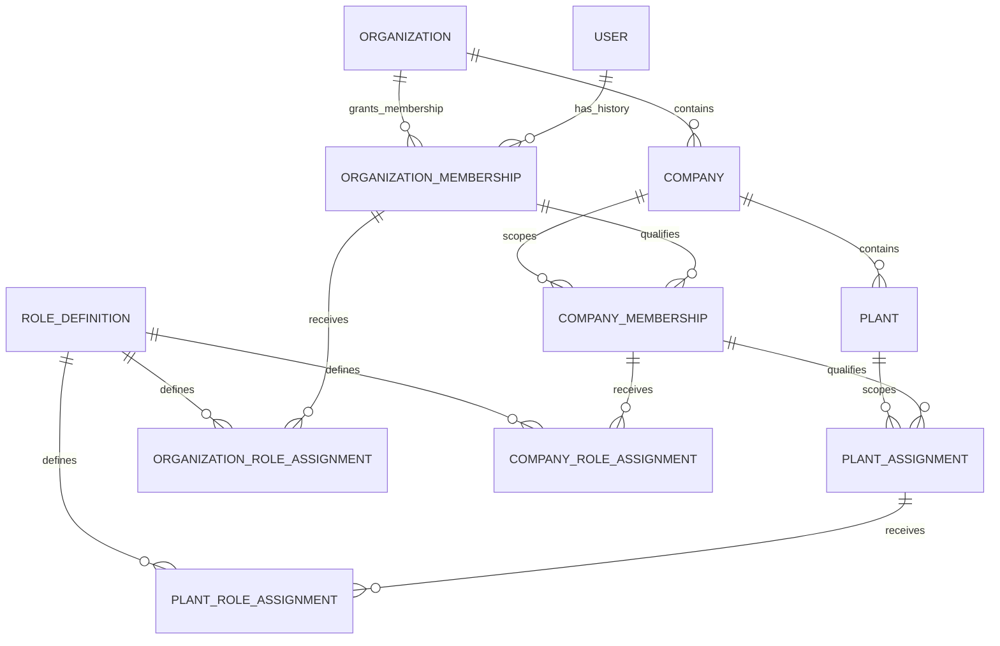

# V04.2 Tenant Scope Model & Structural Consistency Design

**Status:** Design proposal; D1–D4 are `OWNER_APPROVED` (2026-11-06); D5–D15 remain `PENDING_OWNER_APPROVAL`.  
**Scope:** Core-owned organization/company/plant scope, memberships and assignments, invitations, scoped role-assignment relationships, candidate keys/constraints, and the application authorization boundary.  
**Gate state:** V04 remains `BLOCKED`. This design is not implementation or technical-validation evidence.

## 1. Executive summary

This proposal keeps the canonical Better Auth `User` identity independent from tenant membership and authorization. The approved initial operating policy remains one organization per ERP user and single-company-first. D1 defines which organization-membership states occupy that user's one organization slot: ACTIVE and SUSPENDED occupy it; PENDING, REVOKED, and ENDED do not. PENDING grants no ERP access; SUSPENDED denies access. Under D2, pre-registration invitations are separate, non-authorizing `Invitation` records; only verified redemption resolved to the canonical user and validated against D1 may create an ACTIVE membership. D3 approves restoration from SUSPENDED on the same membership record, makes REVOKED and ENDED terminal, and requires a new membership record for any later grant after either terminal state. D4 approves current-state membership semantics: current status determines effectiveness, lifecycle timestamps are audit/history metadata only, and scheduled or backdated membership state changes are not supported in the initial design. Membership and descendant history remain preserved; none of these policies makes a membership or role an authorization decision by itself. The proposed persistence model represents organization association as lifecycle-bearing `OrganizationMembership` records, not a uniqueness rule on `User`; company membership and explicit plant assignment are separate rows; scoped role assignments attach to the applicable membership/assignment instead of creating scope or access by themselves.

The proposal recommends stable surrogate IDs for membership/assignment episodes so ended records can be retained and a later grant can have a distinct history. It recommends structural parent consistency through per-edge foreign keys and selective composite keys: company→organization, plant→company-with-organization, company membership→its organization membership and company, and plant assignment→its company membership and plant. The key tuples below are candidates, not approved P05 edge choices. A valid FK establishes structural association only; current status, applicable lifecycle/time-window policy where separately approved, permission, and resource authorization remain server-side checks. Under D4, membership timestamps are audit/history metadata, not temporal authorization windows.

D1, D2, D3, and D4 resolve the organization-slot semantics, invitation policy, suspension/revocation/regrant history, and membership current-state/timestamp semantics, respectively; none implements its enforcement. Remaining owner decisions include active duplicate rules for company memberships/plant assignments, scope-specific role assignment and custom-role ownership, service-principal representation if in scope, and individual P05 relationship/delete actions. D5–D15 remain pending owner approval; recommendations and consequences are recorded in Section 10. D3 and D4 approve no P05 edge, role policy, or lifecycle rules beyond their respective approved decisions.

This is a conceptual/physical mapping proposal for review only. It does not modify Prisma, migrations, authorization, or tests. Exact compound-key and migration behavior must be validated against the pinned Prisma/PostgreSQL/provider set before implementation.

## D1. Organization Membership Slot Semantics — OWNER_APPROVED

**Owner approval date:** 2026-11-06. No approver identity or additional approval detail is recorded.

| Membership state | Occupies organization slot | Grants ERP access |
|---|---|---|
| `PENDING` | No | No |
| `ACTIVE` | Yes | Potentially, subject to authorization |
| `SUSPENDED` | Yes | No |
| `REVOKED` / `ENDED` | No | No |

Approved invariants:

1. A canonical user may have at most one organization membership occupying the organization slot at any given time.
2. `ACTIVE` and `SUSPENDED` memberships both occupy that slot.
3. `PENDING` memberships do not occupy the slot and cannot grant ERP access.
4. `REVOKED` and `ENDED` memberships do not occupy the slot.
5. A suspended membership denies ERP access but does not permit reassignment until the previous membership has been formally ended.
6. Reassignment must end the previous slot-occupying membership before activating a new organization membership.
7. Historical membership records must be preserved.
8. Database-level concurrency protection must prevent concurrent transitions from creating multiple slot-occupying memberships.
9. Membership state alone is not sufficient authorization. Current session, membership, scope, role, and resource authorization must still be checked server-side.

**Implementation status:** Not implemented or validated. A PostgreSQL partial unique index on the canonical user ID with predicate `status IN ('ACTIVE','SUSPENDED')` is a candidate database guard, not a selected or tested migration. It requires Prisma/PostgreSQL compatibility validation, a reviewed forward migration, concurrent transition tests, tests for every state transition, and fresh migration replay. None of that evidence is claimed here.

## D2. Invitation Handling — OWNER_APPROVED

**Owner approval date:** 2026-11-06. No approver identity or additional approval detail is recorded.

Approved policy:

1. SAP Core supports invitations to people who do not yet have a canonical Better Auth account.
2. An invitation is a separate `Invitation` record, not an `OrganizationMembership`.
3. An invitation may be sent to an email address and must have a cryptographically secure, single-use token with an expiration time.
4. An invitation does not create an account, grant ERP access, occupy an organization membership slot, or independently authorize any operation.
5. The recipient must register or authenticate and verify ownership of the invited email address before redemption.
6. Redemption must resolve to the canonical Better Auth `User` identity. Email is an invitation delivery and verification attribute, never the canonical identity or authorization principal.
7. Only after successful identity verification and validation of the invitation may the system create an `ACTIVE` `OrganizationMembership`.
8. Before activation, enforce D1's approved organization-slot invariant; do not create a second slot-occupying membership for any canonical user. If the user already has an `ACTIVE` or `SUSPENDED` membership in another organization, redemption must fail closed until that membership is formally ended.
9. Expired, revoked, already redeemed, or otherwise invalid invitations cannot be redeemed.
10. Invitation redemption must be atomic and concurrency-safe: duplicate or concurrent redemption must not create duplicate memberships or bypass D1's slot constraint.
11. Preserve invitation and membership lifecycle/audit history according to the future approved retention policy.

**Implementation status:** Invitation schema, token generation/storage, email-verification integration, redemption transaction, concurrency protection, migrations, and tests remain unimplemented and unvalidated. Token storage representation and exact P05 relationship edges remain technical/design validation items; D2 does not approve any additional P05 edge, role policy, or other lifecycle decision.

## D3. Suspension, Revocation, and Regrant History — OWNER_APPROVED

**Owner approval date:** 2026-11-06. No approver identity or additional approval detail is recorded.

Approved policy:

1. A `SUSPENDED` `OrganizationMembership` may be restored to `ACTIVE` on the same membership record, subject to required authorization. Record suspension and restoration in auditable history.
2. `REVOKED` and `ENDED` are terminal states. A membership in either state is never reactivated or reopened.
3. A grant after a membership reaches `REVOKED` or `ENDED` creates a new `OrganizationMembership` record; do not overwrite or reopen the historical episode.
4. Preserve membership history, including grant, suspension, restoration, revocation, and ending history. Preserve `CompanyMembership` and `PlantAssignment` history as well.
5. Descendant entitlements are ineffective whenever their parent `OrganizationMembership` is not currently effective. Do not cascade-delete descendant history. Any descendant invalidation or lifecycle updates must retain the original records.
6. Restoring a membership does not restore sessions that were already revoked. Protected operations must check the current membership and scope; a valid session alone does not establish current entitlement.
7. Preserve D1's organization-slot rules. A suspended membership continues to occupy the slot; before another organization membership can occupy it, the suspended membership must be formally transitioned to terminal `ENDED` or `REVOKED`. Reassignment must still end the prior slot occupant before activating another membership.

D3 approves only these membership lifecycle and history semantics. It does not approve any P05 relationship edge, role policy, or other lifecycle rule; D4 is recorded separately below.

**Implementation status:** Transition implementation, auditable-history storage, descendant invalidation, transaction/concurrency handling, migrations, and tests remain unimplemented and unvalidated. D3 approval is policy approval only and is not evidence of technical validation.

## D4. Effective-Date Semantics — OWNER_APPROVED

**Owner approval date:** 2026-11-06. No approver identity or additional approval detail is recorded.

Approved policy:

1. Membership uses current-state semantics. Its current status is the source of truth for determining whether the membership is effective.
2. Record lifecycle timestamps as audit/history metadata, including grant/creation, activation, suspension, restoration, revocation, and ending times as applicable to the transition.
3. Scheduled membership activation and backdated membership state changes are not supported in the initial design.
4. No temporal interval-overlap constraint is required for membership in the initial design.
5. D1's organization-slot invariant remains unchanged.
6. Audit timestamps do not imply or support scheduled or backdated authorization; they must not be interpreted as temporal validity intervals.

**Implementation status:** D4 policy approval is not implementation or technical-validation evidence. Timestamp schema, audit-history storage, lifecycle transition implementation, migrations, concurrency handling, and tests remain unimplemented and unvalidated.

## 2. Approved constraints and boundary

| Source decision | Constraint carried into this proposal | Not inferred or reopened |
|---|---|---|
| P02 / canonical identity | Better Auth authenticates and persists the canonical ERP user identity; ERP membership and authorization are separate from auth accounts/sessions. The current Prisma model maps that persistence to `core.user`; retain the adapter-selected ID type for every FK. | No second ERP login identity, Better Auth organization role, session hint, or email value is a tenant grant. The actual adapter/model mapping remains subject to P02 validation. |
| P03 / organization | Initial operating policy: one organization per ERP user; single-company-first; preserve membership/assignment relationships rather than a permanent global uniqueness rule on the canonical user. D1 separately approves organization-slot state and reassignment ordering; D3 approves suspension restoration and terminal revocation/ending with a new record for any later grant; D4 approves current-state membership effectiveness and audit-only lifecycle timestamps. | No permanent `UNIQUE(User.id)`-based one-organization rule; D1, D3, and D4 enforcement/history implementation remain unimplemented and unvalidated. D4 excludes scheduled or backdated membership state changes and requires no initial membership overlap constraint. |
| P03 / company and plant | Organization membership and company membership are distinct; company membership is explicit; plant access requires explicit assignment. Roles may differ by company or plant. | Organization membership does not grant every company; company membership does not grant every plant. |
| P04 / roles | Hybrid system/custom roles; explicit permission inheritance; deny overrides allow within the applicable scope; Platform Admin and Tenant Admin remain distinct; controlled break-glass; dedicated service identities; SoD and audit. | Detailed grants, role catalog ownership, role-to-scope compatibility, and enforcement are not finalized by this proposal. |
| P05 / relationships | Select FK, selective composite FK, or application reference per edge, with an explicit owner, invariant, lifecycle, nullability, action, migration, and test. FKs do not grant access. | X01–X05 are candidates, not individually approved physical edges. No blanket composite FK or cascade rule is assumed. X06's approved Restrict behavior is unrelated to these new relationships. |
| P07 / ownership | Core owns the conceptual organization/company/plant, canonical user, membership, assignment, and authorization-assignment concepts. Each persistent business entity has one logical write owner and lifecycle. | This conceptual assignment does not finalize every aggregate, field, custom-role owner, or physical model. |
| P08 / persistence | One governed Prisma model/client and migration history; explicitly map models to their owning schema; PostgreSQL FKs are the baseline, with per-edge validation; Prisma Migrate is the governed migration path. | No claim is made that a particular compound relation or SQL constraint is supported by the selected exact toolchain until generated schema/SQL and migrations are tested. |
| P10 / freshness | Protected operations use current account/session and current membership/scope; changes affect protected operations on the next request under a bounded, tested propagation policy. | No specific propagation bound, cache TTL, or membership-status API is selected here. |

The approved P03 model and trusted-scope sequence are in `docs/phase-0.1/03-organizational-model.md`; P04 separation and enforcement are in `04-authorization-scope-model.md`; per-edge integrity rules are in `05-cross-schema-relationship-policy.md`; conceptual ownership is in `07-entity-ownership-finalization.md`; P07/P08/P10 closures are in `docs/phase-0.2/`. The V04.1 audit records the current implementation gaps in `docs/phase-0.3/v04-tenant-isolation-audit.md`.

## 3. Entity relationship model

### 3.1 Conceptual ER diagram

The diagram shows logical relationships and history-capable multiplicities, not a final physical schema, approved FK list, or permission inheritance rule. The initial one-organization/single-company policy is a constraint on operation and onboarding, not a reason to collapse the relationship entities.

The proposed role-assignment design treats `ScopedRoleAssignment` as one conceptual relationship with scope-specific physical assignment rows. That avoids a polymorphic membership FK and lets each assignment point to the precise organization membership, company membership, or plant assignment that establishes its scope. Whether this subtype design is preferred over a single nullable-scope table is an owner decision listed below.

### 3.2 Responsibility, ownership, parent, and lifecycle

| Entity | Responsibility and owner | Parent / relation | Proposed lifecycle boundary |
|---|---|---|---|
| **Core User** | Canonical ERP principal, owned by Core; Better Auth account/session persistence remains authentication infrastructure. | No organization/company parent. It may have many historical organization memberships and many company/plant membership relationships through their own records. | Auth account/session lifecycle is P02/P10. Do not delete/recreate a user to transfer tenant scope; current hard deletion is disabled and auth FKs are Restrict. Membership lifecycle is independent. |
| **Organization** | Initial tenant context, owned by Core. Does not automatically represent a jurisdiction/legal entity. | Parent of companies and organization memberships. | Provision, activate, suspend/retire under a future core lifecycle policy. Retire/restrict children rather than cascade-delete access/history. Exact lifecycle and decommissioning are not selected here. |
| **Organization Membership** | Records a user's organization association and its lifecycle; owned by Core. It is the initial tenant-context entitlement input, not a Better Auth role. | One Core User and one Organization. Parent scope for company memberships and organization-scoped role assignments. | Preserve a distinct row per membership episode and auditable grant, suspension, restoration, revocation, and ending history. D1 defines slot occupancy; D3 permits restoring SUSPENDED to ACTIVE on the same row, makes REVOKED and ENDED terminal, and requires a new row for a later grant. Under D4, current status determines membership effectiveness; lifecycle timestamps are audit/history metadata only, with no scheduled or backdated membership state changes or initial overlap constraint. |
| **Company** | Operating/accounting boundary owned by Core. Initial product is single-company-first; the conceptual data model need not hard-code permanent singleton cardinality. | Exactly one Organization parent; may have plants and explicit company memberships. | Activate/retire under Core lifecycle; cannot be removed while memberships, plants, or dependent owned records require it. Parent deletion behavior is per-edge. |
| **Company Membership** | Explicit user's company entitlement, owned by Core. It is separate from organization membership and is required for company-scoped authorization inputs. | One user, the corresponding organization membership, and one company under the same organization. | Preserve each relationship episode; access is ineffective whenever its parent Organization Membership is not currently effective. Do not cascade-delete history. Revoke/expire rather than delete. Exact duplicate and reassignment semantics need approval. |
| **Plant** | Operational site, owned by Core. It does not itself grant access. | Exactly one Company and, for structural consistency, the same Organization as that Company. | Activate/retire under Core lifecycle; keep historical references valid as needed; do not cascade-delete durable operational facts. |
| **Plant Assignment** | Explicit user access-scope relationship to a plant, owned by Core. Company membership does not imply this relationship. | One user, one company membership, and one plant under that membership's company and organization. | Preserve each assignment episode. It is ineffective whenever its parent Company Membership or Organization Membership is not currently effective; do not cascade-delete descendant history. Grant/revoke/expire independently, with each history change attributable. |
| **Scoped Role Assignment** | Assigns a role definition to an already-established membership scope; assignment concept owned by Core. It is an authorization input, not membership itself. | Organization assignment attaches to Organization Membership; company assignment to Company Membership; plant assignment to Plant Assignment. | Grant/revoke/effectivity and audit are separate from membership status. A role assignment cannot extend or revive its parent membership. Role catalog ownership and grant lifecycle need owner decision. |
| **Role Definition** *(supporting entity)* | Describes a system or custom role name/version and its governed permission references. A separate definition is warranted by P04's hybrid roles and multiple assignments; it must not be duplicated as arbitrary role strings on memberships. Candidate owner is Core for the authorization catalog, with organization ownership for tenant-defined records only if approved. | Referenced by the three scoped assignment types; custom role records may require an owning organization if the owner selects tenant-defined roles. | Retire/version rather than mutate historical grant meaning silently. Exact catalog owner, tenant-customization, and permission representation remain unresolved. |
| **Invitation** *(supporting entity; D2 approved)* | A separate invitation record for an intended Organization and invited email; it is not an Organization Membership, User, entitlement, or authorization principal. | Targets an email before canonical Better Auth identity exists; after authenticated registration or sign-in and verified email ownership, valid redemption resolves the canonical User and may create an ACTIVE Organization Membership subject to D1. The exact physical relation remains subject to P05 approval. | Cryptographically secure single-use token and expiration; invalid, revoked, expired, or redeemed invitations cannot be redeemed. Preserve invitation and membership lifecycle/audit history under the future approved retention policy. Token storage, redemption, schema, and migration remain unimplemented and unvalidated. |

### 3.3 Why the relationships are separate

- **Organization Membership** cannot be a `user.organizationId` field: P03 explicitly preserves membership history and future policy change without a permanent user-identity constraint. The row also has its own grant/revocation/audit lifecycle.
- **Company Membership** cannot be inferred from Organization Membership: company-level access is explicit under P03, and it may carry distinct company-scoped roles.
- **Plant Assignment** cannot be inferred from Company Membership: plant access is explicitly assigned and may have its own roles/effectivity.
- **Scoped Role Assignment** cannot be stored as a role column on a user or membership: one principal may have different roles at organization, company, and plant scopes; assignments need independent grant/revocation/audit history and explicit permission rules.
- **Role Definition** is a supporting catalog object because P04 approves hybrid system/custom roles. Role codes on assignment rows alone would not provide a governed owner, definition lifecycle, or stable permission meaning.
- **Invitation** is a separate, non-authorizing record under approved D2 for pre-registration onboarding. It must not be represented as an Organization Membership; redemption follows verified email ownership, resolves the canonical Better Auth User, checks D1's slot invariant, and atomically creates an ACTIVE Organization Membership only when the invite is valid. D2 does not approve physical FK edges or token-storage implementation.

## 4. Cardinality matrix

“Initial policy” is the approved product operating rule; it is deliberately distinguished from a permanent database shape. Database constraints below are candidates subject to P05 approval and validation. Application checks remain necessary even where a constraint exists.

| Relationship | Initial product operating policy | Conceptual/history cardinality | Candidate database enforcement | Application enforcement / future history |
|---|---|---|---|---|
| User → Organization Membership → Organization | An ERP user belongs to one organization under the initial policy; D1 specifies which membership states occupy the slot, D3 specifies restoration and terminal regrant history, and D4 specifies current-state effectiveness. | A user may have zero memberships before onboarding and many historical membership episodes; each episode refers to exactly one user and one organization. Restore from SUSPENDED on the same row; after REVOKED or ENDED, any later grant is a new row. Current status determines effectiveness; lifecycle timestamps are audit/history metadata, not authorization intervals. No scheduled activation or backdated state changes. An organization has zero or many members. | FKs to User and Organization. Candidate partial unique index on `OrganizationMembership.userId` with predicate `status IN ('ACTIVE','SUSPENDED')`; PENDING, REVOKED, and ENDED rows are outside the index. Do not put uniqueness on User itself; D4 requires no temporal overlap constraint for membership in the initial design. | Resolve exactly one applicable membership for a human principal; fail closed on zero or multiple slot-occupying memberships. Serialize transitions and retain every episode and transition history. A suspended membership must become terminal before another membership occupies the slot. Do not interpret audit timestamps as scheduled/backdated authorization. Any future multi-organization policy requires an explicit product decision and revised constraint/tests. |
| Invitation → canonical User → Organization Membership | D2 approves a separate invitation record for a person without a canonical account; invitation itself never grants access or occupies a membership slot. | Each invitation targets an intended organization and invited email; redemption resolves a verified canonical User and may produce at most one ACTIVE Organization Membership. Invitation creation does not create User or Membership. | Candidate Invitation model and constraints only. Any Organization/User/Membership FK, token-storage shape, or uniqueness strategy requires separate technical/P05 review; D2 approves no physical edge. | Verify invited-email ownership, resolve canonical User, validate one-time/unexpired/unrevoked invitation and D1 slot, then consume atomically and create the membership. Fail closed on invalid or duplicate redemption; preserve history under future approved retention policy. |
| Organization → Company | Initial product is single-company-first and starts with one company. | An organization has zero or many companies across its lifecycle; each company has exactly one organization. | Non-null FK `Company.organizationId → Organization.id`; candidate alternate unique `(organizationId,id)` for composite child FKs. No permanent unique constraint on `Company.organizationId` is proposed. | Provision the initial company per product setup; do not expose multi-company workflow until approved. Model and migrations can still represent future companies without redesign. |
| Organization Membership → Company Membership ← Company | Organization membership alone does not grant every company. Company membership is explicit; initial scope is single-company-first. | An organization membership may have zero or many company-membership episodes; each company membership references exactly one matching organization membership and company. A company has zero or many member episodes. | FKs to User, the parent Organization Membership (including user and organization), and Company (including organization). Candidate partial unique on `(userId, companyId)` for the owner-selected set of current states; no uniqueness that erases historical rejoin episodes. | Validate parent membership and company scope/status on every protected operation. Multiple current companies remain disabled by initial product policy, not by globally unique canonical identity. Decide whether duplicate active company-membership rows are invalid. |
| Company → Plant | A company may contain plants; initial product can use one or more according to selected setup, but no access follows automatically. | A company has zero or many plants; each plant belongs to exactly one company. | Non-null composite FK candidate `(Plant.organizationId, Plant.companyId) → Company.(organizationId,id)`; candidate unique `(organizationId,companyId,id)` for dependent scope FKs. | Confirm the company and plant are active and the requested resource is plant-scoped. A valid parent FK does not grant a user access. |
| Company Membership → Plant Assignment ← Plant | Company membership does not grant plant access; assignment must be explicit. | A company-membership episode may have zero or many plant-assignment episodes; each assignment references exactly one member, that member's company membership, and a plant in the same company/organization. A plant has zero or many assigned users. | FKs to User; composite FK to Company Membership over stable membership ID/user/org/company; composite FK to Plant over org/company/plant. Candidate partial unique `(userId,plantId)` for currently effective assignment if the owner chooses one row per user/plant. | Check assignment and all ancestor memberships are current, and that the target operation requires the selected plant. Record reassignment/revocation without deleting history. |
| Membership/assignment → scoped Role Assignment → Role Definition | Roles may differ by company/plant; only explicitly defined inheritance applies. | A membership/assignment may have zero or many role grant episodes; each assignment has exactly one role definition and one scope parent. Multiple roles can exist at one scope unless owner-selected policy narrows them. | Prefer scope-specific assignment FKs to the exact membership/assignment and Role Definition. Candidate active uniqueness by parent + role + assignment scope; time-overlap constraints depend on temporal model. | Verify parent membership/assignment is current, role is enabled and applicable to scope, and the requested action is allowed. Never infer child-scope grants from a parent role unless an explicit P04 policy says so. |

### Database-enforced versus application-enforced cardinality

- **Good database candidates:** parent existence; non-null required parent columns; same-organization/company composite relationships; stable row identity; duplicate current rows when a clear status-based partial-unique predicate is approved; uniqueness of an explicitly scoped role code if that catalog policy is approved.
- **Not an FK guarantee:** active membership, current time window, enabled company/plant, requested action, role inheritance, field-level restrictions, or whether the target business record is in the allowed scope. These require authorization-time server checks, and where appropriate same-transaction owner checks.
- **Initial one-organization rule:** D1 approves one slot-occupying membership per canonical user: rows with `status IN ('ACTIVE','SUSPENDED')` occupy the slot; `PENDING`, `REVOKED`, and `ENDED` do not. D3 approves same-row restoration from `SUSPENDED` and a new row after terminal `REVOKED`/`ENDED`. D4 confirms current-state membership effectiveness and that lifecycle timestamps are audit/history metadata only; scheduled/backdated membership state changes and a temporal overlap constraint are not part of the initial design. The candidate partial unique index is on membership rows, not `User`, and is not yet implemented or validated. Any future `EXPIRED` label must be mapped to an approved state before it affects slot enforcement.
- **Single-company-first:** do not create `UNIQUE(Company.organizationId)` solely to encode an initial product rollout. Enforce the initial supported workflow in provisioning/application policy unless the owner explicitly approves a permanent physical one-company invariant.

## 5. Membership lifecycle

D1's organization-slot state semantics, D2's invitation policy, D3's suspension/revocation/regrant history policy, and D4's current-state membership timestamp policy are owner-approved. These approvals do not imply that a state or invitation is an authorization grant or finalize every membership lifecycle detail. `PENDING`, `ACTIVE`, `SUSPENDED`, `REVOKED`, and `ENDED` are the states named by D1; D3 makes `REVOKED` and `ENDED` terminal. Under D4, current membership status is the effectiveness source of truth; lifecycle timestamps are audit/history metadata only, and scheduled activation/backdated membership state changes are unsupported in the initial design. Any additional label such as `EXPIRED` must be mapped to an approved state before it affects slot enforcement.

### Invitation and activation

1. An invitation is its own lifecycle-bearing `Invitation` record, never an `OrganizationMembership`. It may address a person by email before canonical account creation, but it creates no account, grants no ERP access, occupies no membership slot, and authorizes no operation.
2. The invitation carries a cryptographically secure, single-use redemption token and expiration. Expired, revoked, redeemed, or otherwise invalid invitations must fail closed. Token storage format and email delivery implementation are not selected or validated here.
3. The recipient must register or authenticate and verify ownership of the invited email before redemption. Redemption resolves that authenticated person to the canonical Better Auth `User`; email is a delivery/verification attribute only, never identity or authorization principal.
4. After validating the invitation and verified canonical identity, enforce D1's slot invariant. If the user already has an `ACTIVE` or `SUSPENDED` membership occupying another organization's slot, redemption fails closed until that membership is formally ended. Only then may redemption create an `ACTIVE` Organization Membership.
5. Invitation validation, slot check, single-use consumption, and membership creation must be one atomic, concurrency-safe transition. Retries, duplicate requests, or racing redemptions cannot produce duplicate memberships or bypass D1's slot guard. Preserve invitation and membership lifecycle/audit history under the future approved retention policy.
6. An invitation itself never authorizes a company or plant. Company Membership and Plant Assignment remain separately granted after parent entitlement and hierarchy checks; no additional scope or role policy is approved by D2.
7. Invitation schema, token generation/storage, email-verification integration, redemption transaction, concurrency protection, migrations, and tests remain unimplemented and unvalidated. D2 does not approve any physical P05 invitation edge.

### Suspension, revocation, and regrant

- **Suspension (D1 approved):** preserve the membership row, make it ineffective for ERP access, and continue to occupy the user's one-organization slot. A suspended membership therefore denies access but does not permit reassignment until formally ended.
- **Revocation/end (D1 and D3 approved):** `REVOKED` and `ENDED` rows do not occupy the slot or grant access, and are terminal. Preserve their historical records; do not cascade-delete Company Membership, Plant Assignment, or role-grant history. Descendant entitlements are ineffective whenever their parent Organization Membership is not currently effective. Recheck the full current parent chain on every protected operation; any descendant invalidation or lifecycle updates must retain descendant history.
- **Reassignment (D1 and D3 approved ordering):** a SUSPENDED membership continues to occupy the slot and must be formally transitioned to terminal `ENDED` or `REVOKED` before another organization membership can occupy it. End the previous slot-occupying membership before activating a new organization membership. The operation must not change `User.id`, delete history, or silently move company/plant relationships. New Company Membership and Plant Assignment records are explicit and do not carry over by inference. A new `PENDING` row may precede the transfer, but it cannot authorize access or activate until the old slot is terminal.
- **Restoration and regrant (D3 approved):** restore `SUSPENDED` to `ACTIVE` on the same `OrganizationMembership` record, subject to required authorization, and record the transition in auditable history. Never reactivate or reopen `REVOKED` or `ENDED`; a later grant creates a new membership record. Restoring the membership does not restore already-revoked sessions. D3 does not approve a role policy or any additional lifecycle rule.
- Role assignments and descendant entitlements must not remain effective when their parent Organization Membership is not currently effective. Parent-state validation is mandatory; do not cascade-delete descendant history.

### History and lifecycle timestamps

- Preserve a distinct row for each membership episode and preserve grant, suspension, restoration, revocation, and ending history. Record creation/grant and activation, suspension, restoration, revocation, and ending timestamps as applicable, with transition actor and other approved audit metadata. D3 requires auditable transition history and D4 defines these timestamps as audit/history metadata; neither decision selects the storage implementation. Security audit events remain separate governed records; do not store tokens or unnecessary payloads in membership rows. Preserve Company Membership and Plant Assignment history as well.
- D4 approves current-state membership semantics: the current membership status is the source of truth for effectiveness. Scheduled membership activation and backdated membership state changes are unsupported in the initial design, lifecycle timestamps do not imply temporal validity windows, and no temporal interval-overlap constraint is required for membership initially. These audit timestamps must not be interpreted as support for scheduled or backdated authorization.
- D3 resolves the membership episode rules: restore SUSPENDED on the same row; REVOKED and ENDED remain terminal; a later grant after either terminal state creates a new row. Descendant entitlements remain ineffective while the parent Organization Membership is not currently effective, without deleting descendant history. D4 does not alter D1's organization-slot invariant.

### Duplicate and concurrent membership changes

D1 requires at most one slot-occupying membership per canonical user at a time. All grant/activation/suspend/revoke/reassign paths must enforce that invariant, including concurrent invite acceptance, administration, same-record restoration, new-episode regrant, and bulk provisioning. D3 approves these lifecycle outcomes but does not select their transaction or concurrency implementation.

Required implementation safeguards (not yet implemented or tested):

1. Run transitions in a transaction and lock the canonical user row (or use an equally explicit per-user serialization mechanism) before reading/changing slot rows.
2. Re-read the current membership status inside that transaction; D4 makes it the source of truth for membership effectiveness. Validate expected versions and idempotency for retryable commands; do not use audit timestamps as temporal authorization intervals.
3. Use the candidate PostgreSQL partial unique index on canonical user ID with predicate `status IN ('ACTIVE','SUSPENDED')` as a database backstop. It is not a unique constraint on `User` and leaves `PENDING`, `REVOKED`, and `ENDED` history outside the slot index.
4. For reassignment, end the prior ACTIVE or SUSPENDED row before activating the new membership, within the governed transition transaction. A concurrent attempt must fail/serialize rather than commit a second slot-occupying row.
5. D4 does not support scheduled membership activation or backdated membership state changes in the initial design, so no temporal interval-overlap constraint is required for membership. This decision does not determine temporal semantics for Company Membership, Plant Assignment, or role assignments; those remain subject to their applicable owner decisions.
6. Apply analogous company/plant duplicate guards only after D6 is approved. Role grants may be multiple; their uniqueness and overlap semantics are separate.
7. Emit attributable audit events for grants, transitions, and failed high-risk administrative attempts under the approved audit policy. Conflicts fail closed and do not create another active membership.

The D1, D3, and D4 policies are decided; their transition/timestamp implementation and database enforcement are not. The partial-index proposal and D3/D4 transition, timestamp-schema, and history behavior require Prisma/PostgreSQL compatibility validation, reviewed forward migrations, transaction/concurrency handling, tests for every approved state transition, and fresh migration replay. D4 requires no temporal membership overlap guard in the initial design. None of this implementation or validation evidence is claimed to exist or to have passed.

## 6. Structural integrity proposal

All rows below are Core-owned conceptual candidates. Names and key types are proposals: P07's UUID direction applies to ERP-owned identifiers, while the canonical Better Auth user ID remains adapter-selected and is currently modeled as `String`. Each edge and referential action below remains subject to P05 owner review and exact Prisma/PostgreSQL validation.

| Entity / edge | Candidate key and columns | Candidate constraint, index, and reason | Candidate referential action / lifecycle |
|---|---|---|---|
| Organization | `Organization.id` candidate UUID primary key. Optional business code is not defined here. | PK; any code uniqueness/normalization needs a business decision. | Referenced organization is retired, not physically deleted while child relationships exist. |
| Company → Organization (P05 X01) | `Company.id` candidate UUID PK; required `organizationId`. | FK `organizationId → Organization.id`; alternate unique `(organizationId,id)` so composite descendants can prove same parent. Index `organizationId`; PostgreSQL does not automatically index referencing FK columns. | Candidate `RESTRICT`/non-destructive retirement while companies/records exist, consistent with X01's candidate; X01 still needs individual approval. |
| Plant → Company (P05 X02) | `Plant.id` candidate UUID PK; required `organizationId`, `companyId`. | Composite FK `(organizationId,companyId) → Company(organizationId,id)` prevents a plant from pairing a real company with a different organization. Candidate unique `(organizationId,companyId,id)` for child assignments. Index the child FK tuple. | Candidate `RESTRICT`; deactivation/retirement instead of cascading operational history. X02 is not individually approved. |
| Organization Membership → User / Organization (P05 X03) | `OrganizationMembership.id` candidate UUID PK; `userId` uses the Better Auth scalar type; required `organizationId`; status/effective/audit fields. | FKs `userId → User.id` and `organizationId → Organization.id`. Candidate unique `(id,userId,organizationId)` permits a child FK to validate the exact historical parent, including subject and scope. Candidate partial unique index on canonical `userId` with `status IN ('ACTIVE','SUSPENDED')` enforces D1's one-slot invariant while leaving `PENDING`, `REVOKED`, and `ENDED` history outside the index. Index `(userId,status)` and `(organizationId,status)` for resolution/admin queries. | Candidate `RESTRICT`; end/revoke rather than delete. D1 defines the index predicate semantically, but the database guard is not implemented or validated. X03 still requires per-edge P05 selection. |
| Company Membership → User / Organization Membership / Company (P05 X04) | `CompanyMembership.id` candidate UUID PK; `userId`, `organizationMembershipId`, `organizationId`, `companyId`; state/effectivity fields. | Simple User FK; composite FK `(organizationMembershipId,userId,organizationId) → OrganizationMembership(id,userId,organizationId)`; composite FK `(organizationId,companyId) → Company(organizationId,id)`. Candidate unique `(id,userId,organizationId,companyId)` for child plant/role references. Index `(userId,organizationId,companyId,status)`, parent FK tuples, and `(organizationId,companyId,status)`. Candidate partial unique `(userId,companyId)` for approved current states; do not unique over all history. | Candidate `RESTRICT`; preserve history and end/revoke. Parent FK proves the referenced organization-membership row and hierarchy, not that it is currently active. X04 remains a per-edge choice. |
| Plant Assignment → User / Company Membership / Plant (P05 X05) | `PlantAssignment.id` candidate UUID PK; `userId`, `companyMembershipId`, `organizationId`, `companyId`, `plantId`; state/effectivity fields. | Simple User FK; composite FK `(companyMembershipId,userId,organizationId,companyId) → CompanyMembership(id,userId,organizationId,companyId)`; composite FK `(organizationId,companyId,plantId) → Plant(organizationId,companyId,id)`. Candidate unique target `(id,userId,organizationId,companyId,plantId)` if scoped role assignment needs it. Index user/status, membership tuple, and plant tuple. Candidate partial unique `(userId,plantId)` for owner-approved current assignments. | Candidate `RESTRICT`; explicit revoke/end; no cascade from company membership or plant. X05's precise keys/actions are unapproved and need validation. |
| Role Definition / scoped assignment | Candidate role-definition PK plus stable assignment IDs. Assignment rows refer to one scope-specific parent and one role definition. | Unique role code must be scoped according to approved global-vs-tenant catalog semantics. Index each assignment parent, role, status, and effective dates. Candidate active uniqueness by parent + role; multiple simultaneous roles may be allowed. | Retire role definitions; revoke assignments. Restrict deletion where grants/history refer to them. Exact role edge/actions are P05 decisions and role lifecycle is a P04 owner choice. |
| Invitation (D2-approved concept) | Candidate invitation UUID; intended organization; invited email; token material/storage representation, expiry, inviter, redeemed/revoked lifecycle and verified canonical User on redemption. | A distinct record, never an Organization Membership or authorization principal. Candidate Organization association and any other physical edge require separate P05 approval; email is not a canonical identity key. | Single-use, cryptographically secure token; expire/revoke/consume without cascade into membership history. Atomic redemption may create an ACTIVE membership only after verified identity and D1 slot validation. Schema, token storage, transaction, migration, and tests remain unimplemented/unvalidated. |

### Composite-key rationale and limitations

- The composite company/plant keys are proposed only where a child must prove same-parent scope. They are not a blanket pattern for all company/plant business tables. Module-specific business rows remain per-entity P05 decisions (including X08/X09).
- The row-ID-plus-subject/scope alternate unique keys let a child reference a specific historical membership episode and simultaneously prove its user and organization/company. A plain FK to `membership.id` alone proves which row exists but does not prove duplicated child scope fields agree with it.
- Historical rejoin needs multiple rows for the same user/organization or user/company/plant over time. D3 specifically requires a new Organization Membership row after a terminal `REVOKED` or `ENDED` episode, while restoration from `SUSPENDED` reuses the same row. Therefore an unconditional unique `(userId,organizationId)` or `(userId,companyId)` on membership history is not proposed. D1 approves a partial unique guard on organization-membership rows for `status IN ('ACTIVE','SUSPENDED')`; this candidate is not yet implemented or technically validated. Company/plant current-state guard choices depend on D6; D4 does not determine their time-window semantics. No `User` uniqueness is added.
- PostgreSQL does not infer same-parent consistency from separate simple FKs. If the proposed compound key cannot be expressed safely in the pinned Prisma/provider version, record that per-edge and use the P05-approved same-transaction Core contract plus a dedicated consistency test; do not silently describe an application check as a database FK.
- No `ON DELETE CASCADE` is proposed for identity/membership/assignment/role history. `RESTRICT` is a candidate, not blanket owner approval. Ordinary lifecycle transitions are status/effectivity changes; any retention or privacy erasure must follow applicable policy and owner/legal review.
- Primary keys are stable and immutable per P07. Exact `ON UPDATE` actions remain per-edge; do not repurpose keys or assume updates cascade through identity/scope relationships.
- PostgreSQL FK constraints do not automatically create indexes on referencing columns. Indexes listed above are candidates for FK checks and common scope-resolution paths; final workload and index choices require validation rather than indexing every possible column by default.

## 7. Company and plant consistency rules

### Structural (database) consistency candidates

1. **Company belongs to one organization:** `Company.organizationId` is non-null and references an Organization. Its `(organizationId,id)` candidate key allows dependent rows to reference that exact organization/company pair.
2. **Plant belongs to one company and its organization:** Plant carries both required `organizationId` and `companyId`; one composite FK points to the Company pair. Do not rely on two unrelated FKs (`companyId` and `organizationId`) because each may independently exist while describing different parents.
3. **Company Membership matches the organization membership:** Company Membership carries the parent organization-membership row ID plus the user's ID and organization ID; its composite FK targets that exact membership episode. A second composite FK requires `(organizationId,companyId)` to exist as one Company. This prevents a user belonging to organization A from structurally receiving a company-membership row for organization B.
4. **Plant Assignment matches both parents:** Plant Assignment references its exact Company Membership using membership ID + user + organization + company, and references Plant using organization + company + plant. The same user, organization, and company must therefore agree on both parent paths.
5. **Scoped Role Assignment matches the entitlement row:** The assignment references the membership/assignment at exactly its intended scope. Scope-specific models avoid an assignment whose nullable `companyId`/`plantId` disagrees with an unrelated membership row.

These are candidate FK designs. X01–X05 and any new role/invitation edges require individual P05 approval and pinned DDL/Prisma validation.

### Runtime authorization checks (not guaranteed by structural keys)

- On every protected server operation, resolve the authenticated canonical user, current account/session state, active organization membership, selected company membership, and explicit plant assignment as applicable.
- Confirm the company and plant are active and the requested business resource belongs to the permitted scope. A valid Company Membership FK or Plant Assignment FK can point to a revoked/suspended historical record; current membership and assignment status, plus any other separately approved lifecycle conditions, must be checked in the owning transaction. Under D4, membership audit timestamps are not authorization intervals.
- Require Company Membership for company access; do not treat organization membership or an organization-scoped role as company access automatically. Require Plant Assignment for plant-scoped access; do not treat company membership or a company-scoped role as plant access automatically.
- Evaluate the role/permission policy after membership/scope resolution. P04 inheritance is explicit; no parent-to-child role/access inheritance comes merely from the ERD hierarchy.
- Apply the verified scope as part of database read/write predicates. Composite FKs prevent inconsistent writes, but do not prevent reading a structurally valid row outside the principal's allowed scope.

## 8. Proposed Prisma mapping (not schema code)

All proposed models map to `@@schema("core")`, consistent with P07's Core ownership of organization, company, plant, membership, plant assignment, and authorization-assignment concepts. Names below are descriptive candidates; the actual existing `User` model/table and Better Auth adapter mapping must remain compatible with P02 and be tested. Do not modify `prisma/schema.prisma` as part of this design task.

| Proposed Prisma model | Key field concepts and relations | Mapping note |
|---|---|---|
| `User` *(existing)* | Existing adapter-selected `id`; reverse relations to organization/company memberships and plant assignments. | Remains canonical authentication/ERP identity. Do not add a tenant FK or organization-specific unique field to User. Preserve Better Auth's actual table mapping. |
| `Organization` | `id` candidate UUID; lifecycle/status and timestamps; `companies`, `memberships`. | `@@schema("core")`; no invented legal, tax, or jurisdiction fields. |
| `Company` | `id`, required `organizationId`; organization relation; `plants`, `memberships`; candidate compound unique for `(organizationId,id)`. | `@@schema("core")`; company code/natural-key shape is unresolved. |
| `Plant` | `id`, required `organizationId`, `companyId`; Company relation over both parent fields; `assignments`. | `@@schema("core")`; compound unique candidate for `(organizationId,companyId,id)`. |
| `OrganizationMembership` | `id`, `userId`, `organizationId`, proposed lifecycle status and audit timestamp concepts; User and Organization relations; company memberships and organization role assignments. | `@@schema("core")`; relation tuple `(id,userId,organizationId)` may be needed for composite child relations. D4 makes current status authoritative and lifecycle timestamps audit/history metadata only; no temporal membership overlap constraint is required initially. Timestamp schema and the D1 partial unique guard remain unimplemented and require review/validation. |
| `CompanyMembership` | `id`, `userId`, `organizationMembershipId`, `organizationId`, `companyId`, lifecycle/effectivity; User, OrganizationMembership, and Company relations; plant assignments and company role assignments. | `@@schema("core")`; composite relations must prove both same user/org and same org/company. Candidate tuple `(id,userId,organizationId,companyId)` for child references. |
| `PlantAssignment` | `id`, `userId`, `companyMembershipId`, `organizationId`, `companyId`, `plantId`, lifecycle/effectivity; User, CompanyMembership, and Plant relations; plant role assignments. | `@@schema("core")`; composite relations tie the assignment to one user-company membership and one plant in that company. |
| `RoleDefinition` | `id`, stable code/version, role kind, allowed scope category, lifecycle; optional owning `organizationId` only for organization-owned custom definitions if approved; reverse relations to assignments. | `@@schema("core")` is the proposal for shared authorization concepts. Custom-role ownership/permission storage is unresolved; avoid embedding an ungoverned permissions JSON blob. |
| `OrganizationRoleAssignment` | `id`, `organizationMembershipId`, `roleDefinitionId`, lifecycle/effectivity, grant/revoke actor references as approved. | Physical subtype of conceptual `ScopedRoleAssignment`; binds only an organization membership. |
| `CompanyRoleAssignment` | `id`, `companyMembershipId`, `roleDefinitionId`, lifecycle/effectivity and audit references. | Binds only a company membership; does not grant plant scope. |
| `PlantRoleAssignment` | `id`, `plantAssignmentId`, `roleDefinitionId`, lifecycle/effectivity and audit references. | Binds only an explicit plant assignment. |
| `Invitation` *(proposed mapping for D2-approved concept)* | Candidate `id`, intended `organizationId`, invited email, candidate token digest/storage fields, expiry, inviter, redeemed/revoked metadata, and canonical `userId` recorded on successful redemption as appropriate. | Distinct non-authorizing record; it is never a User or Organization Membership. Exact Prisma model/table, token storage, canonical-user relation, and every P05 edge remain to be designed and validated; no company or role grant is implied. |

### Prisma-specific validation notes

- The proposed user FK scalar must match the exact Better Auth-generated/model ID type; `String` reflects the current schema only, not a final P02 adapter validation.
- ERP-owned UUID IDs follow P07's UUID direction, but UUID version/default/generation remain technical choices, not selected here.
- Composite relations need matching compound unique targets and compatible scalar types/order. Validate whether the pinned Prisma version can represent every intended relation and generate the expected PostgreSQL constraints; do not assume that a diagram or `@@unique` proposal proves it.
- PostgreSQL partial unique indexes, exclusion constraints for other separately approved use cases, checks tying scope subtype to role scope, and some lifecycle guards may need explicit reviewed migration SQL. D4 requires no temporal interval-overlap constraint for membership in the initial design. P08 requires Prisma Migrate as the governed migration path; any migration-only construct must be represented/reviewed within that history and tested on fresh and upgrade paths.
- Keep domain data-access contracts owner-controlled. A central generated Prisma Client does not authorize arbitrary modules to write Core membership/role tables.

## 9. Authorization implications

This model supplies structured inputs to future server-side authorization; it does not make an authorization decision by itself.

1. **Authenticate:** use the server-verified Better Auth session to identify the canonical Core User. A valid session does not prove current ERP membership.
2. **Resolve scope:** treat route/UI/session scope as a selector. Load the current Organization Membership; validate the selected Company Membership and, for plant operations, the explicit Plant Assignment. Confirm organization→company→plant parent consistency.
3. **Resolve current lifecycle:** require active account and the current Organization Membership status on each protected operation under P10's tested freshness bound; under D4, that status is the source of truth for membership effectiveness, not lifecycle timestamps. Check Company Membership and Plant Assignment status under their applicable lifecycle policies. Suspended, expired, revoked, mismatched, or ambiguous relationships deny access. Restoring a membership does not restore a session that was already revoked; authorization must resolve the current membership and scope.
4. **Evaluate scoped role and action:** load role grants attached at the applicable scope and apply P04's hybrid role model, explicit inheritance, deny-overrides-allow, separation of duties, and resource lifecycle conditions. Do not infer a company/plant grant merely from a parent entity or parent role.
5. **Authorize the target and query:** check that the target record belongs to the resolved organization/company/plant and that the requested action is permitted. Put the same authorized scope into database filters and writes; never fetch broad data and filter after serialization.
6. **Audit and return minimum data:** record required grant/revocation and sensitive-action audit context, use a bounded non-human identity for jobs, and return only the minimum approved DTO. Cache keys partition by principal and authorized scope and are invalidated when memberships, role assignments, sessions, or scope change.

A composite FK may prove a Company Membership points through an Organization Membership to a Company in the same organization; it cannot prove either membership is active or that a role permits `read`, `update`, `export`, or a specific field. RLS, if selected later, remains defense-in-depth and depends on the V07 transaction-local pooled-context evidence documented in V04.1.

## 10. D1–D4 approved policies; unresolved D5–D15

D1, D2, D3, and D4 are `OWNER_APPROVED` as of 2026-11-06, with their exact organization-slot, invitation, suspension/revocation/regrant history, and membership current-state/timestamp policies recorded in the dedicated sections above. D1 enforcement, D2 invitation implementation, D3 transition/history implementation, and D4 timestamp-schema/history/transition implementation remain unimplemented and technically unvalidated. D5–D15 remain `PENDING_OWNER_APPROVAL`; their options and recommendations below are proposals, not approvals. P03/P04/P05/P07/P08/P10 decisions already approved are not reopened; pending questions fill details they leave open. D1–D4 do not approve additional P05 edges, role policies, or other lifecycle decisions. No approver identity or additional approval detail is inferred.

| ID | Owner question and options | Recommendation | Technical consequences | Does implementation depend on answer? |
|---|---|---|---|---|
| **D1 — Organization-slot states (`OWNER_APPROVED`, 2026-11-06)** | Approved policy: `PENDING`—does not occupy/no access; `ACTIVE`—occupies/potential access subject to authorization; `SUSPENDED`—occupies/no access; `REVOKED`/`ENDED`—does not occupy/no access. A canonical user may have at most one slot-occupying membership. Suspension blocks access and reassignment until formally ended; reassignment ends the former occupant before activating another; preserve history; prevent concurrent duplicate occupants at database level; always check session, membership, scope, role, and resource authorization server-side. | Implement the approved state semantics with a candidate partial unique index on canonical user ID for `ACTIVE` and `SUSPENDED` membership rows, plus serialized transition transactions. This remains a technical proposal, not an implementation decision. | Requires Prisma/PostgreSQL compatibility validation, reviewed forward migration, concurrent transition tests, tests for every state transition, and fresh migration replay. No such tests have passed or are claimed. | **Policy answer: resolved.** Technical implementation and validation remain required before the guard or V04 can be considered complete. |
| **D2 — Invitation handling (`OWNER_APPROVED`, 2026-11-06)** | Approved: support pre-registration invitations as separate `Invitation` records addressed by email, with cryptographically secure single-use expiring tokens. They create no account/access/membership or authorization. Recipient registers or authenticates, verifies invited-email ownership, resolves to canonical Better Auth User, and may receive an ACTIVE Organization Membership only after invitation validation and D1 slot validation; fail closed for invalid/redeemed/expired/revoked invitations or an already-occupied different organization slot. Redemption is atomic/concurrency-safe, with invitation and membership history preserved under future approved retention policy. | Implement only this approved policy: verify identity/email and invitation, serialize/atomically consume redemption, check D1's ACTIVE/SUSPENDED slot guard, then create ACTIVE Organization Membership. | Invitation schema, token generation/storage, email-verification integration, redemption transaction, concurrency protection, migrations, and tests remain unimplemented and unvalidated. D2 approves no additional P05 relationship edge, role policy, or other lifecycle rule. | **Policy answer: resolved.** Technical implementation and validation remain required before invitation handling or V04 can be considered complete. |
| **D3 — Suspension, revocation, and regrant history (`OWNER_APPROVED`, 2026-11-06)** | Approved policy: restore `SUSPENDED` to `ACTIVE` on the same `OrganizationMembership` record subject to required authorization; `REVOKED` and `ENDED` are terminal and never reactivated; a later grant after either terminal state creates a new record. Preserve auditable membership grant/suspension/restoration/revocation/ending history and preserve Company Membership and Plant Assignment history. Descendant entitlements are ineffective while the parent Organization Membership is not currently effective; never cascade-delete descendant history. Restoration does not restore already-revoked sessions. Preserve D1's slot rules, including that a suspended membership must be terminally ended or revoked before another membership occupies the slot. | Implement only these approved lifecycle/history semantics. D3 does not itself approve P05 edges, roles, or other lifecycle rules; D4 is a separate approval. | Transition implementation, audit-history storage, descendant invalidation, transaction/concurrency handling, migrations, and tests remain unimplemented and unvalidated. D3 is policy approval only. | **Policy answer: resolved.** Technical implementation and validation remain required before the lifecycle behavior or V04 can be considered complete. |
| **D4 — Effective-date semantics (`OWNER_APPROVED`, 2026-11-06)** | Approved policy: membership uses current-state semantics; current status is the source of truth for effectiveness. Record grant/creation, activation, suspension, restoration, revocation, and ending timestamps as applicable, for audit/history only. Scheduled membership activation and backdated membership state changes are unsupported in the initial design; no temporal interval-overlap constraint is required. D1's organization-slot invariant remains unchanged, and timestamps do not imply scheduled or backdated authorization. | Implement only the approved current-state and audit-metadata semantics; do not introduce timestamp-based membership authorization, scheduled activation, backdated changes, or an initial membership interval-overlap constraint. | Timestamp schema, audit-history storage, lifecycle transition implementation, migrations, concurrency handling, and tests remain unimplemented and unvalidated. D4 policy approval is not technical-validation evidence. | **Policy answer: resolved.** Technical implementation and validation remain required before the membership lifecycle behavior or V04 can be considered complete. |
| **D5 — Physical one-company invariant** | Should the initial “single-company-first” policy mean a database-enforced maximum of one company per organization, or only that provisioning/UI initially exposes one company while the model supports many? | Keep the model 0..many companies per organization and enforce the initial rollout in provisioning/product policy; do not create a permanent one-company unique constraint without an explicit product decision. | A singleton DB constraint affects onboarding, future multi-company evolution, migrations, and tests; application-only rollout allows future companies but requires product gates. | **Only if a database singleton is desired.** The base hierarchy model does not depend on that answer; the recommended design avoids a singleton constraint. |
| **D6 — Duplicate current company memberships and plant assignments** | May a user have multiple simultaneous current rows for the same user/company or user/plant (for example separate role-bearing rows), or is each relationship unique and roles separate? | One current Company Membership per user/company and one current Plant Assignment per user/plant; represent multiple roles as separate role assignments. Permit historical episodes. | Determines scoped partial-unique indexes and whether a grant may have multiple membership records per scope. | **Yes** before active unique constraints and grant workflows; basic FK hierarchy can be modeled first. |
| **D7 — Role assignment scope/inheritance and special grants** | Are roles assigned only to the matching membership scope, or may organization-scoped roles explicitly inherit into selected company/plant actions? What exact scopes/actions can Platform Admin, Tenant Admin, break-glass, and service identities receive? | Store scope-specific role assignments; default to no inheritance. Add only explicit, owner-approved inheritance/grants. Keep Platform Admin and Tenant Admin separate, and keep human membership separate from service identity. | Determines grant representation, ability evaluation, caches, audit, and whether scope-specific subtype models are sufficient. Exact grant matrix must precede CASL/authorization implementation. | **Yes** for role assignment and protected operations; not required to establish base entity FKs. |
| **D8 — Custom role catalog ownership** | Are custom roles global platform definitions, organization-owned definitions, or both? Can tenants edit system roles or only create bounded custom roles? | Core owns the catalog and system-role definitions; permit separately organization-owned custom definitions only if approved, immutable/versioned, and unable to widen the tenant boundary. | Determines `RoleDefinition` owner/scope columns, uniqueness, FK shape, versioning, cross-tenant isolation, and CRUD authority. | **Yes** before role catalog and role assignment implementation; not before modeling membership entities. |
| **D9 — P05 X01: Company→Organization edge** | Choose same-schema FK vs owning-Core transaction/application reference; confirm nullability and delete/update action. | Non-null same-schema FK `Company.organizationId → Organization.id`, candidate `RESTRICT`/retire. | Requires exact migration, indexes, and deletion tests; FK enforces parent existence only. | **Yes** before Company schema/migration. |
| **D10 — P05 X02: Plant→Company hierarchy edge** | Choose simple company FK plus application consistency, or composite FK `(organizationId,companyId)`; confirm actions. | Composite FK to `(Company.organizationId,Company.id)` to prove same organization, subject to Prisma/provider proof; candidate `RESTRICT`. | Requires matching target unique key and tested compound relation. If unsupported, record application contract fallback and add same-transaction mismatch tests. | **Yes** before Plant schema/migration. |
| **D11 — P05 X03: Organization Membership edges** | Approve User and Organization FKs, stable membership ID, and per-edge delete/update behavior. | Same-schema FKs to User and Organization; retain history and candidate `RESTRICT` rather than cascade delete. | FKs do not enforce one current membership or status; active-slot guard is separate. | **Yes** before membership migration. |
| **D12 — P05 X04: Company Membership edges** | Approve User, Organization Membership, and Company references; choose simple versus composite tuples and actions. | User FK; composite membership reference containing membership ID/user/org; composite Company reference containing org/company; candidate `RESTRICT`. | Matching alternate unique keys and generated compound FKs are required; parent status remains runtime-checked. | **Yes** before Company Membership migration. |
| **D13 — P05 X05: Plant Assignment edges** | Approve User, Company Membership, and Plant references; choose simple/composite key tuples and actions. | User FK; composite Company Membership tuple containing assignment ID/user/org/company; composite Plant tuple containing org/company/plant; candidate `RESTRICT`. | Proves consistent scope structurally but not active entitlement. Requires compound-target validation and direct wrong-parent insert tests. | **Yes** before Plant Assignment migration. |
| **D14 — Role relationship and deletion edges** | Approve the selected scope-specific role-assignment→membership/assignment and role-definition FKs, including lifecycle and whether retired role definitions remain referentially valid. | Same-schema typed FKs; revoke/retire instead of cascade deletion; preserve grant history. | Determines assignment tables and schema migration; exact P05 edge records and P04 role catalog must align. | **Yes** before role model/migration; can be deferred if role assignments are not in the V04.2 implementation slice. |
| **D15 — Service principal representation** | If background/integration jobs are in initial implementation scope, how are dedicated service identities issued, scoped, rotated, revoked, and related to authorization without pretending they are human Users? | Model a distinct service principal/credential lifecycle and scoped assignments; do not overload `User` or allow implicit human impersonation. Defer the entity if no such jobs are in scope. | Adds identity type, key/credential handling, audit actor semantics, and role-assignment relation variants; P04's dedicated service-identity architecture remains binding. | **Only when service jobs are brought into scope;** do not block human membership hierarchy design. |

P05 edge recommendations above are deliberately presented as decision requests, not approved FK declarations. Product owners must also approve any business-key uniqueness or legal retention policy before those fields/retention rules are introduced; no legal/jurisdictional policy is invented here. Exact UUID type/version, Prisma compound-relation support, index/constraint SQL, and adapter scalar compatibility are technical validation items under P02/P08/P09, not fabricated owner approvals.

## 11. Risks and implementation dependencies

| Risk / dependency | Consequence if ignored | Required handling |
|---|---|---|
| D1–D4 policies are approved, but enforcement is unvalidated | Without D1's ACTIVE/SUSPENDED slot guard, D2's atomic verified-email invitation redemption, D3's restoration/terminal-regrant/history handling, and D4's current-status source of truth with audit-only timestamps, concurrent transitions could create multiple slot occupants, redeem invalid/duplicate invitations, reopen terminal episodes, lose descendant history, or misinterpret timestamps as authorization windows. | Validate the candidate partial unique index and invitation token, email-verification, redemption, migration, and concurrency design. Implement and test D3 transitions/history/descendant effectiveness and D4 timestamp/audit semantics without deleting history; test every approved D1–D4 behavior and fresh replay. Do not add scheduled/backdated membership state changes or temporal overlap constraints to the initial design. |
| Composite FK support is assumed from a diagram | Prisma generation or migration may fail, or the database may omit the intended same-parent invariant. | Validate each X01–X05 edge in the pinned Prisma/PostgreSQL/provider setup; use the documented P05 fallback if a specific edge cannot be safely expressed. |
| FK is mistaken for current authorization | A structurally valid but revoked membership can authorize stale requests or assignments. | Recheck parent state and grants transactionally on every protected operation; test stale session/role/scope changes under P10. |
| Membership transitions or invitation redemption bypass atomic concurrency controls | Concurrent grants, restorations, terminal regrants, or duplicate invitation redemptions can violate D1's one-organization slot, reopen terminal episodes, lose audit history, or create duplicate memberships. | One owning-Core transaction contract for all writers, per-user serialization, atomic single-use invitation consumption, D1's database uniqueness backstop, D3 transition/history handling, D4 current-status checks and audit-only timestamp recording, idempotency, and concurrency tests; all remain unimplemented and unvalidated. No temporal membership overlap guard is required by D4 for the initial design. |
| Company/plant scope fields drift | A relation may point to a valid but wrong parent if only independent simple FKs are used. | Use approved compound keys where feasible; otherwise same-transaction owner validation with direct wrong-parent tests. |
| Historical rows are cascade-deleted | Reassignment erases audit/history and changes the meaning of prior transactions. | Prefer lifecycle revoke/retire; per-edge action approval; governed retention/decommissioning before any physical deletion. |
| Role scope is encoded as strings or inherited implicitly | Tenant/company/plant grants bleed across boundaries; custom roles can widen access. | Typed role assignments, explicit inheritance/grant matrix, separate admin trust boundaries, and negative authorization tests. |
| Prisma and PostgreSQL constraint expressiveness differs | A hand-waved partial unique/check/exclusion constraint may not be represented in generated schema or migration history. | Treat manual SQL constructs as candidates only; maintain them through reviewed Prisma Migrate migrations and test fresh plus upgrade migration paths. |
| P07 ownership/access contracts are bypassed by a shared client | Other modules mutate Core membership or scope rows without the Core owner lifecycle. | Publish Core-owned commands/read contracts; restrict direct write access by module convention/architecture checks and later privilege governance. |
| Session/cache freshness is unspecified | A valid session or cached scope can preserve revoked membership or role access. | Select and test P10 propagation bounds and cache invalidation; fail closed when current entitlement cannot be established. |
| Custom roles or service identities are underspecified | Assignment rows lack stable ownership, actor attribution, or scope-safe subject identity. | Resolve D7/D8 and, if jobs are in scope, D15 before implementing those authorization subjects. |

Implementation dependencies include P02 Better Auth ID mapping; D1's approved organization-slot semantics, D2's approved invitation policy, D3's approved suspension/revocation/regrant history policy, and D4's approved current-state membership/timestamp policy, all still requiring technical validation; pending D5–D15 decisions as applicable; P04 detailed scoped grants; each P05 FK/composite-FK/application-reference/action approval (including any Invitation edges); P07 entity/aggregate registry and Core write contracts; P08 exact Prisma/PostgreSQL generation and migrations; P09 pinned versions; P10 current-state propagation; and V07 pooling/session-context tests before any RLS use based on pooled tenant state. D1's partial unique index, D2's invitation schema/token storage/email-verification/redemption implementation, D3's transition implementation/audit-history storage/descendant invalidation, and D4's timestamp schema/audit-history storage/lifecycle transition implementation remain unimplemented and unvalidated; migrations, concurrency handling, and tests for these policies also remain unimplemented and unvalidated. D4 requires no temporal membership overlap constraint in the initial design. This design does not clear V04 or any other gate.

## 12. Recommended next validation steps

1. Treat D1, D2, D3, and D4 as `OWNER_APPROVED` (2026-11-06); do not reopen their organization-slot, invitation, membership regrant-history, or current-state/timestamp policies. Obtain owner selections for pending D5–D8 and any in-scope D15 items. Do not infer approval of P05 edges, role policies, or other lifecycle rules. Confirm pending choices do not change P03's approved one-organization initial policy or create a permanent global canonical-user uniqueness constraint.
2. Review and approve each P05 edge separately: X01 Company→Organization, X02 Plant→Company, X03 Organization Membership→User/Organization, X04 Company Membership→User/Organization Membership/Company, X05 Plant Assignment→User/Company Membership/Plant, and any role/Invitation edges. D2 approves the invitation policy only, not any physical relationship edge. For each edge, record invariant, nullable fields, exact key tuple, delete/update action, source/target owners, migration approach, and tests.
3. Reconcile the approved choices into the P07 entity/aggregate ownership registry and conceptual/physical ERDs. Decide whether scoped roles use three typed assignment tables as proposed or an owner-approved alternative; do not treat this document as an ERD approval.
4. Validate Better Auth's generated User identifier type and P02 mapping; validate candidate UUID choices and every compound target/reference using the pinned P09 Prisma/PostgreSQL/provider version. Inspect generated client and SQL rather than relying on prose or diagrams.
5. Validate that the pinned Prisma/PostgreSQL combination can represent and migrate D1's candidate partial unique index, the future Invitation schema/constraints/token-storage representation, and the chosen implementation of D3 history/transitions and D4 lifecycle timestamp metadata. Prepare reviewed migrations, then on a disposable database perform fresh migration replay and upgrade from the current V03 history. Validate email-verification integration and atomic redemption design. Inspect index predicates, FK metadata (without assuming any Invitation edge is approved), nullability, other unique/exclusion/check constraints, delete/update actions, and same-parent behavior. Confirm that D4's initial membership design has no scheduled activation, backdated state changes, or temporal interval-overlap constraint. Test approved membership-state and invitation validity outcomes plus valid/invalid organization/company/plant combinations; none of these tests has yet been run or passed.
6. Test each owner-approved D1–D4 policy and D2 invitation outcome: verified-email/canonical-user resolution; valid one-time redemption; expired, revoked, already-redeemed, and otherwise invalid invitation rejection; fail-closed redemption when another ACTIVE/SUSPENDED organization membership occupies the slot; restoration from SUSPENDED to ACTIVE on the same membership record subject to authorization; rejection of reactivation/reopening for REVOKED or ENDED; later grant creating a new membership record after either terminal state; preservation of grant/suspension/restoration/revocation/ending history and Company Membership/Plant Assignment history; descendant ineffectiveness while the parent Organization Membership is not currently effective without cascade deletion; confirmation that restoration does not restore already-revoked sessions; and confirmation that current membership status, not lifecycle timestamps, determines effectiveness. Verify lifecycle timestamp capture as audit/history metadata only, with no scheduled activation, backdated membership state changes, or temporal membership overlap constraint; confirm D1's slot invariant is unchanged. Exercise duplicate/concurrent redemption, grant, restoration, and reassignment races. None of these tests has yet been run or passed.
7. Implement only after design approvals and technical validation. Exercise D1 slot enforcement, D2 invitation creation/redemption and canonical identity/verified-email checks, D3 membership transitions/history/descendant effectiveness, D4 current-status effectiveness and audit timestamp handling, and protected server/query boundaries for memberships, assignments, scoped roles, revocation, and stale-session/cache propagation. Do not introduce scheduled/backdated membership authorization or temporal overlap constraints in the initial design. Add multi-tenant and invitation-abuse negative tests to CI; unit-only or FK-only tests do not prove tenant isolation.
8. If selective RLS is later selected, first complete V07 for transaction-local context and pooled connection reuse, then validate selected policies under least-privilege runtime roles. RLS does not replace the membership/authorization checks described here.
9. Record evidence and residual risk in Phase 0.3. V04 may change status only after all relevant structural, authorization, pooling, and adversarial criteria pass. Keep V05–V10 and Phase 1 statuses independent and unchanged by this design document.

## Status boundary

- This file is a design proposal only; no schema, migration, code, role catalog, authorization, or test is implemented by it.
- **D1–D4 are `OWNER_APPROVED` (2026-11-06); D1's candidate database enforcement, D2's invitation schema/token storage/email-verification/redemption implementation, D3's transition implementation/audit-history storage/descendant invalidation, and D4's timestamp schema/audit-history storage/lifecycle transition implementation remain unimplemented and unvalidated. Migrations, concurrency handling, and tests for these policies also remain unimplemented and unvalidated. D5–D15 remain `PENDING_OWNER_APPROVAL`. V04 remains `BLOCKED`; owner approval does not establish technical validation or clear V04.
- **V05–V10 remain unchanged.** In particular, V07 remains a separate prerequisite for any future RLS design relying on pooled transaction-local context.
- **Phase 1 remains `BLOCKED`.** Applicable owner decisions and reproducible technical evidence remain required.
